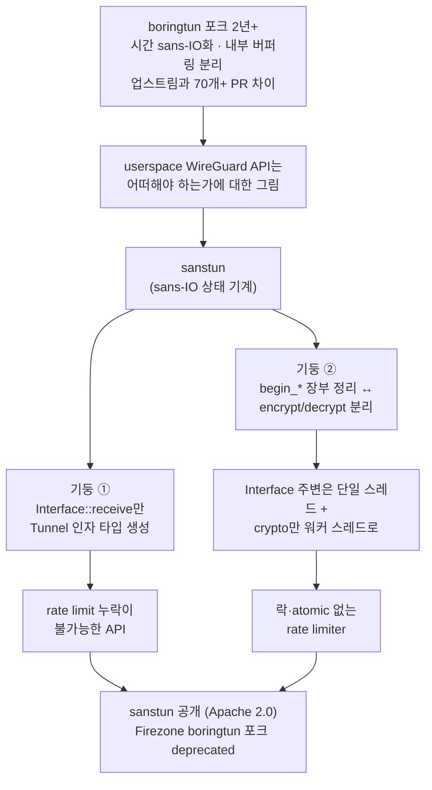
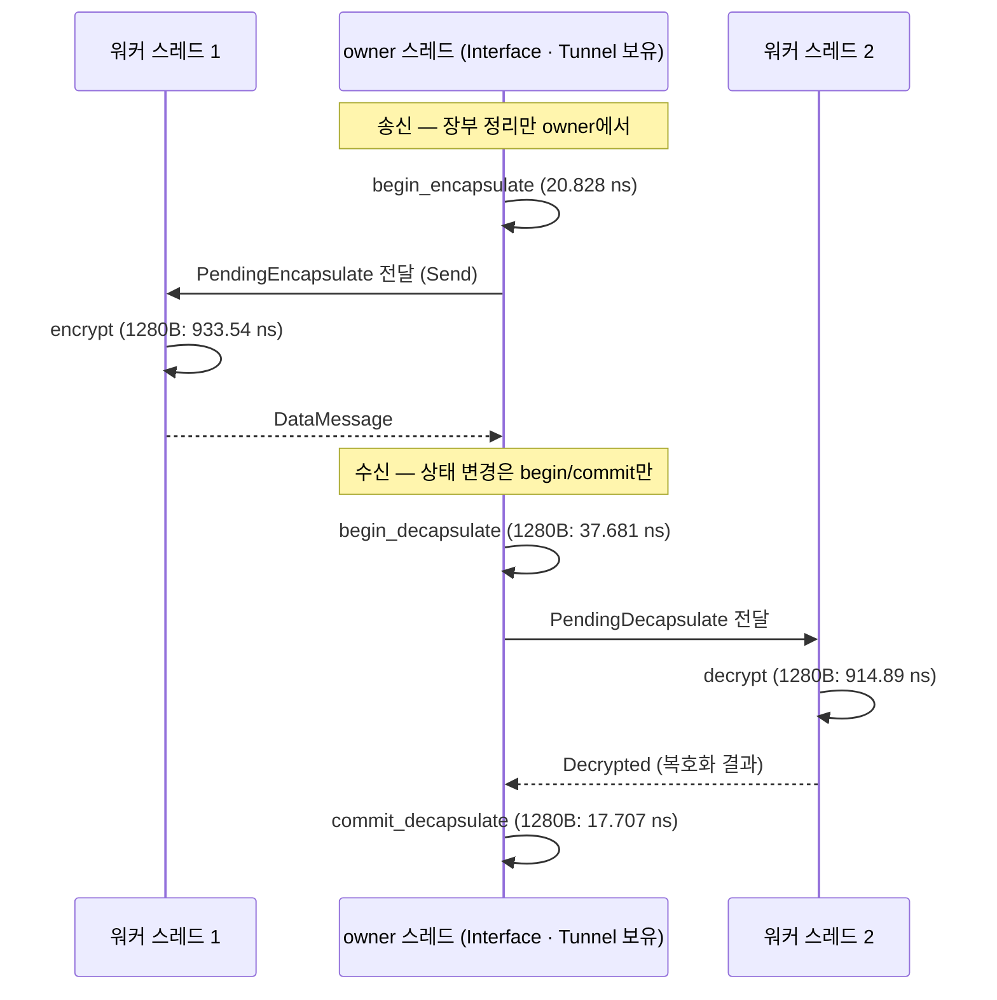

<figure class="post-figure post-figure--header">
<svg role="img" aria-label="가운데 상자에 WireGuard 상태 기계(세션·카운터·타이머)가 있고, 점선 테두리 바깥으로 소켓(왼쪽), 시계와 난수(오른쪽)가 화살표를 따라 밀려나 있는 sans-IO 개념도" viewBox="0 0 700 380" width="520" xmlns="http://www.w3.org/2000/svg">
<title>sans-IO: 상태는 안에, 부수효과는 밖에</title>
<defs>
<marker id="sst-h-arrow" viewBox="0 0 10 10" refX="9" refY="5" markerWidth="7" markerHeight="7" orient="auto-start-reverse"><path d="M0,0 L10,5 L0,10 z" fill="currentColor"/></marker>
</defs>
<text x="350" y="50" text-anchor="middle" font-size="30" font-weight="700" fill="var(--accent-color)">sans-IO</text>
<rect x="175" y="80" width="350" height="200" rx="8" fill="none" stroke="var(--gold)" stroke-width="3" stroke-dasharray="10 7"/>
<rect x="200" y="100" width="300" height="160" rx="6" fill="var(--accent-color)" fill-opacity="0.07" stroke="currentColor" stroke-width="3"/>
<text x="350" y="148" text-anchor="middle" font-size="28" font-weight="700" fill="currentColor">WireGuard</text>
<text x="350" y="188" text-anchor="middle" font-size="30" fill="currentColor">상태 기계</text>
<text x="350" y="230" text-anchor="middle" font-size="28" fill="var(--secondary-color)">세션·카운터·타이머</text>
<line x1="200" y1="160" x2="122" y2="160" stroke="currentColor" stroke-width="3" marker-end="url(#sst-h-arrow)"/>
<rect x="56" y="140" width="56" height="42" rx="5" fill="none" stroke="currentColor" stroke-width="3"/>
<line x1="70" y1="140" x2="70" y2="124" stroke="currentColor" stroke-width="4"/>
<line x1="98" y1="140" x2="98" y2="124" stroke="currentColor" stroke-width="4"/>
<line x1="84" y1="182" x2="84" y2="200" stroke="currentColor" stroke-width="3"/>
<text x="84" y="238" text-anchor="middle" font-size="28" fill="currentColor">소켓</text>
<line x1="500" y1="128" x2="582" y2="126" stroke="currentColor" stroke-width="3" marker-end="url(#sst-h-arrow)"/>
<circle cx="620" cy="126" r="27" fill="none" stroke="currentColor" stroke-width="3"/>
<line x1="620" y1="126" x2="620" y2="108" stroke="currentColor" stroke-width="3"/>
<line x1="620" y1="126" x2="634" y2="134" stroke="currentColor" stroke-width="3"/>
<text x="620" y="190" text-anchor="middle" font-size="28" fill="currentColor">시계</text>
<line x1="500" y1="240" x2="582" y2="248" stroke="currentColor" stroke-width="3" marker-end="url(#sst-h-arrow)"/>
<rect x="594" y="224" width="52" height="52" rx="7" fill="none" stroke="currentColor" stroke-width="3"/>
<circle cx="608" cy="238" r="4" fill="currentColor"/>
<circle cx="620" cy="250" r="4" fill="currentColor"/>
<circle cx="632" cy="262" r="4" fill="currentColor"/>
<text x="620" y="316" text-anchor="middle" font-size="28" fill="currentColor">난수</text>
<text x="350" y="350" text-anchor="middle" font-size="28" fill="currentColor">상태는 안에, 부수효과는 밖에</text>
</svg>
<figcaption>sanstun은 IO뿐 아니라 시간과 난수까지 상태 기계 바깥으로 밀어낸 sans-IO WireGuard 구현이다(시간·난수는 저장소 README 기준).</figcaption>
</figure>

## 원문 정보

> - **제목**: Introducing sanstun: A sans-IO, parallel-friendly, userspace WireGuard implementation in Rust
> - **출처**: Firezone 공식 블로그 / Thomas Eizinger ([firezone.dev](https://www.firezone.dev))
> - **발행**: 2026-10-31 · 약 8분 분량 (원문에 분량 표기가 없어 본문 길이로 추정)
> - **원문 링크**: <https://www.firezone.dev/blog/introducing-sanstun>

Firezone이 **자사 제품을 위해 만든 라이브러리를 직접 발표하는 회사 블로그 글**이다. 홍보 성격이 있다는 점을 감안하되, "프로토콜의 불변식을 API 타입으로 옮기는 법"과 "상태 기계를 어떻게 쪼개야 병렬화가 열리는가"라는 시스템 프로그래밍의 보편적 질문에 구체적인 답을 주는 글이라 Systems-Programming에 담는다.

## 한 줄 요약 (TL;DR)

Firezone은 2년 넘게 Cloudflare의 boringtun을 포크해 70개가 넘는 PR로 패치해 온 경험을 바탕으로, IO·시간·난수(README 기준)를 모두 바깥으로 밀어낸 **sans-IO WireGuard 상태 기계 sanstun**을 새로 만들었다. 핵심은 두 가지다. ① 모든 수신 패킷이 `Interface::receive`를 거쳐야만 `Tunnel`에 닿도록 **타입으로 강제**해 rate limit 누락 같은 버그를 컴파일 단계에서 막고, ② 암호화를 **장부 정리(`begin_*`)와 실제 암호 연산(`encrypt`/`decrypt`)으로 쪼개** 상태는 단일 스레드에 두면서 무거운 crypto만 워커 스레드로 넘길 수 있게 했다.



## 왜 이 글을 골랐나

이 위키의 Systems-Programming 글들은 대체로 "상태를 어디에 두고, 누가 그것을 바꾸며, 무엇을 병렬로 돌릴 수 있는가"라는 질문 주위를 돈다. sanstun 발표 글은 그 질문을 **실제 네트워크 프로토콜(WireGuard)** 위에서 끝까지 밀어붙인 사례다.

- **sans-IO**라는 설계 원칙이 추상론이 아니라, 버퍼링을 걷어내고 시간을 인자로 받는 식의 구체적인 API 결정으로 어떻게 내려오는지 보여 준다.
- Rust의 타입 시스템(crate-private 생성자, `Send`)으로 **"잘못 쓰는 것이 불가능한 API"**를 만드는 실전 예제다. "타입으로 데이터를 모델링한다"는 이야기가 프로토콜 수준으로 확장된다.
- 벤치마크 숫자로 **어디가 병렬화할 가치가 있는 부분인지**를 근거 있게 보여 준다.

## 핵심 내용

### sans-IO란 무엇인가

원문은 sans-IO를 "IO와 부수효과를 상태·비즈니스 로직에서 깔끔하게 분리하도록 시스템을 설계하는 것"이라고 정의한다. 여기서 IO는 파일·네트워크만이 아니라 **시간과 난수까지** 포함한다는 점이 강조된다.

원문이 꼽는 장점은 다음과 같다.

- 부수효과가 없으니 컴포넌트끼리 잘 조립되고 테스트하기 쉽다.
- **function coloring**(async/sync 함수가 서로 섞이지 못하는 문제) 같은 문제를 피하고, Rust의 소유권 규칙과도 잘 어울린다.
- 예제는 Rust지만 sans-IO 자체는 언어에 묶이지 않는 패턴이다. (더 깊은 설명은 Firezone의 별도 [sans-IO 글](https://www.firezone.dev/blog/sans-io)로 안내한다.)

### 역사: boringtun 포크를 패치하며 배운 것

Firezone은 처음에 Cloudflare의 [boringtun](https://github.com/cloudflare/boringtun)을 WireGuard 구현으로 썼다. 그런데 버그 수정과 API 추가를 위해 포크를 계속 패치하게 되었고, 업스트림에 다시 올릴 수 있도록 기존 API를 그대로 유지하려 했지만 제품 요구가 커지면서 100% 호환을 지키기가 점점 어려워졌다고 한다.

원문이 소개하는 대표적인 변경은 두 가지다.

1. **시간 처리의 sans-IO화** ([firezone/boringtun#5](https://github.com/firezone/boringtun/pull/5)): `Instant`를 인자로 받는 `_at` 접미사 API를 전부 추가했다. 원문은 시스템 전체를 정확하게 **시뮬레이션**하려면 시간을 sans-IO로 다루는 것이 매우 중요하다고 말한다.
2. **내부 버퍼링을 feature flag로 분리**: boringtun은 세션이 없을 때 패킷을 보내려 하면 자동으로 세션을 맺어 주는데, 원문은 이 편의 기능의 문제를 이렇게 정리한다.
   - 버퍼는 언젠가 비워야 하는데, boringtun에서는 길이 0짜리 datagram으로 `decapsulate`를 호출해야 했다. "꽤 직관적이지 않다."
   - (boringtun의 구현 방식으로는) 추가 할당이 생긴다.
   - 버퍼 크기는 설정·조정할 수 있어야 한다.

원문의 결론은 간단하다. **"그냥 라이브러리 안에서 버퍼링하지 말 것."** 그래야 인터페이스와 구현 양쪽이 단순해진다.

포크와 업스트림의 차이는 의존성 업데이트를 빼고도 **70개가 넘는 PR**이고, 그중 여럿은 직접 발견한 엣지 케이스 수정이라고 한다. 2년 넘게 boringtun을 쓰고 고치면서 "userspace WireGuard 구현의 API는 어떠해야 하는가"에 대한 그림이 생겼고, 그것이 sanstun이 되었다는 것이 원문의 설명이다.

### 더 나은 sans-IO API

sanstun의 핵심 API는 다음과 같이 정리된다.

| 역할 | API |
| --- | --- |
| 수신 패킷 처리 | `Tunnel::handle_handshake_initiation`, `Tunnel::handle_handshake_response`, `Tunnel::handle_cookie_reply`, `Tunnel::begin_decapsulate` & `Tunnel::commit_decapsulate` |
| 송신 패킷 처리 | `Tunnel::begin_encapsulate` |
| 타이머 갱신 | `Tunnel::handle_timeout` & `Tunnel::poll_timeout` |
| 이벤트 처리 | `Tunnel::poll_event` |

내부 버퍼링이 없으니 "특정 API를 루프 안에서 호출해야 한다"는 계약도 사라진다. 패킷을 보내려면 `Tunnel::begin_encapsulate`를 부르고, 아직 세션이 없다면 **패킷을 버퍼링하는 것은 호출자의 몫**이다. 새 세션은 핸드셰이크로 만들어지며, `Tunnel::initiate_handshake`로 언제든 시작할 수 있다.

### WireGuard 프로토콜 복습

원문은 API 설계를 이해하기 위해 WireGuard를 짧게 복습한다.

- 메시지는 네 종류다: **handshake init, handshake response, cookie reply, encrypted data**.
- 모든 세션은 비교적 비싼 **Diffie-Hellman 키 교환**으로 시작한다.
- 상대의 공개키만 알면 가짜 handshake initiation을 쉽게 만들고 UDP 출발지 IP도 위조할 수 있다. 수신 측은 DH 연산을 해 본 뒤에야 가짜임을 알 수 있으므로, 그 시점엔 이미 CPU를 썼다. 이런 요청을 충분히 보내면 수신 측 CPU가 쓸모없는 핸드셰이크 처리로 소진된다.
- 이를 막기 위해 WireGuard는 **cookie 메커니즘**으로 상대가 주장하는 출발지 IP의 소유를 증명하게 하고, 이를 바탕으로 **출발지 IP별 핸드셰이크 rate limit**을 건다. 이 제한은 터널 하나가 아니라 **WireGuard 인터페이스 전체**에 적용된다.
- 핸드셰이크가 끝나면 대칭 암호로 데이터 패킷을 주고받는다. 핸드셰이크 중 양쪽이 각자 고른 **session index**를 교환하며, 이 인덱스로 여러 터널과 한 터널 안의 여러 세션을 구분(de-multiplexing)한다.

### 프로토콜 불변식을 API 설계로 옮기기

원문의 문제의식은 이렇다. rate limiter 적용을 빠뜨리는 버그는 평소에는 드러나지 않고, 수신 패킷을 엉뚱한 터널로 보내는 버그는 프로덕션에서야 드러난다. 좋은 API는 **망가진 것을 아예 만들 수 없게 하고**, 동시에 사용자가 프로토콜을 이해하도록 이끌어야 한다.

### 하나의 Interface, 여러 Tunnel

WireGuard 인터페이스는 하나의 키로 식별되고, 터널은 두 인터페이스 사이의 연결이다. sanstun은 이 개념을 그대로 `Interface`와 `Tunnel` 타입으로 옮겼다.

- 모든 수신 패킷은 `Interface::receive`를 거친다. 원시 datagram을 파싱하는 **유일한 공개 API**다.
- `Interface::receive`는 패킷을 파싱하고 rate limit을 적용한 뒤, WireGuard 메시지 타입마다 enum variant 하나씩을 가진 `ReceivedMessage`를 돌려준다. 인터페이스가 부하 상태라면 대신 돌려보낼 cookie reply를 준다.
- 각 variant는 `Tunnel`의 대응 함수(`handle_handshake_initiation` 등)로 그대로 이어진다. handshake initiation은 **개시자의 static 공개키**로, 나머지 메시지는 `TunnelId`로 어느 터널에 넘길지 드러낸다.
- 내부적으로는 터널 인덱스를 파싱해 상위 24비트를 추출하고, rate limit 적용, cookie reply 생성, 핸드셰이크 메시지 검증까지 처리한다고 한다.

가장 중요한 장치는 **`HandshakeInitiation` 같은 타입의 생성자가 모두 crate-private**이라는 점이다. `Tunnel::handle_handshake_initiation`은 public이지만, 그 인자 타입을 얻는 유일한 길은 `Interface::receive`를 거치는 것뿐이다. 그래서 rate limiter가 사용자가 신경 쓰지 않아도 항상 적용된다.

<figure class="post-figure">
<svg role="img" aria-label="위에서 아래로 흐르는 관문 구조. 모든 수신 UDP datagram이 유일한 공개 API인 Interface::receive로 들어가 파싱, 출발지 IP별 rate limit, 핸드셰이크 메시지 검증을 거친다. 부하 시에는 cookie reply가 대신 나간다. 결과는 ReceivedMessage enum이 되어 HandshakeInitiation은 개시자 static 공개키로, 나머지 메시지는 TunnelId로 Tunnel의 handle_* 또는 begin_decapsulate에 전달된다. 왼쪽의 우회 경로는 X로 막혀 있고, 아래에 생성자가 crate-private이라 관문을 우회할 수 없다는 자물쇠 표시가 있다." viewBox="0 0 400 730" width="460" xmlns="http://www.w3.org/2000/svg">
<title>Interface::receive — 우회할 수 없는 유일한 관문</title>
<defs>
<marker id="sst-f-arrow" viewBox="0 0 10 10" refX="9" refY="5" markerWidth="7" markerHeight="7" orient="auto-start-reverse"><path d="M0,0 L10,5 L0,10 z" fill="currentColor"/></marker>
</defs>
<text x="215" y="28" text-anchor="middle" font-size="17" font-weight="700" fill="currentColor">모든 수신 UDP datagram</text>
<rect x="166" y="40" width="14" height="10" fill="currentColor"/>
<rect x="186" y="40" width="14" height="10" fill="currentColor"/>
<rect x="206" y="40" width="14" height="10" fill="currentColor"/>
<rect x="226" y="40" width="14" height="10" fill="currentColor"/>
<rect x="246" y="40" width="14" height="10" fill="currentColor"/>
<line x1="215" y1="56" x2="215" y2="92" stroke="currentColor" stroke-width="2.5" marker-end="url(#sst-f-arrow)"/>
<rect x="50" y="96" width="330" height="168" rx="6" fill="var(--accent-color)" fill-opacity="0.07" stroke="var(--accent-color)" stroke-width="3"/>
<path d="M344,116 v-6 a8,8 0 0 1 16,0 v6" fill="none" stroke="var(--accent-color)" stroke-width="3"/>
<rect x="340" y="116" width="24" height="18" rx="2" fill="var(--accent-color)"/>
<text x="205" y="128" text-anchor="middle" font-size="18" font-weight="700" font-family="ui-monospace, SFMono-Regular, Menlo, monospace" fill="currentColor">Interface::receive</text>
<text x="205" y="152" text-anchor="middle" font-size="16" fill="var(--accent-color)">유일한 공개 API</text>
<line x1="66" y1="166" x2="364" y2="166" stroke="currentColor" stroke-width="1" stroke-dasharray="4 4"/>
<text x="70" y="192" font-size="16" fill="currentColor">· 파싱 (인덱스 상위 24비트)</text>
<text x="70" y="218" font-size="16" fill="currentColor">· 출발지 IP별 rate limit</text>
<text x="70" y="244" font-size="16" fill="currentColor">· 핸드셰이크 메시지 검증</text>
<line x1="295" y1="264" x2="295" y2="278" stroke="currentColor" stroke-width="2" stroke-dasharray="4 3" marker-end="url(#sst-f-arrow)"/>
<rect x="210" y="282" width="170" height="54" rx="6" fill="none" stroke="var(--gold)" stroke-width="2.5" stroke-dasharray="7 5"/>
<text x="295" y="304" text-anchor="middle" font-size="16" fill="currentColor">부하 시 대신</text>
<text x="295" y="326" text-anchor="middle" font-size="16" fill="currentColor">cookie reply 반송</text>
<line x1="120" y1="264" x2="120" y2="352" stroke="currentColor" stroke-width="2.5" marker-end="url(#sst-f-arrow)"/>
<rect x="50" y="356" width="330" height="60" rx="6" fill="none" stroke="currentColor" stroke-width="2.5"/>
<text x="215" y="382" text-anchor="middle" font-size="17" font-weight="700" font-family="ui-monospace, SFMono-Regular, Menlo, monospace" fill="currentColor">ReceivedMessage</text>
<text x="215" y="405" text-anchor="middle" font-size="16" fill="currentColor">메시지 타입마다 enum variant</text>
<line x1="129" y1="416" x2="129" y2="444" stroke="currentColor" stroke-width="2.5" marker-end="url(#sst-f-arrow)"/>
<line x1="301" y1="416" x2="301" y2="444" stroke="currentColor" stroke-width="2.5" marker-end="url(#sst-f-arrow)"/>
<rect x="50" y="448" width="158" height="88" rx="6" fill="none" stroke="currentColor" stroke-width="2.5"/>
<text x="129" y="472" text-anchor="middle" font-size="16" font-family="ui-monospace, SFMono-Regular, Menlo, monospace" fill="currentColor">Handshake</text>
<text x="129" y="492" text-anchor="middle" font-size="16" font-family="ui-monospace, SFMono-Regular, Menlo, monospace" fill="currentColor">Initiation</text>
<text x="129" y="522" text-anchor="middle" font-size="16" fill="var(--secondary-color)">→ static 공개키로</text>
<rect x="222" y="448" width="158" height="88" rx="6" fill="none" stroke="currentColor" stroke-width="2.5"/>
<text x="301" y="472" text-anchor="middle" font-size="16" font-family="ui-monospace, SFMono-Regular, Menlo, monospace" fill="currentColor">Response ·</text>
<text x="301" y="492" text-anchor="middle" font-size="16" font-family="ui-monospace, SFMono-Regular, Menlo, monospace" fill="currentColor">Cookie · Data</text>
<text x="301" y="522" text-anchor="middle" font-size="16" fill="var(--secondary-color)">→ TunnelId로</text>
<line x1="129" y1="536" x2="129" y2="566" stroke="currentColor" stroke-width="2.5" marker-end="url(#sst-f-arrow)"/>
<line x1="301" y1="536" x2="301" y2="566" stroke="currentColor" stroke-width="2.5" marker-end="url(#sst-f-arrow)"/>
<rect x="62" y="582" width="318" height="64" rx="6" fill="none" stroke="currentColor" stroke-width="1.5"/>
<rect x="56" y="576" width="318" height="64" rx="6" fill="none" stroke="currentColor" stroke-width="1.5"/>
<rect x="50" y="570" width="318" height="64" rx="6" fill="var(--bg-panel)" stroke="currentColor" stroke-width="2.5"/>
<text x="209" y="597" text-anchor="middle" font-size="18" font-weight="700" font-family="ui-monospace, SFMono-Regular, Menlo, monospace" fill="currentColor">Tunnel</text>
<text x="209" y="622" text-anchor="middle" font-size="16" font-family="ui-monospace, SFMono-Regular, Menlo, monospace" fill="currentColor">handle_* · begin_decapsulate</text>
<path d="M150,45 H26 V602 H44" fill="none" stroke="currentColor" stroke-width="2" stroke-dasharray="6 5" marker-end="url(#sst-f-arrow)"/>
<line x1="16" y1="320" x2="36" y2="340" stroke="var(--accent-color)" stroke-width="4"/>
<line x1="36" y1="320" x2="16" y2="340" stroke="var(--accent-color)" stroke-width="4"/>
<path d="M58,682 v-7 a9,9 0 0 1 18,0 v7" fill="none" stroke="var(--accent-color)" stroke-width="3"/>
<rect x="53" y="682" width="28" height="22" rx="2" fill="var(--accent-color)"/>
<text x="94" y="689" font-size="16" fill="currentColor">생성자가 crate-private</text>
<text x="94" y="713" font-size="16" fill="currentColor">→ 관문을 우회할 길이 없다</text>
</svg>
<figcaption>Tunnel 핸들러의 인자 타입은 Interface::receive만 만들 수 있으므로, rate limiter를 건너뛰는 경로(왼쪽 점선)는 컴파일 단계에서 막힌다.</figcaption>
</figure>

### 병렬 crypto

원문이 sanstun의 "가장 좋은 기능 중 하나"로 꼽는 부분이다.

WireGuard는 프로토콜 수준에서 터널 간에 상태를 공유하지 않으므로 **피어 단위 병렬화는 쉽다**. 문제는 **한 터널 안**이다. WireGuard는 L3에서 동작하므로 세션 하나가 수많은 네트워크 flow를 실어 나르고, 같은 호스트·서브넷으로 가는 모든 flow(고유한 5-tuple)는 순차 처리되어 결국 CPU의 ChaCha20-Poly1305(WireGuard의 데이터 패킷 암호) 속도에 묶인다. 게다가 재전송 공격을 막기 위한 **단조 증가 패킷 카운터**가 세션 단위로 있어서, 여러 스레드가 동시에 접근하려면 동기화가 필요하다.

sanstun의 해법은 **장부 정리(bookkeeping)와 실제 암·복호화를 분리**하는 것이다. `Tunnel::begin_encapsulate`는 실제로는 아무것도 암호화하지 않는다. 현재 세션을 확인하고, 패킷 카운터를 예약하고, 타이머 상태를 진행시킨 뒤 `PendingEncapsulate`를 건넨다. 원문이 보여 주는 시그니처는 다음과 같다.

```rust
impl PendingEncapsulate {
    pub fn encrypt<'a>(self, plaintext: &[u8], dst: &'a mut [u8]) -> Result<DataMessage<'a>, Error> {
        // ...
    }
}
```

`PendingEncapsulate`는 `Send`를 구현하므로 다른 스레드로 옮겨 무거운 작업을 맡길 수 있다. `self`를 값으로 소비하는 시그니처라 예약된 카운터 하나가 정확히 한 번만 쓰인다는 점도 눈여겨볼 만하다(이 해석은 시그니처에서 읽어낸 것으로, 원문이 직접 설명하지는 않는다).

원문은 sanstun 저장소에서 `cargo bench data_path`를 돌린 결과를 제시한다. 원문 수치를 그대로 옮기면(각 항목의 가운데 값):

| 단계 | 64B 패킷 | 1280B 패킷 |
| --- | --- | --- |
| `begin_encapsulate` | 20.828 ns | 20.828 ns |
| `encrypt` | 226.22 ns | 933.54 ns |
| `begin_decapsulate` | 37.675 ns | 37.681 ns |
| `decrypt` | 205.83 ns | 914.89 ns |
| `commit_decapsulate` | 17.529 ns | 17.707 ns |

원문의 해석은 이렇다.

- 장부 정리(`begin_encapsulate`, `begin_decapsulate`, `commit_decapsulate`)는 **패킷 크기와 무관**하고, 크기에 비례하는 것은 `encrypt`/`decrypt`뿐이다.
- 1280바이트 패킷에서 새 패킷 암호화의 장부 정리 비중은 **약 2%**에 불과하다. 실제 암호화를 다른 스레드로 옮기면 **이론상 45배가 넘는 속도 향상**이 가능하다는 뜻이다.
- 다만 `PendingEncapsulate`를 다른 스레드로 넘기는 비용과 다른 오버헤드를 무시한 수치이므로, 실제로 45배를 얻기는 어렵다고 원문 스스로 단서를 단다. 그럼에도 crypto를 워커 스레드로 넘길 수 있다는 것만으로 처리량을 크게 높일 수 있다고 말한다.



sans-IO 라이브러리답게 sanstun은 **병렬화를 어떻게 할지에는 관여하지 않는다**. 단순하게 가고 싶다면 `encrypt`/`decrypt`를 인라인으로 호출하고 병렬화를 아예 신경 쓰지 않아도 된다. 원문이 밝히는 설계 목표는 **"병렬 crypto는 가능하게 하되 `Interface` 주변은 전부 단일 스레드로 유지하는 것"**이다. 그래야 내부 rate limiter가 락이나 atomic 카운터 없이 동작하고, 여러 터널의 상태를 묶으면서도 Rust borrow checker의 이점을 누릴 수 있다.

### 마무리 (원문)

sanstun 공개와 함께 Firezone의 boringtun 포크([firezone/boringtun](https://github.com/firezone/boringtun))는 deprecated 되었다. VPN이든 mesh 네트워크든 WireGuard 위에 무언가를 만드는 사람에게 도움이 되길 바란다는 말과 함께, [crates.io](https://crates.io/crates/sanstun)에 배포되어 있고 [GitHub](https://github.com/firezone/sanstun)에서 Apache 2.0 라이선스로 공개되어 있다고 밝힌다.

## 분석과 인사이트

여기서부터는 원문 요약이 아니라 나의 해석이다.

### 1. "라이브러리는 버퍼링하지 않는다"는 결정이 모든 것의 출발점이다

boringtun의 자동 세션 수립 + 내부 버퍼링은 처음 쓰는 사람에게는 친절하지만, 그 친절이 "길이 0 datagram으로 decapsulate를 불러 버퍼를 비운다" 같은 **숨은 호출 규약**을 낳았다. 숨은 규약은 문서로만 존재하고, 문서로만 존재하는 규약은 결국 누군가 어긴다. sanstun은 버퍼링을 호출자에게 돌려줌으로써 API를 "입력 → 출력"의 순수한 형태로 되돌렸다. 편의 기능을 라이브러리에 넣을지 고민할 때, **그 편의가 새로운 호출 순서를 요구하는지**를 기준으로 삼아 볼 만하다.

### 2. 보안 속성을 "타입의 출입구"로 만든 점이 가장 인상적이다

rate limit은 정상 트래픽에서는 존재감이 없는 기능이다. 그래서 빠뜨려도 테스트가 통과하고, 공격을 받을 때에야 드러난다. sanstun은 이를 리뷰 체크리스트가 아니라 **crate-private 생성자**로 해결했다. `Tunnel`의 핸들러를 부르려면 그 인자 타입이 필요하고, 그 타입은 `Interface::receive`만 만들 수 있다. "올바른 경로가 유일한 경로"가 되도록 만든 것이다. 흔히 parse, don't validate라고 부르는 원칙을 네트워크 보안 경계에 적용한 깔끔한 예로 읽힌다. 프로토콜·결제·권한 처리처럼 "한 단계를 건너뛰면 치명적인" 흐름이 있다면 같은 패턴을 그대로 가져올 수 있다.

### 3. 병렬화의 단위는 "상태"가 아니라 "작업"이다

한 터널 안의 병렬화를 막는 진짜 장애물은 crypto가 아니라 **패킷 카운터라는 공유 상태**다. 흔한 접근은 그 상태를 `Mutex`나 atomic으로 감싸 여러 스레드가 나눠 쓰는 것인데([Rust 스마트 포인터와 동시성](/2026/01/09/rust-smart-pointers-concurrency-and-projects.html)에서 본 `Arc<Mutex<_>>` 패턴), sanstun은 반대로 간다. 상태 변경은 한 스레드에서 수십 ns짜리 짧은 구간으로 끝내고, 그 결과를 **값(`PendingEncapsulate`)으로 포장해** 넘긴다. 상태를 공유하는 대신 작업을 넘기는 것이다. 벤치마크가 이 분할이 맞다는 근거가 된다. 1280B 기준 장부 정리가 ~21ns, 암호화가 ~934ns라면, 직렬 구간은 작고 병렬 구간은 크다. 암달의 법칙 관점에서 아주 좋은 형태다.

다만 원문이 직접 단서를 달았듯 45배는 상한이다. 실제로는 스레드 간 전달 비용, 워커 풀 스케줄링, 그리고 수신 측에서 `commit_decapsulate`(replay check)를 owner로 다시 가져오는 왕복이 더해진다. 원문은 실측 처리량 개선 수치를 따로 제시하지 않으므로, "얼마나 빨라졌는가"는 이 글만으로는 판단할 수 없다.

### 4. sans-IO는 테스트 전략이기도 하다

원문은 시간 처리를 sans-IO로 바꾼 이유로 "시스템 전체의 정확한 시뮬레이션"을 든다. 시간과 난수까지 바깥에서 주입되면, 네트워크 스택 전체를 결정론적으로 재현할 수 있다. 이는 [Future에는 '끝났음' 상태가 없다](/2026/10/30/the-missing-future-state.html)에서 다룬 async 상태 기계 논의와도 맞닿는다. 상태 기계를 런타임(async executor, 소켓, 시계)과 분리해 두면, async냐 sync냐(function coloring)의 문제에서도 자유로워진다.

### 5. 아쉬운 점과 열린 질문

- 원문은 회사 블로그 발표 글이라 **boringtun과의 직접 성능 비교**나 실제 Firezone 운영 환경에서의 처리량 변화는 제시하지 않는다.
- 수신 측은 `begin_decapsulate` → (워커에서) `decrypt` → `commit_decapsulate`의 3단계다. 복호화 결과가 순서 없이 돌아올 때 replay window를 어떻게 관리하는지 같은 세부는 원문에 없어서, 저장소 코드를 직접 봐야 확인할 수 있다.
- sans-IO의 대가는 **호출자가 지는 책임**이다. 버퍼링, 타이머 구동, 스레드 배치까지 직접 짜야 하므로, 단순한 VPN 클라이언트를 원하는 사람에게는 진입 장벽이 될 수 있다.

## 적용 포인트

- **라이브러리 API에서 숨은 호출 규약을 찾아라.** "이걸 부른 다음엔 반드시 저걸 루프로 불러야 한다"는 규칙이 있다면, 그 원인(대개 내부 버퍼나 내부 IO)을 호출자 쪽으로 빼낼 수 있는지 검토한다.
- **시간과 난수도 IO로 취급하라.** `now()`를 직접 부르는 대신 `Instant`를 인자로 받는 `_at` 스타일 API를 두면, 시뮬레이션·재현 가능한 테스트가 쉬워진다.
- **빠뜨리면 안 되는 검증은 타입의 출입구로 만들어라.** 검증을 통과한 값만 만들 수 있는 타입을 두고 생성자를 crate-private(또는 모듈 private)으로 막으면, 검증 누락이 컴파일 에러가 된다.
- **병렬화 전에 "직렬 구간 vs 병렬 구간"을 측정하라.** sanstun처럼 상태 변경과 무거운 계산을 나누고 각각을 벤치마크하면, 병렬화로 얻을 수 있는 상한을 숫자로 먼저 확인할 수 있다.
- **공유 상태 대신 "예약된 작업 토큰"을 넘겨라.** 카운터·시퀀스 번호를 한 스레드에서 예약하고 `Send` 가능한 값으로 포장해 워커에 넘기면, 락 없이도 병렬 처리가 가능하다.

## 마무리

sanstun 발표 글은 "WireGuard 라이브러리를 새로 만들었다"는 소식보다, **2년간의 포크 패치에서 얻은 교훈이 어떤 API 결정으로 굳어졌는지**를 보여 준다는 점에서 가치가 있다. 버퍼링을 걷어내 호출 규약을 없애고, crate-private 생성자로 rate limiter를 우회 불가능하게 만들고, 장부 정리와 암호 연산을 분리해 단일 스레드 상태와 병렬 crypto를 동시에 얻었다. 세 결정 모두 "상태는 작고 한곳에, 무거운 일과 부수효과는 바깥으로"라는 같은 원칙에서 나온다. 네트워크 프로토콜을 다루지 않더라도, 상태 기계를 설계하는 모든 시스템 프로그래머가 가져갈 만한 패턴이다.

### 더 읽어보기

- [원문 — Introducing sanstun (Firezone Blog)](https://www.firezone.dev/blog/introducing-sanstun)
- [firezone/sanstun (GitHub)](https://github.com/firezone/sanstun) — 소스와 `cargo bench data_path` 벤치마크
- [Firezone — sans-IO 소개 글](https://www.firezone.dev/blog/sans-io) — 원문이 추천하는 sans-IO 입문
- [네트워크 보안 (TLS · 방화벽 · VPN · 위협 모델)](/2026/07/29/network-security-tls.html) — WireGuard가 VPN 지형에서 어디에 놓이는지, 대칭·비대칭 암호의 결합
- [Rust 스마트 포인터, 동시성, 그리고 프로젝트](/2026/01/09/rust-smart-pointers-concurrency-and-projects.html) — `Send`·스레드·`Arc<Mutex<_>>`, sanstun이 피해 간 공유 상태 방식의 기본기
- [Future에는 '끝났음' 상태가 없다](/2026/10/30/the-missing-future-state.html) — Rust 상태 기계와 async 런타임의 경계에 대한 또 다른 시선
