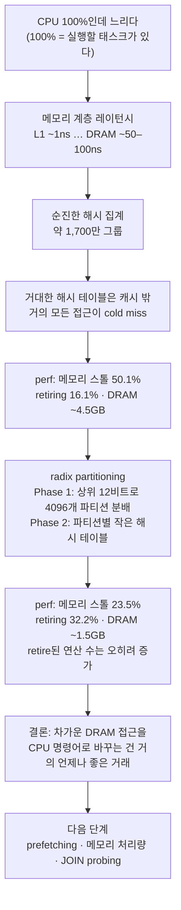

<figure class="post-figure post-figure--header">
<svg role="img" aria-label="위쪽의 CPU 칩은 100%를 띄운 채 모래시계 옆에서 대기 중이다. 그 아래 L1, L2, L3 캐시 선반은 점선으로 비어 있고, 선반 아래로 지그재그로 길게 늘어진 길 끝에 DRAM 창고가 있다. 길 위에는 64B 캐시 라인 짐 하나가 CPU 쪽으로 천천히 올라오고 있다." viewBox="0 0 400 450" width="460" xmlns="http://www.w3.org/2000/svg">
<title>CPU 100%인데 실제로는 먼 DRAM에서 캐시 라인을 기다리는 코어</title>
<g stroke="currentColor" stroke-width="3" stroke-linecap="round">
<line x1="128" y1="48" x2="140" y2="48"/><line x1="128" y1="70" x2="140" y2="70"/><line x1="128" y1="92" x2="140" y2="92"/>
<line x1="260" y1="48" x2="272" y2="48"/><line x1="260" y1="70" x2="272" y2="70"/><line x1="260" y1="92" x2="272" y2="92"/>
</g>
<rect x="140" y="30" width="120" height="80" rx="6" fill="var(--bg-panel)" stroke="currentColor" stroke-width="3"/>
<text x="200" y="62" text-anchor="middle" font-size="18" font-weight="700" fill="currentColor">CPU</text>
<text x="200" y="94" text-anchor="middle" font-size="22" font-weight="700" fill="var(--accent-color)">100%</text>
<g fill="none" stroke="var(--gold)" stroke-width="3" stroke-linejoin="round">
<path d="M78 40 H112 M78 100 H112 M82 40 L108 70 L82 100 M108 40 L82 70 L108 100"/>
</g>
<path d="M88 92 H102 L95 84 Z" fill="var(--gold)"/>
<text x="282" y="76" font-size="17" fill="currentColor">대기 중…</text>
<g fill="none" stroke="currentColor" stroke-width="2.5" stroke-dasharray="7 6" opacity="0.8">
<rect x="150" y="136" width="100" height="34" rx="4"/>
<rect x="125" y="186" width="150" height="34" rx="4"/>
<rect x="100" y="236" width="200" height="34" rx="4"/>
</g>
<g font-size="17" font-weight="700" fill="currentColor" text-anchor="middle">
<text x="200" y="159">L1</text>
<text x="200" y="209">L2</text>
<text x="200" y="259">L3</text>
</g>
<path d="M200 270 V292 H350 V322 H50 V352 H200 V376" fill="none" stroke="var(--secondary-color)" stroke-width="4" stroke-dasharray="2 9" stroke-linecap="round"/>
<text x="20" y="306" font-size="16" fill="currentColor">~50–100 ns</text>
<rect x="232" y="309" width="54" height="26" rx="3" fill="var(--gold)" fill-opacity="0.45" stroke="currentColor" stroke-width="2"/>
<text x="259" y="328" text-anchor="middle" font-size="16" font-weight="700" fill="currentColor">64B</text>
<path d="M300 322 l-8 -6 v12 Z" fill="currentColor"/>
<path d="M80 400 L200 374 L320 400 Z" fill="var(--bg-panel)" stroke="currentColor" stroke-width="3" stroke-linejoin="round"/>
<rect x="90" y="400" width="220" height="40" fill="var(--bg-panel)" stroke="currentColor" stroke-width="3"/>
<text x="200" y="427" text-anchor="middle" font-size="18" font-weight="700" fill="currentColor">DRAM</text>
</svg>
<figcaption>CPU 사용률은 100%지만, 코어는 비어 있는 L1·L2·L3 선반 너머 먼 DRAM에서 64바이트 캐시 라인이 올라오기를 기다리고 있다.</figcaption>
</figure>

## 원문 정보

> - **제목**: It's the memory latency, stupid — Making GROUP BY faster by doing more (CPU!) work
> - **출처**: Maor Kern, Pivot blog / Epsio Labs ([pivotlake.io](https://pivotlake.io/blog/))
> - **발행**: 2026-10-28 · 약 8분 분량(본문·코드 분량 기준 추정, 원문 표기 없음)
> - **원문 링크**: <https://pivotlake.io/blog/its-the-memory-latency-stupid/>

쿼리 엔진 개발사가 자사 엔진을 일부러 "망가뜨린" 뒤 하드웨어 카운터로 병목을 해부하는 글이라, 성능 엔지니어링의 측정 → 가설 → 개선 루프를 실물로 보여 주는 사례로 Systems-Programming에 담는다.

## 한 줄 요약 (TL;DR)

CPU 사용률 100%는 "CPU가 일하고 있다"가 아니라 "실행할 태스크가 있다"는 뜻일 뿐이고, 고유 키가 약 1,700만 개인 해시 집계에서는 그 시간의 절반이 메모리(load 완료)를 기다리며 멈춰 있는 데 쓰인다. 해시 상위 12비트로 키를 4096개 파티션에 먼저 흩어 놓고 파티션별로 작은 해시 테이블을 만들면(radix partitioning), **명령어는 더 많이 실행하지만** 필요한 데이터를 캐시에서 찾을 확률이 높아져 더 빨라진다.

## 왜 이 글을 골랐나

성능 이야기에서 "캐시 친화적으로 짜라"는 말은 흔하지만, 그 말이 **실제 카운터 숫자로 어떻게 바뀌는지** 보여 주는 글은 드물다. 이 글은 하나의 쿼리, 하나의 코어, 두 가지 구현을 놓고 `perf stat`으로 메모리 스톨 비율·retire된 연산 수·DRAM에서 채운 캐시 라인 수를 나란히 비교한다. 직관에 반하는 결론("일을 더 하는데 더 빠르다")을 숫자로 납득시키는 구조라 교재로 쓰기 좋다.

위키 맥락에서도 연결 고리가 분명하다. [DuckDB 내부 구조 딥다이브](/2026/06/24/duckdb-internals-why-fast.html)가 "왜 컬럼형 엔진이 빠른가"를 아키텍처 수준에서 설명했다면, 이 글은 그중 GROUP BY 하나를 마이크로아키텍처 수준까지 끌어내린다. 또 [증설 전에 측정하라](/2026/07/18/measure-before-you-scale.html)가 서비스 수준에서 말한 "측정 먼저"를 CPU 파이프라인 수준에서 실천하는 글이기도 하다.

이 글의 흐름을 한 장으로 정리하면 다음과 같다.



## 핵심 내용

### 1. CPU 100%는 무엇을 의미하나

원문은 질문으로 시작한다. 데이터베이스 CPU가 100%일 때 CPU는 실제로 무엇을 하고 있는가? 우리는 편의상 CPU가 코드를 한 줄씩 실행한다고 생각하지만, 실제 CPU는 한 번에 여러 명령을 처리할 수도 있고 **아무것도 못 할 수도** 있다. 저자의 설명에 따르면 CPU가 "idle"로 집계되는 건 CPU 시간을 원하는 Linux 태스크가 하나도 없을 때뿐이며, 이것이 CPU가 포화 상태로 일하고 있다는 뜻은 아니다. 그래서 같은 100%라도 실제 처리량은 크게 다를 수 있다. 그 차이를 만드는 주범으로 저자는 **메모리**를 지목한다.

### 2. 메모리 계층과 레이턴시 감각

원문이 제시하는 대략적인 수치는 다음과 같다(모두 원문 기준의 "어림값"이다).

| 계층 | 접근 레이턴시 | 크기(대략) | 접근 1회 동안 가능한 명령 수 |
| --- | --- | --- | --- |
| CPU 코어 | 4–8 instr / ns | — | — |
| L1 캐시 | ~1 ns | ~64 KB | ~4–8 |
| L2 캐시 | ~3–4 ns | ~1 MB | ~15–30 |
| L3 캐시 | ~10–15 ns | 최대 수백 MB | ~50–100 |
| DRAM | ~50–100 ns | GB 단위 | ~400–800 |

요점은 마지막 줄이다. DRAM 접근 한 번이면 현대 CPU가 400–800개의 명령을 처리할 수 있는 시간이 흘러간다. 그래서 CPU는 캐시를 칩 안에 두고, 좋은 데이터베이스는 데이터를 작은 "청크" 단위로 다뤄 캐시를 최대한 활용하려 한다. 저자는 캐시 활용이 성능 엔지니어링의 최우선 관심사 중 하나로 흔히 꼽힌다고 덧붙인다.

<figure class="post-figure">
<svg role="img" aria-label="메모리 계층 레이턴시 사다리. 위에서 아래로 CPU 코어(나노초당 명령 4–8개), L1 캐시 약 1 ns, L2 캐시 약 3–4 ns, L3 캐시 약 10–15 ns, DRAM 약 50–100 ns가 쌓여 있고, 각 계층 아래 막대는 접근 1회 동안 처리할 수 있는 명령 수(L1 약 4–8, L2 약 15–30, L3 약 50–100, DRAM 약 400–800)를 같은 축척으로 그린다. DRAM 막대만 압도적으로 길다." viewBox="0 0 400 486" width="460" xmlns="http://www.w3.org/2000/svg">
<title>메모리 계층별 레이턴시와 접근 1회 동안 가능한 명령 수</title>
<text x="200" y="28" text-anchor="middle" font-size="16" font-weight="700" fill="currentColor">접근 1회 동안 처리할 수 있는 명령 수</text>
<rect x="20" y="46" width="360" height="40" rx="6" fill="none" stroke="currentColor" stroke-width="2.5"/>
<text x="200" y="72" text-anchor="middle" font-size="16" font-weight="700" fill="currentColor">CPU 코어 · 4–8 instr / ns</text>
<g font-size="16" fill="currentColor">
<text x="20" y="128"><tspan font-weight="700">L1 캐시</tspan> · ~1 ns</text>
<text x="380" y="128" text-anchor="end">~4–8개</text>
<text x="20" y="208"><tspan font-weight="700">L2 캐시</tspan> · ~3–4 ns</text>
<text x="380" y="208" text-anchor="end">~15–30개</text>
<text x="20" y="288"><tspan font-weight="700">L3 캐시</tspan> · ~10–15 ns</text>
<text x="380" y="288" text-anchor="end">~50–100개</text>
<text x="20" y="368"><tspan font-weight="700">DRAM</tspan> · ~50–100 ns</text>
<text x="380" y="368" text-anchor="end" font-weight="700" fill="var(--accent-color)">~400–800개</text>
</g>
<g fill="var(--accent-color)">
<rect x="20" y="140" width="1.8" height="22"/>
<rect x="20" y="220" width="6.75" height="22"/>
<rect x="20" y="300" width="22.5" height="22"/>
<rect x="20" y="380" width="180" height="22"/>
</g>
<g fill="none" stroke="var(--accent-color)" stroke-width="1.5" stroke-dasharray="4 3">
<rect x="21.8" y="140" width="1.8" height="22"/>
<rect x="26.75" y="220" width="6.75" height="22"/>
<rect x="42.5" y="300" width="22.5" height="22"/>
<rect x="200" y="380" width="180" height="22"/>
</g>
<g stroke="currentColor" stroke-width="2" opacity="0.7">
<line x1="20" y1="428" x2="380" y2="428"/>
<line x1="20" y1="422" x2="20" y2="434"/>
<line x1="200" y1="422" x2="200" y2="434"/>
<line x1="380" y1="422" x2="380" y2="434"/>
</g>
<g font-size="16" fill="currentColor" text-anchor="middle">
<text x="22" y="454">0</text>
<text x="200" y="454">400</text>
<text x="374" y="454">800</text>
<text x="200" y="474" opacity="0.8">명령 수 (같은 축척)</text>
</g>
</svg>
<figcaption>원문 어림값 기준. 진한 막대는 하한, 점선 연장은 상한까지의 범위다. 크기는 L1 ~64 KB, L2 ~1 MB, L3 최대 수백 MB, DRAM GB 단위.</figcaption>
</figure>

### 3. 실험 설정: 일부러 단순하게 만든 GROUP BY

저자는 자사 Pivot 엔진의 복잡한 집계 로직을 걷어내고 가장 단순한 해시 집계로 갈아 끼운다. 키마다 `HashMap` 엔트리를 찾아(없으면 0으로 만들고) 1을 더하는, `count(*) GROUP BY key`의 교과서적 구현이다.

```rust
// 원문의 "순진한" 구현 (발췌)
for &key in group_keys.values() {
    // 그룹 키가 없으면 0으로 넣고, 1을 더한다 → count(*) GROUP BY key
    *self.counts.entry(key).or_insert(0) += 1;
}
```

- **쿼리**: ClickBench의 `hits` 데이터셋(약 9,900만 행)에 대해 `SELECT count(*), UserID FROM hits GROUP BY UserID`. 고유 `UserID`는 약 1,700만 개라서 해시 맵에도 엔트리가 약 1,700만 개 생긴다.
- **장비**: CherryServers의 베어메탈 서버(AMD EPYC 9124 Genoa, 16코어, DDR5 128GB). 저자는 일반 AWS/GCP 인스턴스에서는 보안상 노출되지 않는 카운터(예: DRAM 컨트롤러에서 코어로 넘어오는 메모리 양)가 필요해서 베어메탈을 썼다고 밝힌다.
- **단일 코어**: 순진한 GROUP BY는 멀티코어로 돌릴 수 없으므로 `workers: 1`로 설정하고, `taskset -c 3`으로 서버를 3번 코어에 고정한다. 코어를 고정했기 때문에 `perf stat -C 3`으로 그 코어만 관찰할 수 있다.

### 4. 순진한 해시 집계의 해부

결과는 첫 실행 3.9초, 서버를 재시작하지 않은 두 번째 실행 3.6초다. 저자는 데이터가 이미 page cache에 올라와 디스크가 개입하지 않는 두 번째 실행을 기준으로 삼는다.

`perf stat -M backend_bound_memory,retiring`과 별도 `-e ls_dmnd_fills_from_sys.dram_io_near` 실행 결과(원문 수치):

| 지표 | 순진한 구현 |
| --- | --- |
| `backend_bound_memory` (메모리 때문에 멈춘 슬롯 비율) | **50.1%** |
| `retiring` (실제로 micro-op을 retire한 슬롯 비율) | **16.1%** |
| `ex_ret_ops` (retire된 연산 수) | 11,431,618,219 |
| `ex_no_retire.load_not_complete` | 8,364,109,137 |
| `ls_dmnd_fills_from_sys.dram_io_near` (DRAM에서 채운 demand load) | 76,190,837 |

저자의 해석은 명료하다. 시간의 절반은 메모리를 기다리느라 CPU가 아무것도 못 했고, 실제로 연산을 처리한 건 16.1%뿐이다. DRAM에서 가져온 load는 캐시 라인(64바이트) 단위이므로 76,190,837 × 64 ≈ **4.5GB**를 이 쿼리 동안 DRAM에서 끌어왔다(원문은 이것이 prefetching을 제외한 수치라고 명시한다).

이유도 단순하다. 그룹이 수백만 개면 해시 테이블은 캐시에 들어가지 않고, 거의 모든 해시 테이블 접근이 RAM까지 가는 "cold" 접근이 된다. 겉으로는 CPU가 100%로 보이지만 실제로는 계속 차가운 메모리를 기다리고 있는 셈이다.

### 5. Radix partitioning: 두 단계로 쪼개기

개선책은 radix partitioning이다. 집계를 두 단계로 나눈다.

**Phase 1 — 분배.** 각 키를 해시하고, 64비트 해시의 **상위 12비트**(`hash >> 52`, 2^12 = 4096)로 파티션 번호를 정해 4096개 파티션 중 하나에 `(hash, key)`를 밀어 넣는다. 파티션은 `SlabVec`(이미 page-in된 메모리 위에 올라가는 `Vec` 유사 자료구조)의 `Vec`이다. 저자는 Pivot이 원시 메모리에 `Vec`을 쓰지 않는 이유로 분산(variance)이 커지기 때문이라고만 짧게 언급하고 자세한 설명은 다음으로 미룬다.

```rust
// Phase 1: 해시 상위 12비트로 4096개 파티션에 분배 (원문 발췌)
for &key in keys.values() {
    let hash = self.hasher.hash_one(key);
    let partition = (hash >> 52) as usize; // u64 해시를 52비트 오른쪽으로 → 상위 12비트
    self.partitions[partition].push(&mut self.allocator, (hash, key));
}
```

**Phase 2 — 파티션별 집계.** 입력이 모두 들어오면 파티션을 하나씩 돌면서 매번 새 해시 테이블을 만들어 그 파티션만 집계하고 출력한다. 원래 알고리즘과 거의 같지만, Phase 1에서 계산한 해시를 재사용한다.

```rust
// Phase 2: 파티션마다 작은 HashTable로 집계 (원문 발췌, 요약)
for rows in &self.partitions {
    let mut table: HashTable<(u64, i64, u64)> = HashTable::new(); // (hash, key, count)
    rows.for_each(|(hash, key)| {
        match table.entry(hash, |g| g.1 == key, |g| g.0) {
            Entry::Occupied(mut g) => g.get_mut().2 += 1,
            Entry::Vacant(slot) => { slot.insert((hash, key, 1)); }
        }
    });
    groups.extend(table.into_iter().map(|(_, key, count)| (key, count)));
}
```

저자 스스로 이 해법이 처음엔 이상해 보인다고 인정한다. 두 방식 모두 모든 행을 해시해서 해시 맵에 넣는데, 새 방식은 그 앞에 "의미 없어 보이는" 벡터에 행을 한 번 더 밀어 넣는다. 일이 줄어든 게 아니라 늘었다. 핵심은 **집계용 해시 테이블을 작게 만드는 것**이다. 4096조각으로 나누면 각 해시 테이블이 CPU 캐시에 들어갈 가능성이 훨씬 높아지고, 조회할 때마다 필요한 메모리가 이미 캐시에 있을 확률이 커진다.

<figure class="post-figure">
<svg role="img" aria-label="radix partitioning의 두 단계를 위에서 아래로 그린 그림. 위 Phase 1에서는 UserID 키마다 64비트 해시를 구하고 hash >> 52, 즉 상위 12비트(앞 3 hex 자리)로 파티션 번호를 정해 Partition 0부터 4095 중 하나에 넣는다. 예시에서 키 A는 두 번 모두 파티션 1010으로, 키 B는 파티션 1로 간다. 아래 Phase 2에서는 파티션을 하나씩 꺼내 완료, 진행 중, 대기로 처리하며, 진행 중인 파티션 1010은 CPU 캐시 안에 들어가는 작은 HashTable에서 (A, 2)를 만들어 출력한다. 맨 아래에는 대비로, 순진한 방식의 약 1,700만 엔트리 해시 테이블이 캐시 밖으로 넘쳐 거의 매 접근이 DRAM까지 가는 모습이 있다." viewBox="0 0 400 860" width="440" xmlns="http://www.w3.org/2000/svg">
<title>radix partitioning: 상위 12비트로 4096개 파티션에 분배한 뒤 파티션별 작은 해시 테이블로 집계</title>
<text x="20" y="30" font-size="17" font-weight="700" fill="var(--accent-color)">Phase 1 — 분배</text>
<g font-size="16" fill="currentColor" opacity="0.85">
<text x="20" y="60">키</text><text x="140" y="60" text-anchor="middle">hash (예시)</text><text x="380" y="60" text-anchor="end">파티션</text>
</g>
<g font-size="16" fill="currentColor">
<rect x="20" y="72" width="40" height="28" rx="4" fill="none" stroke="currentColor" stroke-width="2"/><text x="40" y="92" text-anchor="middle" font-weight="700">A</text>
<text x="140" y="92" text-anchor="middle" font-family="monospace"><tspan font-weight="700" fill="var(--accent-color)">0x3F2</tspan>…</text>
<text x="380" y="92" text-anchor="end" font-weight="700">1010</text>
<rect x="20" y="110" width="40" height="28" rx="4" fill="none" stroke="currentColor" stroke-width="2"/><text x="40" y="130" text-anchor="middle" font-weight="700">B</text>
<text x="140" y="130" text-anchor="middle" font-family="monospace"><tspan font-weight="700" fill="var(--accent-color)">0x001</tspan>…</text>
<text x="380" y="130" text-anchor="end" font-weight="700">1</text>
<rect x="20" y="148" width="40" height="28" rx="4" fill="none" stroke="currentColor" stroke-width="2"/><text x="40" y="168" text-anchor="middle" font-weight="700">A</text>
<text x="140" y="168" text-anchor="middle" font-family="monospace"><tspan font-weight="700" fill="var(--accent-color)">0x3F2</tspan>…</text>
<text x="380" y="168" text-anchor="end" font-weight="700">1010</text>
</g>
<g stroke="currentColor" stroke-width="2" fill="currentColor">
<line x1="66" y1="86" x2="84" y2="86"/><path d="M90 86 l-7 -5 v10 Z"/>
<line x1="200" y1="86" x2="300" y2="86" stroke-dasharray="4 4"/><path d="M308 86 l-7 -5 v10 Z"/>
<line x1="66" y1="124" x2="84" y2="124"/><path d="M90 124 l-7 -5 v10 Z"/>
<line x1="200" y1="124" x2="340" y2="124" stroke-dasharray="4 4"/><path d="M348 124 l-7 -5 v10 Z"/>
<line x1="66" y1="162" x2="84" y2="162"/><path d="M90 162 l-7 -5 v10 Z"/>
<line x1="200" y1="162" x2="300" y2="162" stroke-dasharray="4 4"/><path d="M308 162 l-7 -5 v10 Z"/>
</g>
<text x="200" y="206" text-anchor="middle" font-size="16" fill="currentColor"><tspan font-family="monospace" font-weight="700">hash &gt;&gt; 52</tspan> = 상위 12비트</text>
<text x="200" y="228" text-anchor="middle" font-size="16" fill="currentColor" opacity="0.85">(앞 3 hex 자리, 2¹² = 4096)</text>
<g fill="none" stroke="currentColor" stroke-width="2.5">
<rect x="20" y="246" width="62" height="70" rx="4"/>
<rect x="96" y="246" width="62" height="70" rx="4"/>
<rect x="196" y="246" width="70" height="70" rx="4" stroke="var(--accent-color)" stroke-width="3"/>
<rect x="306" y="246" width="74" height="70" rx="4"/>
</g>
<g font-size="22" fill="currentColor" text-anchor="middle"><text x="177" y="286">…</text><text x="286" y="286">…</text></g>
<g fill="var(--gold)" fill-opacity="0.4" stroke="currentColor" stroke-width="1.5">
<rect x="107" y="262" width="40" height="22" rx="3"/>
<rect x="207" y="258" width="48" height="22" rx="3"/>
<rect x="207" y="286" width="48" height="22" rx="3"/>
</g>
<g font-size="16" font-weight="700" fill="currentColor" text-anchor="middle">
<text x="127" y="279">B</text><text x="231" y="275">A</text><text x="231" y="303">A</text>
</g>
<g font-size="16" fill="currentColor" text-anchor="middle">
<text x="51" y="338">P0</text><text x="127" y="338">P1</text><text x="231" y="338" font-weight="700">P1010</text><text x="343" y="338">P4095</text>
</g>
<text x="200" y="362" text-anchor="middle" font-size="16" fill="currentColor" opacity="0.85">같은 키 → 언제나 같은 파티션</text>
<line x1="20" y1="384" x2="380" y2="384" stroke="currentColor" stroke-width="1.5" stroke-dasharray="3 6" opacity="0.6"/>
<text x="20" y="418" font-size="17" font-weight="700" fill="var(--accent-color)">Phase 2 — 파티션별 집계</text>
<rect x="20" y="434" width="110" height="56" rx="4" fill="currentColor" fill-opacity="0.12" stroke="currentColor" stroke-width="2"/>
<rect x="145" y="434" width="110" height="56" rx="4" fill="none" stroke="var(--accent-color)" stroke-width="3.5"/>
<rect x="270" y="434" width="110" height="56" rx="4" fill="none" stroke="currentColor" stroke-width="2" stroke-dasharray="6 5"/>
<g font-size="16" fill="currentColor" text-anchor="middle">
<text x="75" y="457">P0–1009</text><text x="75" y="480" font-weight="700">✓ 완료</text>
<text x="200" y="457">P1010</text><text x="200" y="480" font-weight="700" fill="var(--accent-color)">진행 중</text>
<text x="325" y="457">P1011–4095</text><text x="325" y="480" font-weight="700">대기</text>
</g>
<line x1="200" y1="492" x2="200" y2="516" stroke="currentColor" stroke-width="2.5"/><path d="M200 524 l-6 -9 h12 Z" fill="currentColor"/>
<rect x="60" y="530" width="280" height="140" rx="8" fill="none" stroke="var(--secondary-color)" stroke-width="2.5" stroke-dasharray="8 6"/>
<text x="76" y="554" font-size="16" font-weight="700" fill="var(--secondary-color)">CPU 캐시</text>
<rect x="100" y="566" width="200" height="88" rx="4" fill="var(--bg-panel)" stroke="currentColor" stroke-width="2.5"/>
<text x="200" y="590" text-anchor="middle" font-size="16" font-weight="700" fill="currentColor">작은 HashTable</text>
<line x1="100" y1="602" x2="300" y2="602" stroke="currentColor" stroke-width="1.5" opacity="0.6"/>
<text x="200" y="630" text-anchor="middle" font-size="16" font-family="monospace" fill="currentColor">(hash, A, 2)</text>
<line x1="200" y1="672" x2="200" y2="694" stroke="currentColor" stroke-width="2.5"/><path d="M200 702 l-6 -9 h12 Z" fill="currentColor"/>
<text x="200" y="726" text-anchor="middle" font-size="16" fill="currentColor">출력 <tspan font-family="monospace" font-weight="700">(UserID, count) = (A, 2)</tspan></text>
<line x1="20" y1="746" x2="380" y2="746" stroke="currentColor" stroke-width="1.5" stroke-dasharray="3 6" opacity="0.6"/>
<text x="20" y="772" font-size="16" font-weight="700" fill="currentColor" opacity="0.85">대비 — 순진한 방식</text>
<rect x="20" y="784" width="360" height="62" rx="4" fill="none" stroke="currentColor" stroke-width="2.5"/>
<rect x="28" y="792" width="88" height="46" rx="4" fill="none" stroke="var(--secondary-color)" stroke-width="2.5" stroke-dasharray="8 6"/>
<text x="72" y="820" text-anchor="middle" font-size="16" font-weight="700" fill="var(--secondary-color)">캐시</text>
<text x="250" y="810" text-anchor="middle" font-size="16" font-weight="700" fill="currentColor">약 1,700만 엔트리 HashMap</text>
<text x="250" y="832" text-anchor="middle" font-size="16" fill="var(--accent-color)">캐시 밖 → 거의 매번 DRAM</text>
</svg>
<figcaption>위는 Phase 1(해시 상위 12비트로 4096개 파티션에 분배), 아래는 Phase 2(파티션마다 캐시에 들어가는 작은 해시 테이블로 집계)다. 키와 해시 값은 설명용 예시이며, 맨 아래는 대비용 순진한 방식이다.</figcaption>
</figure>

### 6. 결과: 더 많이 일하고, 덜 기다린다

실행 시간은 첫 실행 3.3초, 두 번째 실행 **2.7초**(순진한 구현은 3.6초). `perf` 결과를 나란히 놓으면 원문이 말하려는 그림이 드러난다.

| 지표 | 순진한 구현 | Radix partitioning |
| --- | --- | --- |
| 두 번째 실행 시간 | 3.6 s | 2.7 s |
| `backend_bound_memory` | 50.1% | **23.5%** |
| `retiring` | 16.1% | **32.2%** |
| `ex_ret_ops` (retire된 연산 수) | 11,431,618,219 | **19,350,459,182** |
| `ex_no_retire.load_not_complete` | 8,364,109,137 | 3,790,955,223 |
| DRAM demand fill (캐시 라인 수) | 76,190,837 | 25,688,280 |
| DRAM에서 가져온 양(원문 환산) | ~4.5 GB | ~1.5 GB |

retire된 연산은 약 114억 개에서 약 194억 개로 **늘었다.** 그런데도 원문 표현으로 "메모리 때문에 멈춘 슬롯"(카운터상으로는 load 미완료로 retire하지 못한 사이클)은 약 84억에서 약 38억으로 줄었고, DRAM에서 끌어온 양도 3분의 1로 줄었다. 저자의 결론은 이 한 문장으로 요약된다. **차가운 DRAM 접근을 CPU 명령어로 바꿀 수 있다면, 그건 거의 언제나 좋은 거래다.**

### 7. 여기서 끝이 아니다

저자는 이것이 GROUP BY에서 캐시를 활용하는 한계가 아니며, 캐시 활용 외에도 DRAM 레이턴시를 "숨기는" 방법으로 **prefetching**(필요하기 전에 캐시로 미리 가져오기)과 **메모리 처리량을 극대화하는 알고리즘**이 있다고 언급한다. 이는 다음 글(겉보기에 "매우 이상한" JOIN probing 구현)로 미룬다.

대신 설명 없이 실제 Pivot 엔진의 수치만 남긴다. 같은 쿼리를 단일 코어로 돌리면 **1,848ms**, DRAM에서 가져온 양은 14,917,958 캐시 라인, 원문 환산 **954MB**. 16코어 병렬로 돌리면 **171.773ms**다.

## 분석과 인사이트

여기부터는 원문 요약이 아니라 내 해석이다. 아래 배수·비율 계산은 원문 수치로 내가 직접 낸 것이며, 원문이 명시한 값이 아님을 밝혀 둔다.

### "사용률"이 아니라 "슬롯이 무엇을 했는가"를 봐야 한다

이 글의 진짜 교훈은 radix partitioning 자체보다 **관찰 단위의 전환**에 있다고 본다. `top`의 100%는 OS 스케줄러 관점의 숫자이고, `backend_bound_memory`/`retiring`은 CPU 파이프라인의 디스패치 슬롯 관점 숫자다. 이 지표 이름은 Intel이 정리한 Top-down Microarchitecture Analysis(TMA) 계열의 분류와 같은 계보로 보이는데, 원문은 이 방법론을 이름으로 언급하지 않으므로 이는 내 맥락 보충이다. 어쨌든 "CPU-bound라서 코어를 더 붙이자"는 판단 이전에 "그 CPU 시간이 실제로 retire에 쓰였나"를 묻는 습관이 필요하다는 점은 분명하다. [증설 전에 측정하라](/2026/07/18/measure-before-you-scale.html)의 메시지를 한 층 더 내려간 버전이다.

### 원문 숫자에서 한 걸음 더 읽기 (내 계산)

- **사이클당 retire 연산(≈IPC)이 대략 두 배.** `ex_ret_ops`를 `ls_not_halted_cyc`(halt되지 않은 사이클)로 나누면 순진한 구현은 약 0.96(114억 / 119억), radix 구현은 약 1.92(194억 / 101억) 연산/사이클이다. 사이클 수 자체는 약 15% 줄었고, 그 안에서 처리한 연산은 약 1.7배 늘었다. "더 많이 일하고 더 빨리 끝난다"를 가장 압축해서 보여 주는 숫자다.
- **벽시계 개선은 생각보다 겸손하다.** 두 번째 실행 기준 3.6s → 2.7s는 약 1.33배다. 메모리 스톨이 반 이하로 줄었다는 극적인 카운터 변화에 비해 체감 속도 향상은 작다. 남은 23.5% 스톨, Phase 1의 추가 쓰기 트래픽, 쿼리 외 오버헤드(서버·psql·결과 처리)가 섞여 있을 것으로 추정한다. 실행 시간을 1.85s, DRAM 트래픽을 954MB까지 끌어내린 실제 Pivot 엔진의 비결이 원문에서 공개되지 않았다는 점이 아쉽다.
- **왜 4096인가에 대한 짐작.** 1,700만 그룹을 4096개로 나누면 파티션당 평균 약 4,150개 그룹이다. `(u64, i64, u64)` 튜플은 24바이트이므로 순수 데이터만 약 100KB, 해시 테이블 오버헤드를 더해도 원문 표의 L2(~1MB)에 넉넉히 들어갈 규모다. 반대로 Phase 1에서는 4096개 파티션의 "현재 쓰는 끝"이 각각 캐시 라인 하나씩만 차지한다고 쳐도 4096 × 64B = 256KiB라서, 쓰기 쪽 작업 집합도 캐시에 들어가는 수준이다. 파티션 수를 너무 늘리면 이 쓰기 꼬리가 캐시를 넘치고, 너무 줄이면 Phase 2 테이블이 넘친다. 원문은 4096을 고른 이유를 설명하지 않으므로 이는 내 추론이다.
- **단위 표기 주의.** 76,190,837 × 64B는 십진 기준 약 4.88GB, 이진 기준 약 4.54GiB다. 원문의 "4.5GB", "1.5GB"는 GiB 기준과 맞고, 마지막 "954MB"(14,917,958 × 64 ≈ 954.7 × 10^6 바이트)는 십진 MB 기준과 맞는다. 결론에는 영향이 없지만, 수치를 인용할 때는 섞여 있다는 걸 알아 두는 편이 좋다.
- **16코어 확장.** 단일 코어 1,848ms에서 16코어 171.8ms면 약 10.8배다. 16코어 효율로는 약 67%(10.8/16)다. 메모리 대역폭을 공유하는 상황에서 이 정도 확장이 나온 데는 단일 코어에서 이미 DRAM 트래픽을 크게 줄여 둔 덕도 있을 것이다(추정). 원문은 병렬 실행 조건을 따로 설명하지 않는다.

### 동의하는 점, 그리고 유보할 점

동의하는 부분은 방법론이다. 코어 고정(`taskset`), 베어메탈에서의 하드웨어 카운터, page cache가 데워진 두 번째 실행을 기준으로 삼는 선택 모두 재현 가능한 측정의 모범이다. 결론("DRAM 접근을 명령어로 바꾸는 건 거의 항상 이득")도 메모리 벽(memory wall)에 관한 오래된 상식과 일치한다.

유보할 부분도 있다.

1. **표본이 하나다.** 하나의 쿼리, 하나의 데이터셋, 실행당 한 번의 측정이다. 분산이나 반복 측정 결과는 없다. `perf stat` 실행 시 elapsed time(4.03s, 3.58s 등)이 `\timing` 값과 다르다는 점도 측정 경계(psql 기동 포함 등)가 다르기 때문일 텐데, 원문은 이를 따로 설명하지 않는다.
2. **카디널리티 의존성.** 이 기법의 이득은 "그룹 수가 캐시를 넘칠 만큼 많다"는 조건에서 나온다. 그룹이 수천 개뿐이라면 순진한 해시 테이블도 이미 캐시에 들어가고, Phase 1은 순수한 추가 비용이 된다. 실제 엔진은 카디널리티 추정이나 적응형 전략(처음엔 순진하게, 테이블이 커지면 파티셔닝으로 전환)을 써야 할 것이다. 원문은 이 분기를 다루지 않는다.
3. **집계 상태의 크기.** `count`는 상태가 8바이트다. `sum`/`avg`/`count distinct`처럼 상태가 크거나 가변 길이인 집계에서는 파티션당 테이블 크기 계산이 달라진다.
4. **새로운 기법은 아니다.** radix partitioning은 해시 조인·집계에서 오래 연구된 기법이고, 원문도 새 발명이라고 주장하지 않는다. 글의 가치는 새로움이 아니라 **카운터로 확인시켜 주는 교육적 전개**에 있다.

### 다른 엔진들과의 연결

[DuckDB 내부 구조 글](/2026/06/24/duckdb-internals-why-fast.html)에서 본 것처럼 GROUP BY는 파이프라인을 끊는 sink 연산자이고, 스레드별 로컬 해시 테이블에 쓰고 나중에 합치는 구조가 흔하다. 이 글은 그 "로컬 해시 테이블"을 **어떻게 캐시 크기로 유지하느냐**라는 한 단계 아래 질문에 답한다. [Spark Tungsten의 cache-aware 연산](/2026/07/16/spark-catalyst-tungsten-aqe.html)이 정렬 시 (키 + 포인터)만 옮겨 캐시 미스를 줄이는 것과도 같은 계열의 사고다. 언어와 엔진은 달라도 "데이터를 캐시 크기 조각으로 다루라"는 원칙은 같다.

## 적용 포인트

- **CPU 100%를 보면 IPC부터 확인한다.** Linux라면 `perf stat`으로 사이클 대비 retire된 명령/연산 수(IPC)를 보고, 가능하면 `backend_bound_memory` 같은 메모리 스톨 지표를 직접 본다. IPC가 낮고 메모리 스톨 비율이 높으면(이 글의 순진한 구현: 사이클당 retire 연산 ≈ 0.96, 스톨 50.1%) 계산이 아니라 메모리 대기가 병목일 가능성이 크다. 이 경우 코어 증설보다 자료구조 배치가 먼저다.
- **측정은 고정된 조건에서.** 코어를 `taskset`으로 고정하고, 캐시·page cache가 데워진 상태와 차가운 상태를 구분해 기록한다. 클라우드 VM에서는 일부 하드웨어 카운터가 막혀 있을 수 있다는 점(원문이 베어메탈을 쓴 이유)도 감안한다.
- **작업 집합이 캐시를 넘는 해시 구조를 의심한다.** 고유 키가 많은 집계·조인·dedup에서는 해시 상위 비트로 먼저 파티셔닝하고 파티션별로 처리하는 패턴을 검토한다. 이때 한 번 계산한 해시를 Phase 2에서 재사용해 중복 계산을 피한다(원문 구현 방식).
- **파티션 수는 두 방향의 작업 집합으로 정한다.** "파티션당 해시 테이블 크기"와 "동시에 쓰는 파티션 꼬리의 총합"이 둘 다 목표 캐시 계층에 들어가도록 잡는다(위 내 계산 참고). 카디널리티가 낮으면 파티셔닝을 건너뛰는 분기를 둔다.
- **"명령어 수 증가"를 두려워하지 않는다.** 명령어 수가 늘어도 DRAM 접근이 줄면 이득일 수 있다. 최적화 PR을 리뷰할 때 명령어 수 하나만 보지 말고 메모리 스톨과 DRAM 트래픽을 함께 본다.
- **수치 인용 시 단위를 확인한다.** 캐시 라인 수 × 64B를 GB로 바꿀 때 십진/이진 단위를 명시한다.

## 마무리

"It's the memory latency, stupid"는 성능 엔지니어링의 오래된 진실, 즉 현대 CPU의 진짜 적은 계산량이 아니라 메모리까지의 거리라는 사실을 하나의 GROUP BY와 몇 개의 하드웨어 카운터로 생생하게 다시 보여 준다. 4096개 파티션이라는 단순한 아이디어로 retire된 연산은 1.7배 늘었는데 메모리 스톨은 반 이하로 줄었고, 쿼리는 더 빨라졌다. 원문이 실제 Pivot 엔진의 1.85초 비결은 설명하지 않았고 prefetching·JOIN probing 이야기는 다음 글로 미뤘으니, 후속편이 나오면 이어서 읽어 볼 만하다. 그 전까지 가져갈 습관은 하나다. CPU 사용률 대신 **CPU가 그 시간에 무엇을 했는지**를 본다.

### 더 읽어보기

- [원문 — It's the memory latency, stupid (Pivot blog)](https://pivotlake.io/blog/its-the-memory-latency-stupid/)
- [DuckDB는 왜 빠른가 (1부)](/2026/06/24/duckdb-internals-why-fast.html) — GROUP BY가 sink 연산자로서 스레드별 로컬 해시 테이블을 쓰는 실행 모델의 큰 그림
- [Spark Catalyst · Tungsten · AQE](/2026/07/16/spark-catalyst-tungsten-aqe.html) — cache-aware 연산과 off-heap 메모리 배치로 같은 "메모리 병목"을 공략하는 JVM 엔진 쪽 사례
- [사용자가 10배 늘었다, 서버부터 사면 될까 — 증설 전에 측정하라](/2026/07/18/measure-before-you-scale.html) — 측정으로 진짜 병목을 찾는 원칙을 서비스 수준에서 다룬 글
- [Lock-free로도 부족할 때: C++ Wait-free 알고리즘 입문](/2026/06/24/wait-free-algorithms-cpp.html) — 단일 코어 최적화 다음 단계인 멀티코어 병렬화에서 마주치는 저수준 동시성 설계(진행 보장) 이야기
