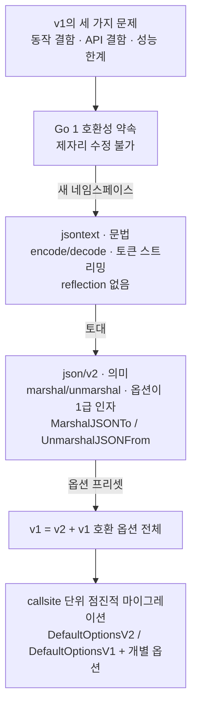

<figure class="post-figure post-figure--header">
<svg role="img" aria-label="세 층으로 다시 쌓은 JSON 패키지. 맨 위에는 두 입구가 나란히 있다. 왼쪽 점선 테두리의 얇은 껍데기 encoding/json(v1)은 v1 호환 옵션 전체를, 오른쪽 실선 테두리의 encoding/json/v2는 v2 기본 옵션을 끼워 같은 엔진으로 내려간다. 가운데 json/v2 의미 계층 엔진은 MarshalJSON과 MarshalJSONTo를 모두 받는다. 맨 아래 jsontext 문법 계층에서는 중괄호, 대괄호, 문자열 토큰이 컨베이어 벨트 위로 흐른다." viewBox="0 0 380 330" width="460" xmlns="http://www.w3.org/2000/svg">
<title>두 입구, 하나의 엔진, 하나의 토큰 컨베이어 — v1은 v2 위의 얇은 호환 껍데기</title>
<rect x="10" y="12" width="170" height="62" rx="4" fill="var(--bg-panel)" stroke="currentColor" stroke-width="2" stroke-dasharray="6 5"/>
<text x="95" y="38" text-anchor="middle" font-family="var(--font-mono)" font-size="15" font-weight="700" fill="currentColor">encoding/json</text>
<text x="95" y="62" text-anchor="middle" font-family="var(--font-body)" font-size="15" fill="currentColor">+ v1 호환 옵션 전체</text>
<rect x="200" y="12" width="170" height="62" rx="4" fill="var(--bg-panel)" stroke="var(--accent-color)" stroke-width="3"/>
<text x="285" y="38" text-anchor="middle" font-family="var(--font-mono)" font-size="15" font-weight="700" fill="var(--accent-color)">encoding/json/v2</text>
<text x="285" y="62" text-anchor="middle" font-family="var(--font-body)" font-size="15" fill="currentColor">+ v2 기본 옵션</text>
<g stroke="currentColor" stroke-width="2.5" fill="currentColor">
<line x1="95" y1="76" x2="95" y2="96"/>
<line x1="285" y1="76" x2="285" y2="96"/>
<path d="M89 94 L95 104 L101 94 Z" stroke="none"/>
<path d="M279 94 L285 104 L291 94 Z" stroke="none"/>
</g>
<rect x="10" y="106" width="360" height="96" rx="4" fill="var(--bg-panel)" stroke="var(--primary-color)" stroke-width="3"/>
<text x="190" y="132" text-anchor="middle" font-family="var(--font-body)" font-size="16" font-weight="700" fill="var(--primary-color)">json/v2 엔진 · 의미 계층</text>
<rect x="24" y="148" width="158" height="38" rx="19" fill="var(--bg-sunken)" stroke="currentColor" stroke-width="1.5" stroke-dasharray="4 3"/>
<text x="103" y="172" text-anchor="middle" font-family="var(--font-mono)" font-size="15" fill="currentColor">MarshalJSON</text>
<rect x="198" y="148" width="158" height="38" rx="19" fill="var(--bg-sunken)" stroke="currentColor" stroke-width="1.5"/>
<text x="277" y="172" text-anchor="middle" font-family="var(--font-mono)" font-size="15" fill="currentColor">MarshalJSONTo</text>
<g stroke="currentColor" stroke-width="2.5" fill="currentColor">
<line x1="190" y1="204" x2="190" y2="216"/>
<path d="M184 214 L190 224 L196 214 Z" stroke="none"/>
</g>
<rect x="10" y="226" width="360" height="94" rx="4" fill="var(--bg-panel)" stroke="var(--gold)" stroke-width="3"/>
<text x="190" y="252" text-anchor="middle" font-family="var(--font-body)" font-size="16" font-weight="700" fill="var(--gold)">jsontext · 문법 계층</text>
<line x1="34" y1="302" x2="346" y2="302" stroke="currentColor" stroke-width="3"/>
<g fill="none" stroke="currentColor" stroke-width="2">
<circle cx="34" cy="308" r="6"/>
<circle cx="346" cy="308" r="6"/>
</g>
<g fill="var(--bg-sunken)" stroke="currentColor" stroke-width="2">
<rect x="56" y="266" width="34" height="34"/>
<rect x="100" y="266" width="34" height="34"/>
<rect x="144" y="266" width="34" height="34"/>
<rect x="188" y="266" width="34" height="34"/>
<rect x="232" y="266" width="34" height="34"/>
<rect x="276" y="266" width="34" height="34"/>
</g>
<g font-family="var(--font-mono)" font-size="20" font-weight="700" fill="var(--gold)" text-anchor="middle">
<text x="73" y="290">{</text>
<text x="117" y="290">[</text>
<text x="161" y="290">"</text>
<text x="205" y="290">"</text>
<text x="249" y="290">]</text>
<text x="293" y="290">}</text>
</g>
<path d="M320 283 L338 283 M332 277 L340 283 L332 289" fill="none" stroke="currentColor" stroke-width="2.5"/>
</svg>
<figcaption>하나의 엔진, 두 입구. 아래층 jsontext는 토큰을 문법대로만 흘려보내고, 위층 json/v2가 Go 값의 의미를 붙인다. v1은 그 위에 v1 호환 옵션 묶음을 끼운 얇은 껍데기라서, 두 입구 모두 MarshalJSON과 MarshalJSONTo를 받는다.</figcaption>
</figure>

## 원문 정보

> - **제목**: A new Go API for JSON
> - **출처**: The Go Blog — Michael Pratt, Joe Tsai, Daniel Martí, Johan Brandhorst-Satzkorn, Roger Peppe, Chris Hines, Damien Neil ([go.dev](https://go.dev/blog/))
> - **발행**: 2026-11-04 · 약 12분 분량(추정)
> - **원문 링크**: <https://go.dev/blog/jsonv2>

Go 표준 라이브러리에서 가장 많이 쓰이는 패키지 중 하나가 "메이저 버전 v2"를 내는 드문 사건이라, 언어 생태계가 호환성을 지키면서 API를 갈아엎는 방법의 사례로 Articles에 담는다.

## 한 줄 요약 (TL;DR)

`encoding/json`(v1)의 문제는 대부분 단순 버그가 아니라 **기존 API에서 나오는 결과**라서 Go 1 호환성 약속 안에서는 고칠 수 없었다. 그래서 Go 팀은 문법 계층 `encoding/json/jsontext`와 의미 계층 `encoding/json/v2`를 새로 만들고, **v1을 v2 위에 옵션 묶음으로 다시 구현해** 두 버전이 섞여도 동작하게 했다. 두 패키지는 **Go 1.27에서 안정·정식 제공**된다.

## 왜 이 글을 골랐나

Go 공식 블로그가 직접 소개하는 새 JSON API라서, Go로 시스템 영역을 넓혀 가는 데 기초가 되는 글이다. JSON 직렬화는 네트워크 서비스, 설정 파일, API 게이트웨이 등 Go가 쓰이는 거의 모든 곳에 있으니, 기본 동작이 무엇이고 왜 바뀌었는지 아는 일이 곧 Go 기초 체력이다. 또 이 위키의 [Rust Essential](/2026/01/02/rust-essential-curriculum.html)에서 다룬 "타입 시스템과 API로 실수를 막는다"는 관점을 Go 표준 라이브러리가 실제로 어떻게 적용하는지 보여 주는 사례이기도 하다.

글 전체의 흐름을 한 장으로 보면 다음과 같다.



## 핵심 내용

### 출발점: 15년을 버틴 v1, 그리고 쌓인 결함

원문은 v1을 깎아내리며 시작하지 않는다. 임의의 Go 타입을 기본 JSON 표현으로 marshal/unmarshal하고, 필요하면 표현을 커스터마이즈할 수 있게 한 설계는 "highly flexible"했다고 인정한다. Go는 1.0 이전부터 JSON을 지원했고, 블로그가 [JSON 지원](https://go.dev/blog/json)을 처음 소개한 지 15년이 넘었다. 2025년에는 [실험적 API](https://go.dev/blog/jsonv2-exp)를 먼저 공개했고, 이번 글은 그 글을 업데이트한 버전이다.

그래도 시간이 흐르며 드러난 결함을 원문은 세 갈래로 나눈다.

**동작 결함(Behavior flaws)**

- **잘못된 UTF-8을 받아들인다.** RFC 8259는 유효한 UTF-8을 요구한다. 원문은 기본 동작이 "silent data corruption"을 만들지 말고 에러를 내야 한다고 본다.
- **중복된 멤버 이름을 받아들인다.** RFC 8259는 중복 이름을 어떻게 다룰지 정하지 않아서 구현마다 해석이 달라질 수 있다. 원문은 이것이 보안 애플리케이션에서 공격에 악용될 수 있고 실제로 악용된 적도 있다며 [CVE-2017-12635](https://nvd.nist.gov/vuln/detail/CVE-2017-12635)를 예로 든다.
- **nil slice/map을 `null`로 내보낸다.** 상대 구현이 배열·객체 자리에 `null`을 허용하지 않으면 에러가 난다. [설문](https://go.dev/issue/63397#discussioncomment-7201222)에서 대부분의 Go 사용자가 빈 배열·객체를 선호했다.
- **대소문자를 구분하지 않고 unmarshal한다.** JSON 멤버 이름을 struct 필드에 대소문자 무시로 매칭한다. 원문은 이것을 "a surprising default, a potential security vulnerability, and a performance limitation"이라고 부른다.
- **메서드 호출이 일관되지 않다.** pointer receiver에 선언한 `MarshalJSON`이 구현 세부사항 때문에 [호출되기도 하고 안 되기도 한다](https://go.dev/issue/22967). 버그이지만, 너무 많은 애플리케이션이 현재 동작에 기대고 있어 고칠 수 없다.

**API 결함(API deficiencies)**

- `io.Reader`에서 올바르게 unmarshal하기 어렵다. 흔히 쓰는 `json.NewDecoder(r).Decode(v)`는 입력 끝의 쓰레기 데이터(trailing junk)를 거부하지 않는다.
- 옵션은 `Encoder`/`Decoder`에만 걸 수 있고 `Marshal`/`Unmarshal` 함수에는 쓸 수 없다. 커스텀 `Marshaler`/`Unmarshaler` 안으로 옵션을 전달할 길도 없다. 예를 들어 `Decoder.DisallowUnknownFields`는 커스텀 `UnmarshalJSON`을 거치면 효과가 사라진다.
- `Compact`, `Indent`, `HTMLEscape`는 `[]byte`나 `io.Writer`가 아니라 `bytes.Buffer`에만 쓴다.

**성능 한계(Performance limitations)** — 내부 구현이 아니라 **공개 API가 강제하는** 한계다.

- `MarshalJSON`은 반환할 `[]byte`를 반드시 할당해야 한다. 게다가 패키지가 그 결과가 유효한 JSON인지 검증하고 들여쓰기에 맞춰 재포맷까지 해야 한다.
- `UnmarshalJSON`은 완전한 JSON 값을 받아야 하므로, 패키지가 값의 끝을 찾으려고 한 번 파싱하고 메서드가 다시 파싱한다. 결국 두 번 파싱한다.
- `Encoder`/`Decoder`는 `io.Writer`/`io.Reader` 위에서 동작하지만 JSON 값 전체를 메모리에 버퍼링한다. `Decoder.Token`은 할당이 많고, 토큰을 쓰는 API는 아예 없다. 커스텀 메서드 안에서 `Marshal`/`Unmarshal`을 재귀 호출하면 성능이 **quadratic**이 된다.

### 왜 v1을 직접 고치지 않았나

원문의 논리는 단순하다. 기능을 **추가**하는 것은 쉽지만 기존 기능을 **바꾸는** 것은 어렵다. 위 문제들은 기존 API에서 나오는 결과라 [Go 1 호환성 약속](https://go.dev/doc/go1compat) 안에서는 "practically impossible to fix"였다. `MarshalV2`처럼 이름만 따로 두는 방법도 있지만, 그러면 같은 패키지 안에 평행 네임스페이스를 만드는 것과 다르지 않다. 그래서 별도 네임스페이스 `encoding/json/v2`를 택했다.

### 토대: `encoding/json/jsontext` — 문법과 의미의 분리

v2의 핵심 설계는 JSON 처리를 두 층으로 나눈 것이다.

- **문법(syntactic)**: JSON 문법에 따라 처리한다. 원문은 이를 **encode/decode**라고 부르며 `jsontext`가 맡는다.
- **의미(semantic)**: JSON 값과 Go 값의 관계를 정의한다. 원문은 이를 **marshal/unmarshal**이라고 부르며 `json/v2`가 맡는다.

<figure class="post-figure">
<svg role="img" aria-label="위아래 두 층으로 나뉜 JSON 처리 구조. 네모는 타입, 둥근 칸은 함수와 메서드다. 위층 json/v2 의미 계층에는 Go 값과 Marshal·Unmarshal(그리고 Write/Read, Encode/Decode 변형)이 있다. 점선 경계 아래 jsontext 문법 계층은 reflection 없이 동작하며, Token·Value(Kind), WriteToken·WriteValue와 ReadToken·ReadValue 메서드, Encoder·Decoder, 그리고 io.Writer·io.Reader가 차례로 이어진다. 왼쪽 화살표는 아래로 향하는 marshal·encode 흐름, 오른쪽 화살표는 위로 향하는 decode·unmarshal 흐름이다." viewBox="0 0 380 444" width="460" xmlns="http://www.w3.org/2000/svg">
<title>문법(jsontext)과 의미(json/v2)의 두 층, 그리고 데이터 흐름</title>
<rect x="56" y="10" width="22" height="22" fill="var(--bg-panel)" stroke="currentColor" stroke-width="2"/>
<text x="86" y="27" font-family="var(--font-body)" font-size="15" fill="currentColor">타입</text>
<rect x="160" y="10" width="40" height="22" rx="11" fill="var(--bg-sunken)" stroke="currentColor" stroke-width="2"/>
<text x="208" y="27" font-family="var(--font-body)" font-size="15" fill="currentColor">함수·메서드</text>
<text x="190" y="60" text-anchor="middle" font-family="var(--font-body)" font-size="16" font-weight="700" fill="var(--primary-color)">json/v2 · 의미 계층</text>
<rect x="66" y="70" width="248" height="36" fill="var(--bg-panel)" stroke="var(--primary-color)" stroke-width="2.5"/>
<text x="190" y="94" text-anchor="middle" font-family="var(--font-body)" font-size="15" fill="currentColor">Go 값 (any)</text>
<rect x="56" y="120" width="268" height="56" rx="20" fill="var(--bg-sunken)" stroke="var(--primary-color)" stroke-width="2.5"/>
<text x="190" y="143" text-anchor="middle" font-family="var(--font-mono)" font-size="15" font-weight="700" fill="currentColor">Marshal · Unmarshal</text>
<text x="190" y="166" text-anchor="middle" font-family="var(--font-body)" font-size="15" fill="currentColor">+ Write/Read · Encode/Decode 변형</text>
<line x1="52" y1="192" x2="328" y2="192" stroke="currentColor" stroke-width="2" stroke-dasharray="7 5"/>
<text x="190" y="218" text-anchor="middle" font-family="var(--font-body)" font-size="16" font-weight="700" fill="var(--gold)">jsontext · 문법 · reflection 없음</text>
<rect x="66" y="228" width="248" height="36" fill="var(--bg-panel)" stroke="var(--gold)" stroke-width="2.5"/>
<text x="190" y="252" text-anchor="middle" font-family="var(--font-mono)" font-size="15" fill="currentColor">Token · Value (Kind)</text>
<rect x="56" y="278" width="268" height="56" rx="20" fill="var(--bg-sunken)" stroke="var(--gold)" stroke-width="2.5"/>
<text x="190" y="301" text-anchor="middle" font-family="var(--font-mono)" font-size="15" fill="currentColor">WriteToken · WriteValue</text>
<text x="190" y="324" text-anchor="middle" font-family="var(--font-mono)" font-size="15" fill="currentColor">ReadToken · ReadValue</text>
<rect x="66" y="348" width="248" height="36" fill="var(--bg-panel)" stroke="var(--gold)" stroke-width="2.5"/>
<text x="190" y="372" text-anchor="middle" font-family="var(--font-mono)" font-size="15" fill="currentColor">Encoder · Decoder</text>
<rect x="66" y="398" width="248" height="36" fill="var(--bg-panel)" stroke="currentColor" stroke-width="2.5" stroke-dasharray="5 4"/>
<text x="190" y="422" text-anchor="middle" font-family="var(--font-mono)" font-size="15" fill="currentColor">io.Writer · io.Reader</text>
<g stroke="currentColor" stroke-width="2" fill="currentColor">
<line x1="190" y1="112" x2="190" y2="114"/><path d="M185 113 L190 106 L195 113 Z M185 113 L190 120 L195 113 Z" stroke="none"/>
<line x1="190" y1="270" x2="190" y2="272"/><path d="M185 271 L190 264 L195 271 Z M185 271 L190 278 L195 271 Z" stroke="none"/>
<line x1="190" y1="340" x2="190" y2="342"/><path d="M185 341 L190 334 L195 341 Z M185 341 L190 348 L195 341 Z" stroke="none"/>
<line x1="190" y1="390" x2="190" y2="392"/><path d="M185 391 L190 384 L195 391 Z M185 391 L190 398 L195 391 Z" stroke="none"/>
</g>
<g stroke="var(--accent-color)" stroke-width="2.5" fill="var(--accent-color)">
<line x1="40" y1="70" x2="40" y2="424"/>
<path d="M33 420 L40 434 L47 420 Z" stroke="none"/>
<line x1="340" y1="80" x2="340" y2="434"/>
<path d="M333 84 L340 70 L347 84 Z" stroke="none"/>
</g>
<text transform="translate(26 252) rotate(-90)" text-anchor="middle" font-family="var(--font-mono)" font-size="15" fill="var(--accent-color)">marshal · encode ↓</text>
<text transform="translate(364 252) rotate(-90)" text-anchor="middle" font-family="var(--font-mono)" font-size="15" fill="var(--accent-color)">decode · unmarshal ↑</text>
</svg>
<figcaption>네모는 타입, 둥근 칸은 함수·메서드다. 아래층 jsontext는 reflection 없이 토큰과 값만 다루고, 위층 json/v2가 그 위에서 Go 값의 의미를 붙인다. 원문 다이어그램을 세로로 재구성했다.</figcaption>
</figure>

원문이 제시하는 `jsontext`의 기본 API는 다음과 같다(본문 그대로 옮김).

```go
package jsontext

type Encoder struct { ... }
func NewEncoder(io.Writer, ...Options) *Encoder
func (*Encoder) WriteValue(Value) error
func (*Encoder) WriteToken(Token) error

type Decoder struct { ... }
func NewDecoder(io.Reader, ...Options) *Decoder
func (*Decoder) ReadValue() (Value, error)
func (*Decoder) ReadToken() (Token, error)

type Kind byte
type Value []byte
func (Value) Kind() Kind
type Token struct { ... }
func (Token) Kind() Kind
```

정리하면 이렇다.

- 이름은 RFC 8259 2절에서 JSON 문법을 "JSON-text"라고 부르는 데서 왔다. 문법 수준에서만 동작하므로 **Go reflection에 의존하지 않는다.**
- v1의 `Encoder`/`Decoder`와 달리 문법과 의미를 섞지 않고 "truly streaming" 방식으로 동작한다.
- `Value`는 이름 붙은 `[]byte`이고, v1의 `RawMessage`는 이제 `jsontext.Value`의 **타입 별칭**이다.
- `Token`은 불투명(opaque) 타입이다. v1의 `Token`과 비슷하지만 임의의 JSON 토큰을 **할당 없이** 표현하도록 설계됐다.
- 이 토대 위에서 v2는 `MarshalJSONTo`/`UnmarshalJSONFrom` 메서드를 도입한다. 두 메서드는 `[]byte`가 아니라 `Encoder`/`Decoder`를 받는다. 그래서 값 검증·포맷팅이나 값의 경계 판정은 json 패키지가 아니라 Encoder/Decoder가 맡는다.

### `encoding/json/v2` — 익숙하지만 옵션이 1급인 API

v2는 v1의 문제를 고치면서 v1 사용자에게 익숙하도록 설계됐다. 목표는 "v1 코드를 v2로 그대로 옮겨도 대부분 똑같이 동작"하는 것이다.

```go
package json

func Marshal(in any, opts ...Options) (out []byte, err error)
func MarshalWrite(out io.Writer, in any, opts ...Options) error
func MarshalEncode(out *jsontext.Encoder, in any, opts ...Options) error

func Unmarshal(in []byte, out any, opts ...Options) error
func UnmarshalRead(in io.Reader, out any, opts ...Options) error
func UnmarshalDecode(in *jsontext.Decoder, out any, opts ...Options) error
```

- `Marshal`/`Unmarshal`은 v1과 시그니처가 비슷하지만 **옵션을 받는다.**
- `MarshalWrite`/`UnmarshalRead`는 `io.Writer`/`io.Reader`에 직접 동작하므로 Encoder/Decoder를 임시로 만들 필요가 없다.
- `MarshalEncode`/`UnmarshalDecode`는 `jsontext.Encoder`/`Decoder` 위에서 동작하며, 실제로 앞의 함수들이 이것으로 구현된다.

간단한 사용 예를 보자. 아래 코드는 원문이 설명한 기본 동작 차이(nil slice → 빈 배열)를 직접 확인하는 예이고, 예제 구성은 필자가 했다.

```go
package main

import (
	"encoding/json/v2"
	"fmt"
	"os"
	"strings"
)

type Order struct {
	ID    string   `json:"id"`
	Items []string `json:"items"`
}

func main() {
	// v2는 nil slice를 빈 배열로 내보낸다. (v1이라면 "items":null)
	b, err := json.Marshal(Order{ID: "a1"})
	fmt.Println(string(b), err) // {"id":"a1","items":[]} <nil>

	// io.Writer로 바로 쓴다. Encoder를 따로 만들 필요가 없다(줄바꿈은 붙이지 않는다).
	_ = json.MarshalWrite(os.Stdout, Order{ID: "a2", Items: []string{"x"}})
	fmt.Println()

	// io.Reader에서 바로 읽는다. 입력은 단일 JSON 값이어야 하고,
	// 패키지 문서에 따르면 io.EOF까지 입력 전체를 소비한다.
	var o Order
	err = json.UnmarshalRead(strings.NewReader(`{"id":"a3","items":[]}`), &o)
	fmt.Println(o.ID, err)
}
```

`UnmarshalRead`에 대해 [패키지 문서](https://pkg.go.dev/encoding/json/v2#UnmarshalRead)는 입력이 "a single JSON value with optional whitespace interspersed"여야 하고 `io.EOF`까지 리더 전체를 소비한다고 설명한다. 원문이 v1의 결함으로 꼽은 "`NewDecoder(r).Decode(v)`가 trailing junk를 거부하지 못함"과 짝을 이루는 대목이다.

### 타입이 정하는 커스터마이즈: `MarshalerTo` / `UnmarshalerFrom`

```go
type Marshaler interface {
    MarshalJSON() ([]byte, error)
}
type MarshalerTo interface {
    MarshalJSONTo(*jsontext.Encoder) error
}

type Unmarshaler interface {
    UnmarshalJSON([]byte) error
}
type UnmarshalerFrom interface {
    UnmarshalJSONFrom(*jsontext.Decoder) error
}
```

`Marshaler`/`Unmarshaler`는 v1과 **동일**하다. 새로 생긴 `MarshalerTo`/`UnmarshalerFrom`은 Encoder/Decoder로 스스로를 표현한다. Encoder/Decoder의 `Options` 접근자로 옵션을 꺼낼 수 있으므로, **옵션이 호출 스택 아래로 전달된다**(v1의 `DisallowUnknownFields` 문제에 대한 답). 원문은 JSON 객체 멤버 순서를 유지하는 커스텀 타입 예로 패키지의 [OrderedObject 예제](https://pkg.go.dev/encoding/json/v2#example-package-OrderedObject)를 가리킨다.

아래는 `MarshalJSONTo`를 구현하는 최소 예다(필자 작성). `[]byte`를 만들어 돌려주지 않고 Encoder에 토큰을 바로 쓴다는 점이 v1의 `MarshalJSON`과 다르다.

```go
import (
	"fmt"

	"encoding/json/jsontext"
)

type Celsius float64

// MarshalJSONTo는 할당된 []byte를 반환하는 대신
// Encoder에 토큰을 직접 쓴다.
func (c Celsius) MarshalJSONTo(enc *jsontext.Encoder) error {
	return enc.WriteToken(jsontext.String(fmt.Sprintf("%.1f°C", float64(c))))
}
```

### 호출자가 정하는 커스터마이즈: `WithMarshalers` / `WithUnmarshalers`

v2에서는 `Marshal`/`Unmarshal`을 **호출하는 쪽**도 임의 타입의 JSON 표현을 지정할 수 있다. 이 caller-specified 함수는 타입에 정의된 메서드나 기본 표현보다 **우선한다.**

```go
func WithMarshalers(*Marshalers) Options
type Marshalers struct { ... }
func MarshalFunc[T any](fn func(T) ([]byte, error)) *Marshalers
func MarshalToFunc[T any](fn func(*jsontext.Encoder, T) error) *Marshalers

func WithUnmarshalers(*Unmarshalers) Options
type Unmarshalers struct { ... }
func UnmarshalFunc[T any](fn func([]byte, T) error) *Unmarshalers
func UnmarshalFromFunc[T any](fn func(*jsontext.Decoder, T) error) *Unmarshalers
```

원문은 이 기능으로 모든 `proto.Message` 타입의 직렬화를 `protojson` 패키지에 맡기는 [ProtoJSON 예제](https://pkg.go.dev/encoding/json/v2#example-package-ProtoJSON)를 든다. 더 작은 예로, 원문이 "v2에서는 `time.Duration`을 직렬화하면 에러가 나고 표현은 호출자가 고르게 한다"고 한 점을 `MarshalToFunc`로 풀어 볼 수 있다(필자 작성).

```go
import (
	"time"

	"encoding/json/jsontext"
	"encoding/json/v2"
)

type Config struct {
	Timeout time.Duration `json:"timeout"`
}

// time.Duration을 "1.5s" 같은 문자열로 내보내도록 호출자가 지정한다.
var durationAsString = json.MarshalToFunc(func(enc *jsontext.Encoder, d time.Duration) error {
	return enc.WriteToken(jsontext.String(d.String()))
})

func encode(cfg Config) ([]byte, error) {
	return json.Marshal(cfg, json.WithMarshalers(durationAsString))
}
```

원문은 `time.Duration` 표현을 호출자가 고를 수 있는 옵션이 있다고만 말하고 이름은 밝히지 않는다. 패키지 문서 기준으로는 `jsonv1.FormatDurationAsNano(true)`로 v1처럼 나노초 숫자를 쓸 수 있다. 위 예는 원문이 소개한 일반 메커니즘(`MarshalToFunc` + `WithMarshalers`)만 사용했다.

### v1과 달라진 기본 동작

<figure class="post-figure">
<svg role="img" aria-label="v1과 v2의 기본 동작 차이 여섯 가지를 카드로 세로로 쌓았다. 각 카드는 위에 v1 동작, 아래에 v2 동작을 적었다. 1. 잘못된 UTF-8: v1은 받아들인다, v2는 에러를 낸다. 2. 중복 멤버 이름: v1은 받아들인다, v2는 에러를 낸다. 3. nil slice / map: v1은 null로 내보낸다, v2는 [] / {}로 내보낸다. 4. JSON 이름 ↔ 필드 매칭: v1은 대소문자 무시, v2는 대소문자 구분. 5. omitempty: v1은 Go 빈 값(false·0·nil·길이 0)이면 생략, v2는 JSON 빈 값(null·&quot;&quot;·[]·{})이면 생략. 6. time.Duration: v1은 나노초 정수로 직렬화, v2는 기본은 에러, 표현은 옵션으로." viewBox="0 0 380 646" width="440" xmlns="http://www.w3.org/2000/svg">
<title>v1에서 v2로 바뀐 기본 동작 여섯 가지</title>
<rect x="10" y="10" width="360" height="96" rx="6" fill="var(--bg-panel)" stroke="currentColor" stroke-width="1.8"/>
<text x="24" y="37" font-family="var(--font-body)" font-size="16" font-weight="700" fill="var(--accent-color)">1</text>
<text x="44" y="37" font-family="var(--font-body)" font-size="16" font-weight="700" fill="currentColor">잘못된 UTF-8</text>
<rect x="24" y="50" width="38" height="22" rx="3" fill="none" stroke="currentColor" stroke-width="1.5" stroke-dasharray="4 3"/>
<text x="43" y="66" text-anchor="middle" font-family="var(--font-mono)" font-size="15" fill="currentColor">v1</text>
<text x="74" y="66" font-family="var(--font-body)" font-size="15" fill="currentColor" opacity="0.8">받아들인다</text>
<rect x="24" y="76" width="38" height="22" rx="3" fill="var(--accent-color)"/>
<text x="43" y="92" text-anchor="middle" font-family="var(--font-mono)" font-size="15" font-weight="700" fill="var(--bg-panel)">v2</text>
<text x="74" y="92" font-family="var(--font-body)" font-size="15" font-weight="700" fill="currentColor">에러를 낸다</text>
<rect x="10" y="116" width="360" height="96" rx="6" fill="var(--bg-panel)" stroke="currentColor" stroke-width="1.8"/>
<text x="24" y="143" font-family="var(--font-body)" font-size="16" font-weight="700" fill="var(--accent-color)">2</text>
<text x="44" y="143" font-family="var(--font-body)" font-size="16" font-weight="700" fill="currentColor">중복 멤버 이름</text>
<rect x="24" y="156" width="38" height="22" rx="3" fill="none" stroke="currentColor" stroke-width="1.5" stroke-dasharray="4 3"/>
<text x="43" y="172" text-anchor="middle" font-family="var(--font-mono)" font-size="15" fill="currentColor">v1</text>
<text x="74" y="172" font-family="var(--font-body)" font-size="15" fill="currentColor" opacity="0.8">받아들인다</text>
<rect x="24" y="182" width="38" height="22" rx="3" fill="var(--accent-color)"/>
<text x="43" y="198" text-anchor="middle" font-family="var(--font-mono)" font-size="15" font-weight="700" fill="var(--bg-panel)">v2</text>
<text x="74" y="198" font-family="var(--font-body)" font-size="15" font-weight="700" fill="currentColor">에러를 낸다</text>
<rect x="10" y="222" width="360" height="96" rx="6" fill="var(--bg-panel)" stroke="currentColor" stroke-width="1.8"/>
<text x="24" y="249" font-family="var(--font-body)" font-size="16" font-weight="700" fill="var(--accent-color)">3</text>
<text x="44" y="249" font-family="var(--font-body)" font-size="16" font-weight="700" fill="currentColor">nil slice / map</text>
<rect x="24" y="262" width="38" height="22" rx="3" fill="none" stroke="currentColor" stroke-width="1.5" stroke-dasharray="4 3"/>
<text x="43" y="278" text-anchor="middle" font-family="var(--font-mono)" font-size="15" fill="currentColor">v1</text>
<text x="74" y="278" font-family="var(--font-body)" font-size="15" fill="currentColor" opacity="0.8">null로 내보낸다</text>
<rect x="24" y="288" width="38" height="22" rx="3" fill="var(--accent-color)"/>
<text x="43" y="304" text-anchor="middle" font-family="var(--font-mono)" font-size="15" font-weight="700" fill="var(--bg-panel)">v2</text>
<text x="74" y="304" font-family="var(--font-body)" font-size="15" font-weight="700" fill="currentColor">[] / {}로 내보낸다</text>
<rect x="10" y="328" width="360" height="96" rx="6" fill="var(--bg-panel)" stroke="currentColor" stroke-width="1.8"/>
<text x="24" y="355" font-family="var(--font-body)" font-size="16" font-weight="700" fill="var(--accent-color)">4</text>
<text x="44" y="355" font-family="var(--font-body)" font-size="16" font-weight="700" fill="currentColor">JSON 이름 ↔ 필드 매칭</text>
<rect x="24" y="368" width="38" height="22" rx="3" fill="none" stroke="currentColor" stroke-width="1.5" stroke-dasharray="4 3"/>
<text x="43" y="384" text-anchor="middle" font-family="var(--font-mono)" font-size="15" fill="currentColor">v1</text>
<text x="74" y="384" font-family="var(--font-body)" font-size="15" fill="currentColor" opacity="0.8">대소문자 무시</text>
<rect x="24" y="394" width="38" height="22" rx="3" fill="var(--accent-color)"/>
<text x="43" y="410" text-anchor="middle" font-family="var(--font-mono)" font-size="15" font-weight="700" fill="var(--bg-panel)">v2</text>
<text x="74" y="410" font-family="var(--font-body)" font-size="15" font-weight="700" fill="currentColor">대소문자 구분</text>
<rect x="10" y="434" width="360" height="96" rx="6" fill="var(--bg-panel)" stroke="currentColor" stroke-width="1.8"/>
<text x="24" y="461" font-family="var(--font-body)" font-size="16" font-weight="700" fill="var(--accent-color)">5</text>
<text x="44" y="461" font-family="var(--font-mono)" font-size="16" font-weight="700" fill="currentColor">omitempty</text>
<rect x="24" y="474" width="38" height="22" rx="3" fill="none" stroke="currentColor" stroke-width="1.5" stroke-dasharray="4 3"/>
<text x="43" y="490" text-anchor="middle" font-family="var(--font-mono)" font-size="15" fill="currentColor">v1</text>
<text x="74" y="490" font-family="var(--font-body)" font-size="15" fill="currentColor" opacity="0.8">Go 빈 값(false·0·nil·길이 0)이면 생략</text>
<rect x="24" y="500" width="38" height="22" rx="3" fill="var(--accent-color)"/>
<text x="43" y="516" text-anchor="middle" font-family="var(--font-mono)" font-size="15" font-weight="700" fill="var(--bg-panel)">v2</text>
<text x="74" y="516" font-family="var(--font-body)" font-size="15" font-weight="700" fill="currentColor">JSON 빈 값(null·&quot;&quot;·[]·{})이면 생략</text>
<rect x="10" y="540" width="360" height="96" rx="6" fill="var(--bg-panel)" stroke="currentColor" stroke-width="1.8"/>
<text x="24" y="567" font-family="var(--font-body)" font-size="16" font-weight="700" fill="var(--accent-color)">6</text>
<text x="44" y="567" font-family="var(--font-mono)" font-size="16" font-weight="700" fill="currentColor">time.Duration</text>
<rect x="24" y="580" width="38" height="22" rx="3" fill="none" stroke="currentColor" stroke-width="1.5" stroke-dasharray="4 3"/>
<text x="43" y="596" text-anchor="middle" font-family="var(--font-mono)" font-size="15" fill="currentColor">v1</text>
<text x="74" y="596" font-family="var(--font-body)" font-size="15" fill="currentColor" opacity="0.8">나노초 정수로 직렬화</text>
<rect x="24" y="606" width="38" height="22" rx="3" fill="var(--accent-color)"/>
<text x="43" y="622" text-anchor="middle" font-family="var(--font-mono)" font-size="15" font-weight="700" fill="var(--bg-panel)">v2</text>
<text x="74" y="622" font-family="var(--font-body)" font-size="15" font-weight="700" fill="currentColor">기본은 에러, 표현은 옵션으로</text>
</svg>
<figcaption>v1과 달라진 v2의 기본 동작. 카드마다 위가 v1, 아래가 v2다. 대부분은 struct tag 옵션이나 호출자 옵션으로 v1 의미로 되돌릴 수 있다.</figcaption>
</figure>

원문이 꼽은 주요 차이는 다음과 같다.

- 잘못된 UTF-8이 있으면 에러를 낸다.
- JSON 객체에 중복 이름이 있으면 에러를 낸다.
- nil slice는 빈 JSON 배열로, nil map은 빈 JSON 객체로 marshal한다.
- JSON 멤버 이름을 struct 필드에 **대소문자를 구분해** 매칭한다.
- `omitempty`의 의미가 바뀌었다. 필드가 "빈" JSON 값(`null`, `""`, `[]`, `{}`)으로 인코딩될 경우에 생략한다.
- `time.Duration`을 직렬화하려 하면 에러를 낸다. 현재 [기본 표현이 정해져 있지 않기](https://go.dev/issue/71631) 때문이며, 대신 호출자가 고를 수 있는 옵션을 제공한다.

대부분의 동작 차이에는 v1 또는 v2 의미로(혹은 호출자가 정한 다른 동작으로) 되돌릴 수 있는 struct tag 옵션이나 호출자 옵션이 있다. 전체 목록은 `encoding/json` 문서의 ["Migrating to v2"](https://pkg.go.dev/encoding/json#hdr-Migrating_to_v2)에 있다.

### 성능

- **Marshal**: v1과 "roughly at parity". 조금 빠를 때도, 조금 느릴 때도 있다.
- **Unmarshal**: v1보다 "significantly faster". 벤치마크에서 **최대 10배**까지 개선됐다.
- 더 큰 이득을 얻으려면 기존 `Marshaler`/`Unmarshaler` 구현에 `MarshalerTo`/`UnmarshalerFrom`을 **추가로** 구현해 순수 스트리밍으로 처리하라고 권한다.
- 사례: Kubernetes의 한 서비스에서 `UnmarshalJSON` 안의 OpenAPI 명세 재귀 파싱이 성능을 크게 떨어뜨렸는데, `UnmarshalJSONFrom`으로 바꾸자 "by orders of magnitude" 개선됐다([kubernetes/kube-openapi#315](https://github.com/kubernetes/kube-openapi/issues/315)).
- 벤치마크 상세는 [go-json-experiment/jsonbench](https://github.com/go-json-experiment/jsonbench)에 있다. v2가 v1보다 느린 [경우들](https://go.dev/issue/81315)은 계속 최적화 중이며, **Go 1.28**에서 추가 개선을 기대해도 된다고 한다.

### 호환성: v1을 v2 위에 다시 구현하다

이 글에서 가장 설계적인 대목이다.

- v1과 v2 모두 Go 1 호환성 약속을 따른다. v1을 쓰는 애플리케이션은 **무기한 지원**되며 v2로 옮길 필요가 전혀 없다.
- 그러나 Go 팀은 "v1을 계속 지원한다"보다 나은 것을 원했다. **v1과 v2를 서로 호환되게 만들어** 의존성마다 다른 버전을 써도 함께 동작하게 했다.
  - 내 패키지는 v2로 marshal하는데 필드 타입을 정의한 다른 패키지가 v1 `MarshalJSON`을 쓴다면? v2는 `MarshalJSON`을 지원한다.
  - 반대로 내 패키지는 v1인데 다른 패키지가 v2 `MarshalJSONTo`를 구현했다면? v1 구현도 내부적으로 `MarshalJSONTo`를 지원한다.
- 비결: **v1은 내부적으로 v2로 구현돼 있다.** 각 동작 차이를 v2 옵션 하나가 제어하므로, v1은 "v1 호환 옵션 전체"를 넘긴 v2 호출이 된다. 덕분에 `MarshalJSONTo` 같은 새 메서드나 `embed` 같은 새 struct tag 같은 하위 호환 추가 사항을 기존 v1 사용자도 자동으로 누린다.

### 마이그레이션: 옵션으로 한 동작씩

v1을 v2 옵션으로 구현했기 때문에 **호출 지점(callsite) 단위의 점진적 마이그레이션**이 가능하다. 많은 애플리케이션은 동작 변화 없이 바로 v2로 옮길 수 있고, v1 동작에 기대는 곳은 해당 동작만 옵션으로 바꾸면 된다. 원문의 두 예시(원문은 인자를 `...`로 생략)를 import와 함께 옮기면 다음과 같다. 원문 코드의 `AllowDuplicateName`은 실제 API 이름 `AllowDuplicateNames`의 오기라 바로잡았다(Go 1.27.3에서 컴파일 확인).

```go
import (
	jsonv1 "encoding/json"

	"encoding/json/jsontext"
	"encoding/json/v2"
)

func migrate(v any) {
	// v2 동작 전체를 쓰되, 중복 이름만은 허용한다.
	b1, err := json.Marshal(v, json.DefaultOptionsV2(), jsontext.AllowDuplicateNames(true))

	// v1 동작 전체를 쓰되, 중복 이름만은 거부한다.
	b2, err := json.Marshal(v, jsonv1.DefaultOptionsV1(), jsontext.AllowDuplicateNames(false))

	_, _, _ = b1, b2, err
}
```

더 자세한 시나리오는 [encoding/json/v2 Migration Guide](https://go.dev/doc/jsonv2-migration)에 있다. 추가 자료로 원문은 ["Working with JSON" 튜토리얼](https://go.dev/doc/tutorial/json), [encoding/json/v2](https://pkg.go.dev/encoding/json/v2)·[jsontext](https://pkg.go.dev/encoding/json/jsontext) 패키지 문서, Anton Zhiyanov의 [블로그 글](https://antonz.org/go-json-v2/)을 안내한다.

### 오래 걸린 길: 약 6년

- **2020년 말**: v1을 고칠 수 없다는 한계에 자극받아 `encoding/json` 메인테이너 Daniel Martí가 가상의 v2 구상을 처음 문서로 정리했다.
- 별도로, Go Protocol Buffers API 작업을 마친 Joe Tsai는 `protojson`이 자체 JSON 구현을 써야 했던 점에 실망했다. `encoding/json`이 Protobuf 명세가 요구하는 더 엄격한 JSON 표준을 지키지도, 스트리밍으로 효율적으로 직렬화하지도 못했기 때문이다.
- 두 사람이 힘을 합쳐 [프로토타입](https://github.com/go-json-experiment/json)을 만들었다. 초기 코드는 Go protobuf 모듈의 JSON 직렬화 로직을 다듬은 것이었다. 이후 Roger Peppe, Chris Hines, Johan Brandhorst-Satzkorn, Damien Neil, Austin Clements, Michael Pratt가 설계 리뷰, 코드 리뷰, 회귀 테스트로 합류했다.
- GopherCon 발표와 [2023년 말 discussion](https://go.dev/issue/63397), [2025년 초 정식 제안](https://go.dev/issue/71497)을 거쳐 [Go 1.25에서 Go experiment로 채택](https://go.dev/issue/71845)돼 모든 Go 사용자가 넓게 테스트했다. 참고로 당시 [실험 소개 글](https://go.dev/blog/jsonv2-exp)은 `GOEXPERIMENT=jsonv2`로 활성화하는 방식을 안내했다. 이번 글은 Go 1.27에서 "stable and generally available"이라고만 밝히고, 실험 플래그는 언급하지 않는다.
- 원문은 이 작업이 "largely been developed and promoted by people not employed by Google"이라고 강조한다.

## 분석과 인사이트

아래는 원문 요약이 아니라 필자의 해석이다.

### 1. "버그"가 아니라 "API가 강제한 비용"이라는 진단이 핵심이다

원문의 성능 절에서 가장 날카로운 문장은 "Setting aside internal implementation details, the public API commits it to certain performance limitations"이다. `MarshalJSON() ([]byte, error)`라는 시그니처 하나가 할당, 재검증, 재포맷을 **계약으로 고정한다.** 구현을 아무리 최적화해도 인터페이스 모양이 비용의 하한을 정해 버린다. 반대로 `MarshalJSONTo(*jsontext.Encoder)`는 인터페이스가 스트림을 받게 해서 하한 자체를 내렸다. 특히 Kubernetes 사례가 `UnmarshalJSONFrom`으로 옮기며 "orders of magnitude" 개선된 것은 구현 트릭보다 **인터페이스 설계 변화**에서 나온 결과로 보이고(필자의 해석; Unmarshal 전반의 최대 10배 개선은 원문이 따로 제시한 일반 결과다), 이 점은 API를 설계하는 모든 개발자에게 교훈이 된다.

### 2. 문법/의미 분리는 sans-IO와 같은 계열의 아이디어다

`jsontext`가 reflection 없이 토큰 스트림만 다루고 `json/v2`가 그 위에서 Go 값의 의미를 다루는 구조는, 이 위키에서 다룬 [sanstun의 sans-IO 설계](/2026/10/31/introducing-sanstun.html)처럼 "관심사를 층으로 잘라 각 층을 독립적으로 재사용·최적화 가능하게 만든다"는 발상과 닮았다(필자의 비교). 실무에서 보면 JSON을 Go 구조체로 바꾸지 않고 **토큰 수준에서만 훑어야 하는 경우**(대용량 로그 필터링, 프록시에서 특정 필드만 검사 등)에 표준 라이브러리만으로 할당 없는 경로를 얻는다는 뜻이다.

### 3. 보안 기본값의 전환: "관대한 파서"의 시대가 끝나간다

중복 이름 거부, 잘못된 UTF-8 거부, 대소문자 구분 매칭은 모두 **두 파서가 같은 입력을 다르게 해석하는 문제(parser differential)**를 줄이는 방향이다. 원문도 "decoders have become stricter at rejecting ambiguous inputs"라고 흐름을 짚는다. 이는 [uv의 tar-codec이 파서 차이와 싸운 이야기](/2026/10/28/tar-codec-differential-resistant-tar-parser.html)와 정확히 같은 문제의식이다. 인증 토큰이나 권한 정보처럼 여러 컴포넌트가 같은 JSON을 읽는 경로라면, v2의 기본값만으로도 위협 표면이 줄어든다(필자의 판단).

### 4. 호환성 전략 — "v1을 v2의 옵션 프리셋으로"

가장 감탄스러운 부분은 마이그레이션 설계다. 보통 메이저 버전업은 생태계를 둘로 쪼갠다. Python 2/3의 긴 공존을 떠올리면 된다. Go 팀은 v1을 v2의 **옵션 프리셋**으로 재정의해서 두 가지를 동시에 얻었다.

- **버전 혼용**: 의존성 그래프 안에서 v1과 v2 패키지가 섞여도 커스텀 메서드가 양방향으로 통한다.
- **동작 단위 마이그레이션**: "패키지를 바꾼다"가 아니라 "옵션 하나를 바꾼다"가 마이그레이션의 단위가 된다.

다만 주의할 점도 있다. 원문은 "Many applications can migrate directly to v2 with no visible behavior changes"라고 했지, 모든 애플리케이션이 그렇다고 하지 않았다. 특히 대소문자 무시 매칭과 `null` 출력에 **외부 클라이언트가 묵시적으로 기대고 있는** 경우는 내 코드만 봐서는 드러나지 않는다(필자의 추론). 마이그레이션 전에 계약 테스트나 골든 파일로 실제 JSON 출력을 고정해 두는 편이 안전하다.

### 5. 아쉬운 점

원문은 고수준 API에 집중한다고 스스로 밝혔고, 옵션 목록과 실전 예제는 패키지 문서·튜토리얼·마이그레이션 가이드로 넘긴다. 그래서 `time.Duration`처럼 "옵션으로 고를 수 있다"고만 말한 부분은 실제 옵션 이름(예: `FormatDurationAsNano`)을 패키지 문서에서 따로 확인해야 한다. 또 Marshal 성능은 "parity"이고 일부 경우엔 v1보다 느리다고 솔직히 밝히므로, 쓰기 중심 워크로드라면 jsonbench나 자체 벤치마크로 확인한 뒤 옮기는 것이 맞다.

## 적용 포인트

- **새 코드는 v2로 시작한다.** Go 1.27 이상이라면 `encoding/json/v2`를 import해 nil → `[]`/`{}`, 대소문자 구분, 중복 이름 거부 같은 안전한 기본값을 그대로 쓴다.
- **`json.NewDecoder(r).Decode(v)` 패턴을 점검한다.** 단일 값 요청 본문을 읽는 곳이라면 `json.UnmarshalRead`로 바꿔 trailing junk를 그냥 넘기지 않게 한다.
- **기존 서비스는 옵션으로 한 동작씩 옮긴다.** `json.DefaultOptionsV2()` + 개별 옵션, 또는 `jsonv1.DefaultOptionsV1()` + 개별 옵션 조합으로 callsite 단위로 전환한다. 전환 전에 대표 응답을 골든 파일로 고정해 둔다.
- **핫패스의 커스텀 메서드에 `MarshalJSONTo`/`UnmarshalJSONFrom`을 추가한다.** 특히 `UnmarshalJSON` 안에서 `Unmarshal`을 재귀 호출하는 코드(quadratic 위험)가 1순위다. 기존 `MarshalJSON`은 남겨 두어도 v1/v2 양쪽에서 동작한다.
- **외부 타입의 표현은 호출자 쪽에서 정한다.** 남의 타입에 메서드를 달 수 없을 때는 `MarshalToFunc`/`UnmarshalFromFunc` + `WithMarshalers`/`WithUnmarshalers`를 쓴다.
- **`time.Duration` 필드를 찾아 둔다.** v2에서는 기본 직렬화가 에러이므로 표현(문자열, 나노초 등)을 명시적으로 정해야 한다.
- **토큰 수준 처리가 필요하면 `jsontext`를 쓴다.** 구조체로 디코딩할 필요가 없는 필터링·검증·재포맷에는 reflection 없는 `jsontext.Decoder`/`Encoder`가 맞다.

## 마무리

이 글은 "JSON 패키지가 새로 나왔다"는 소식보다 **15년 된 표준 라이브러리를 어떻게 깨지 않고 다시 짓는가**에 관한 사례 연구로 읽을 때 가치가 크다. 성능의 하한은 인터페이스 시그니처가 정하고, 보안은 기본값이 정하며, 생태계 전환의 비용은 호환성 설계가 정한다. Go 팀은 문법/의미를 두 층으로 나누고 v1을 v2의 옵션 프리셋으로 다시 세워서 세 문제를 한 구조로 풀었다. Go로 서비스를 만든다면 마이그레이션 가이드와 함께 한 번은 정독할 만하다.

### 더 읽어보기

- [원문 — A new Go API for JSON (The Go Blog, 2026-11-04)](https://go.dev/blog/jsonv2)
- [Go 블로그 — 실험 단계 소개 글 "A new experimental Go API for JSON"](https://go.dev/blog/jsonv2-exp) — Go 1.25 실험(`GOEXPERIMENT=jsonv2`) 당시 버전
- [encoding/json/v2 Migration Guide (go.dev)](https://go.dev/doc/jsonv2-migration) — v1→v2 전환 시나리오별 안내
- [encoding/json — "Migrating to v2" 절 (pkg.go.dev)](https://pkg.go.dev/encoding/json#hdr-Migrating_to_v2) — 동작 차이와 이를 제어하는 옵션 전체 목록
- [tar-codec: uv가 tar 파서를 처음부터 다시 쓴 이유](/2026/10/28/tar-codec-differential-resistant-tar-parser.html) — 엄격한 파싱으로 parser differential을 막는 같은 문제의식
- [sanstun: IO를 걷어낸 WireGuard](/2026/10/31/introducing-sanstun.html) — 계층 분리로 재사용성과 성능을 얻는 API 설계 사례
- [Concurrency Essential Curriculum](/2026/08/24/concurrency-essential-curriculum.html) — Go goroutine·채널을 다루는 위키의 Go 기초 트랙
- [Rust Essential Curriculum](/2026/01/02/rust-essential-curriculum.html) — 타입과 API로 실수를 막는 또 다른 시스템 언어의 접근
