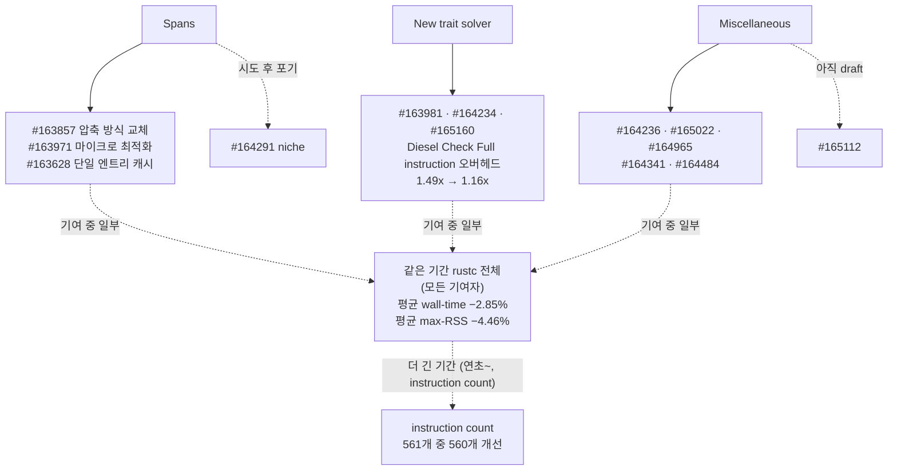

<figure class="post-figure post-figure--header">
<svg role="img" aria-label="rustc 대장간 장면. 위쪽에 lo, hi, ctx, parent 네 칸으로 된 16바이트 Span 덩어리가 있고, 대부분은 아래 모루 위의 절반 폭 8바이트 인라인 칸으로 망치에 눌려 담긴다. 남는 소수만 점선 화살표를 따라 오른쪽 아래 intern 테이블 창고로 보내진다." viewBox="0 0 400 350" width="460" xmlns="http://www.w3.org/2000/svg" font-family="Pretendard, sans-serif">
<title>rustc 대장간 — 16바이트 Span을 8바이트 인라인 칸으로 눌러 담고, 소수만 intern 테이블로</title>
<text x="200" y="24" text-anchor="middle" font-size="17" font-weight="700" fill="currentColor">Span 16바이트</text>
<g stroke="currentColor" stroke-width="2.5" fill="var(--gold-soft)">
<rect x="80" y="36" width="60" height="40"/><rect x="140" y="36" width="60" height="40"/><rect x="200" y="36" width="60" height="40"/><rect x="260" y="36" width="60" height="40"/>
</g>
<g font-size="16" text-anchor="middle" fill="currentColor">
<text x="110" y="61">lo</text><text x="170" y="61">hi</text><text x="230" y="61">ctx</text><text x="290" y="61">parent</text>
</g>
<g stroke="var(--secondary-color)" stroke-width="3" fill="none" stroke-linecap="round">
<line x1="200" y1="84" x2="200" y2="114"/><polyline points="191,105 200,115 209,105"/>
</g>
<text x="212" y="104" font-size="16" font-weight="700" fill="var(--secondary-color)">대부분</text>
<rect x="140" y="122" width="120" height="40" fill="var(--secondary-color)" fill-opacity="0.18" stroke="var(--secondary-color)" stroke-width="3"/>
<text x="200" y="148" text-anchor="middle" font-size="16" font-weight="700" fill="currentColor">8B 인라인</text>
<g stroke="currentColor" stroke-width="2.5" fill="var(--bg-panel)" stroke-linejoin="round">
<path d="M108 166 H292 V182 H236 V206 H270 V222 H130 V206 H164 V182 H108 Z"/>
</g>
<text x="200" y="217" text-anchor="middle" font-size="16" fill="currentColor">rustc</text>
<g transform="rotate(-28 92 128)">
<line x1="92" y1="128" x2="92" y2="208" stroke="currentColor" stroke-width="6" stroke-linecap="round"/>
<rect x="66" y="108" width="52" height="24" fill="currentColor"/>
</g>
<g stroke="var(--accent-color)" stroke-width="3" stroke-linecap="round">
<line x1="132" y1="118" x2="124" y2="108"/><line x1="134" y1="130" x2="122" y2="130"/><line x1="132" y1="142" x2="124" y2="152"/>
</g>
<path d="M322 66 C 370 90, 372 170, 336 238" fill="none" stroke="currentColor" stroke-width="2.5" stroke-dasharray="6 5"/>
<polyline points="330,228 336,240 346,231" fill="none" stroke="currentColor" stroke-width="2.5"/>
<text x="316" y="150" font-size="16" fill="currentColor">소수</text>
<line x1="20" y1="232" x2="250" y2="232" stroke="currentColor" stroke-width="2"/>
<g stroke="currentColor" stroke-width="2.5" fill="none">
<rect x="262" y="246" width="128" height="94"/>
<line x1="262" y1="272" x2="390" y2="272"/>
<line x1="262" y1="294" x2="390" y2="294" stroke-dasharray="4 4"/><line x1="262" y1="316" x2="390" y2="316" stroke-dasharray="4 4"/>
<line x1="292" y1="272" x2="292" y2="340"/>
</g>
<text x="326" y="265" text-anchor="middle" font-size="16" font-weight="700" fill="currentColor">intern 테이블</text>
<g font-size="16" fill="currentColor" text-anchor="middle"><text x="277" y="289">0</text><text x="277" y="311">1</text><text x="277" y="333">2</text></g>
<text x="20" y="262" font-size="16" fill="currentColor">8바이트 인라인 포맷 3종</text>
<text x="20" y="286" font-size="16" fill="currentColor">못 담는 것만 테이블에</text>
<text x="20" y="310" font-size="16" fill="currentColor">넣고 인덱스로 참조</text>
</svg>
<figcaption>rustc의 Span 압축 — 16바이트를 대부분 8바이트 인라인 칸에 눌러 담고, 못 담는 소수만 intern 테이블로 보낸다.</figcaption>
</figure>

## 원문 정보

> - **제목**: How to speed up the Rust compiler in November 2026
> - **출처**: Nicholas Nethercote ([nnethercote.github.io](https://nnethercote.github.io/))
> - **발행**: 2026-11-04 · 약 6분 분량 (단어 수 기준 필자 추정)
> - **원문 링크**: <https://nnethercote.github.io/2026/11/04/how-to-speed-up-the-rust-compiler-in-november-2026.html>

Rust 컴파일러(rustc) 성능 작업 보고를 이어 온 저자가 Hexcat에서 rustc 성능 작업을 시작한 첫 달을 PR 단위로 정리한 진행 보고서다. 이 위키의 Rust 학습 흐름에서 "언어 사용자"를 넘어 "컴파일러 내부"를 들여다보는 창으로 Articles에 담는다.

## 한 줄 요약 (TL;DR)

모든 AST·HIR·MIR 노드가 들고 다니는 `Span`의 압축 방식을 바꿔 incremental 빌드에서 intern되는 span을 20-40%에서 대개 약 1%로 줄였고, 새 trait solver의 Diesel Check Full 빌드 instruction count 오버헤드를 1.49x에서 1.16x로 낮추는 등 크고 작은 PR이 있었다. 같은 기간(2026-09-28~11-02) 여러 기여자의 변경을 모두 합친 rustc 전체로는(원문이 링크한 perf 비교가 두 커밋 사이의 전체 변경을 비교한다) 평균 wall-time 2.85%, 평균 max-RSS 4.46%가 줄었다.

## 왜 이 글을 골랐나

Rust 컴파일러 성능 작업을 `Span`이라는 가장 기초적인 자료구조에서부터 짚어 주는 글이라, 평소 "그냥 느리다"고만 느끼던 rustc의 내부를 구체적인 자료구조와 PR 번호로 들여다볼 수 있다. [Rust-Essential 커리큘럼](/2026/01/02/rust-essential-curriculum.html)에서 소유권·트레이트·`Option<T>`를 익힌 독자라면, 그 언어 기능들이 컴파일러 안에서는 어떤 비용으로 처리되는지(트레이트 해석 = trait solver, `Option`의 크기 = niche) 연결해 볼 좋은 기회다.

한 달의 작업은 세 갈래로 나뉘고, 마지막에 같은 기간 rustc 전체의 성능 변화(Overall progress)를 짚는다. 전체 수치는 이 글의 PR만이 아니라 같은 기간 모든 기여자의 변경을 합친 결과다.

## 핵심 내용

### Spans — 모든 노드가 들고 다니는 위치 정보

저자는 Span을 "Rust 컴파일러의 핵심 자료구조"로 소개한다. 모든 AST, HIR, MIR 노드가 span을 하나씩 들고 다니며, span은 네 개의 필드를 가진다.

- **`lo`, `hi`** — 소스 위치. crate의 소스 파일들을 하나의 버퍼로 이어 붙였을 때 그 버퍼 안의 인덱스다.
- **`context`** — 매크로 등에 쓰이는 hygiene·provenance 데이터 (없을 수도 있다).
- **`parent`** — 파일 맨 앞에 한 줄을 끼워 넣는 것 같은 작은 소스 위치 변화가 컴파일 시간에 주는 영향을 최소화하기 위한 추가 상대 위치 (없을 수도 있다).

각 필드가 32비트라 원래 16바이트지만, 대부분은 세 가지 8바이트 **인라인 포맷** 중 하나로 압축되고 나머지는 전역 테이블에 **intern**된다. 압축이 가능한 이유는 데이터의 패턴 덕분이다. 많은 span은 길이(`hi - lo`)가 짧고, `context`·`parent`가 0인 경우가 많으며, 0이 아닐 때도 대개 작은 정수이고, `parent`는 incremental 빌드에서만 쓰인다.

> **배경 설명 (필자 보충, 원문 주장 아님)**: *intern*은 값을 전역 테이블에 한 번만 저장하고 그 인덱스(작은 정수)로 대신 참조하는 기법이다. 인라인으로 담을 수 없는 span은 테이블 조회를 거쳐야 하므로, intern 비율이 높을수록 span을 읽고 쓰는 비용이 커진다. 또 AST(파싱 직후 구문 트리) → HIR(desugar된 고수준 IR) → MIR(borrow checking·최적화에 쓰이는 제어 흐름 기반 IR)로 이어지는 rustc의 IR 단계마다 노드가 span을 갖는 이유는, 컴파일 에러 메시지가 원래 소스의 정확한 위치를 가리켜야 하기 때문이다. 노드 수만큼 span이 존재하므로 span 크기와 접근 비용은 컴파일러 전반에 곱해진다.

<figure class="post-figure">
<svg role="img" aria-label="Span 구조 도해. 위: 32비트 필드 네 개 lo, hi, context, parent가 모여 16바이트. 가운데: 대부분은 절반 폭인 8바이트 인라인 포맷 세 종류 중 하나로 압축되고, 나머지는 전역 intern 테이블에 저장되어 인덱스로 참조된다. 아래: PR #163857 이후 intern 비율 막대 — incremental은 이전 20-40%에서 이후 대개 약 1%, non-incremental은 대개 0.1% 미만." viewBox="0 0 380 580" width="440" xmlns="http://www.w3.org/2000/svg" font-family="Pretendard, sans-serif">
<title>Span의 네 필드, 인라인 포맷과 intern 테이블, 그리고 intern 비율 변화</title>
<text x="190" y="22" text-anchor="middle" font-size="16" font-weight="700" fill="currentColor">Span = 32비트 필드 4개 = 16바이트</text>
<g stroke="currentColor" stroke-width="2.5" fill="var(--gold-soft)">
<rect x="30" y="34" width="80" height="40"/><rect x="110" y="34" width="80" height="40"/><rect x="190" y="34" width="80" height="40" stroke-dasharray="6 4"/><rect x="270" y="34" width="80" height="40" stroke-dasharray="6 4"/>
</g>
<g font-size="15" text-anchor="middle" fill="currentColor">
<text x="70" y="59">lo</text><text x="150" y="59">hi</text><text x="230" y="59">context</text><text x="310" y="59">parent</text>
<text x="110" y="96">소스 위치</text><text x="230" y="96">hygiene</text><text x="310" y="96">상대 위치</text>
</g>
<text x="190" y="118" text-anchor="middle" font-size="15" fill="currentColor" opacity="0.8">점선 칸 = 없을 수도 있음</text>
<g stroke="var(--secondary-color)" stroke-width="3" fill="none" stroke-linecap="round"><line x1="190" y1="126" x2="190" y2="146"/><polyline points="182,138 190,147 198,138"/></g>
<rect x="20" y="152" width="340" height="128" fill="none" stroke="var(--secondary-color)" stroke-width="2.5"/>
<text x="34" y="176" font-size="16" font-weight="700" fill="var(--secondary-color)">대부분 → 8바이트 인라인 포맷 3종</text>
<g stroke="var(--secondary-color)" stroke-width="2" fill="var(--secondary-color)" fill-opacity="0.15">
<rect x="30" y="188" width="160" height="24"/><rect x="30" y="218" width="160" height="24"/><rect x="30" y="248" width="160" height="24"/>
</g>
<g font-size="15" fill="currentColor"><text x="40" y="206">포맷 1</text><text x="40" y="236">포맷 2</text><text x="40" y="266">포맷 3</text>
<text x="202" y="218">16바이트의</text><text x="202" y="240">절반 크기</text></g>
<rect x="20" y="292" width="340" height="104" fill="none" stroke="currentColor" stroke-width="2.5" stroke-dasharray="7 5"/>
<text x="34" y="316" font-size="16" font-weight="700" fill="currentColor">나머지 → 전역 intern 테이블</text>
<rect x="34" y="334" width="76" height="40" fill="none" stroke="currentColor" stroke-width="2"/>
<text x="72" y="359" text-anchor="middle" font-size="15" fill="currentColor">인덱스</text>
<g stroke="currentColor" stroke-width="2.5" fill="none"><line x1="114" y1="354" x2="168" y2="354"/><polyline points="160,347 169,354 160,361"/></g>
<g stroke="currentColor" stroke-width="2" fill="var(--gold-soft)"><rect x="176" y="328" width="168" height="54"/></g>
<g stroke="currentColor" stroke-width="1.5"><line x1="176" y1="346" x2="344" y2="346"/><line x1="176" y1="364" x2="344" y2="364"/></g>
<text x="260" y="361" text-anchor="middle" font-size="15" fill="currentColor">16바이트 원본</text>
<text x="20" y="428" font-size="16" font-weight="700" fill="currentColor">intern 비율 (#163857 전후)</text>
<g font-size="15" fill="currentColor">
<text x="20" y="454">incremental · 이전 20-40%</text>
<text x="20" y="500">incremental · 이후 대개 약 1%</text>
<text x="20" y="546">non-incremental · 대개 0.1% 미만</text>
</g>
<rect x="20" y="462" width="160" height="16" fill="currentColor" opacity="0.55"/>
<rect x="180" y="462" width="160" height="16" fill="none" stroke="currentColor" stroke-width="2" stroke-dasharray="5 4"/>
<rect x="20" y="508" width="8" height="16" fill="var(--secondary-color)"/>
<rect x="20" y="554" width="2" height="16" fill="var(--secondary-color)"/>
<text x="346" y="476" font-size="15" fill="currentColor">40%</text>
</svg>
<figcaption>Span의 네 필드는 대부분 8바이트 인라인 포맷에 담기고 나머지만 intern된다. #163857 이후 incremental intern 비율은 20-40%에서 약 1%로 떨어졌다(막대 길이는 비율에 비례, 0-40% 축).</figcaption>
</figure>

이 위에서 진행된 PR들:

- **#163857 — 압축 방식 교체.** 기존 압축 방식을 더 단순하고 효율적인 방식으로 바꿨다. incremental 빌드에서 intern되는 span이 기존의 20-40%에서 대개 약 1%로 줄었다(non-incremental 빌드에서는 대개 0.1% 미만). 또 intern된 경우에도 `context` 필드는 항상 인라인으로 저장할 수 있게 됐는데, `context`만 따로 읽는 경우가 많아서 유용하다. 여러 벤치마크에서 instruction count가 줄었고 최선의 경우 3% 넘게 줄었으며, cycle count 개선은 그보다 더 컸다. intern이 줄어든 incremental 빌드가 가장 크게 개선됐다.
- **#163971 — 새 표현 위의 마이크로 최적화.** Josh Triplett이 새 표현을 활용해 여러 span 연산을 마이크로 최적화했다. 여러 벤치마크에서 instruction count가 줄었고, 최선의 경우 2% 넘게 줄었다.
- **#164291 — 시도했다가 포기한 niche.** pattern type을 이용해 `Span`에 niche를 줘서 `Option`이 `Span`과 같은 크기가 되게 했다. 동작은 했지만 `Option`을 많이 쓰지 않아 성능에 도움이 되지 않았고 코드만 복잡해져서 포기했다.
- **#163628 — 단일 엔트리 캐시.** 메타데이터 인코딩/디코딩과 stable hashing 중에는 같은 parent span의 정보를 해시 테이블에서 대개 반복해서 가져와야 한다. 그 해시 테이블 앞에 단일 엔트리 캐시를 둬서 대부분의 조회를 피했다. 많은 벤치마크에서 instruction count가 줄었고 최선의 경우 4% 넘게 줄었으며, 주로 incremental 컴파일이 이득을 봤다.

> **배경 설명 (필자 보충)**: *niche*는 타입이 절대 갖지 않는 비트 패턴을 말한다. 예컨대 `&T`는 null이 될 수 없으므로 `Option<&T>`는 null을 `None`으로 써서 추가 공간 없이 `&T`와 같은 크기가 된다. 일반 구조체인 `Span`에는 그런 "쓰지 않는 값"이 없으니, 아직 실험 단계인 pattern type으로 값의 범위를 제한해 niche를 만들려 한 시도로 읽힌다. *stable hashing*은 incremental 컴파일에서 이전 빌드와의 결과를 비교하기 위해 실행마다 달라지지 않는 해시(fingerprint)를 계산하는 과정이다. 같은 parent가 연달아 조회되는 접근 패턴이라면 "직전 결과 하나만 기억하는" 캐시로도 대부분의 해시 조회를 건너뛸 수 있다는 것이 #163628의 요지로 이해된다.

### New trait solver — Diesel에서의 오버헤드 줄이기

- **#163981, #164234, #165160** — 개발 중인 새 trait solver가 기존 solver보다 느린 crate인 [Diesel](https://github.com/diesel-rs/diesel)의 컴파일 시간에 집중했다. 세 PR에 걸쳐 열두 개 남짓의 마이크로 최적화를 했다. hot path에서의 early return, 할당 피하기, 일부 재계산 피하기, 일부 특수 케이스 최적화 등이다.
- 그 결과 **Check Full** 빌드에서 새 solver의 instruction count 오버헤드가 **1.49x에서 1.16x**로 줄었고, typenum·nalgebra 같은 다른 새 solver 벤치마크도 개선됐다. 저자는 "아직 할 일이 더 있지만 좋은 진전"이라고 정리한다.

> **배경 설명 (필자 보충)**: trait solver는 "이 타입이 이 트레이트를 구현하는가", "이 연관 타입은 무엇인가" 같은 질문에 답하는 rustc의 구성 요소로, 제네릭과 트레이트 바운드를 많이 쓰는 코드일수록 부담이 커진다. Diesel·typenum·nalgebra는 모두 타입 수준 계산과 트레이트 바운드를 대규모로 쓰는 crate라 solver 성능을 가늠하는 대표적인 시험대 역할을 한다. "Check Full"은 perf.rust-lang.org의 벤치마크 조합 이름으로, `cargo check`에 해당하는 프로필을 incremental 없이 처음부터(full) 빌드하는 시나리오다. 1.16x는 "Diesel의 Check Full 빌드에서 새 solver가 여전히 기존 solver보다 instruction을 16% 더 쓴다"는 뜻으로 읽어야 한다.

### Miscellaneous — 잡다하지만 쌓이는 PR들

- **#164236** — 코드를 재배치해 early return 케이스에서 불필요한 일을 피했다. 많은 벤치마크에서 instruction count가 줄었고 최선의 경우 4% 넘게 줄었다.
- **#165022** — `AttrTokenStream`과 `AttrTokenTree` 타입을 제거했다. 널리 쓰이는 `TokenStream`·`TokenTree`를 거울처럼 본뜬 타입인데 `cfg` 처리에만 쓰였다. 주목적은 코드 단순화였지만 일부 토큰 스트림 변환도 사라져, `deep-vector` 스트레스 테스트에서 4%, 일부 실제 사례에서 1% 미만 instruction count가 줄었다.
- **#164965** — `vec![1, 2, 3, 4]`처럼 타입 추론이 필요한 리터럴에서 원소마다 type variable을 하나씩 만들던 것을 피했다. 10만 개가 넘는 원소의 vec 리터럴을 담은 `deep-vector` 스트레스 테스트에서는 큰 이득(cycle count 8-12% 감소)이었지만 다른 벤치마크에는 도움이 되지 않았다. 저자는 "스트레스 테스트의 큰 이득이 실제 코드의 작은 이득으로 이어질 때도 있고 아닐 때도 있다"고 쓰며, 아주 단순한 변경이고 한 테스트의 에러 메시지도 개선했기 때문에 결국 머지했다고 밝힌다.
- **#164341** — coercion 처리의 early return에 케이스를 몇 가지 추가했다. 수많은 벤치마크에서 instruction count가 줄었고, 대부분 1% 미만이었다.
- **#165112 (draft)** — 컴파일러에는 `const N: usize = 0` 같은 trivial const에 대해 borrow checking을 포함한 패스 전체를 건너뛰는 기존 `trivial_consts` 메커니즘이 있다. 이 draft PR은 그 메커니즘을 확장해 이런 const의 MIR 빌드도 피한다. 최선의 경우(`libc`) instruction count가 최대 6% 줄지만, `trivial_consts`가 이미 까다롭고 다소 논쟁적인 메커니즘이라 앞으로의 방향은 불분명하다고 한다. 자세한 논의는 [Zulip 스레드](https://rust-lang.zulipchat.com/#narrow/channel/131828-t-compiler/topic/.60trivial_consts.60.20without.20MIR/with/636155146)에 있다.
- **#164484** — Takayuki Maeda가 메타데이터용 sparse 인코딩 메커니즘을 도입했다. instruction count는 약간 늘었지만 cycle count와 wall-time은 중립이었고, 더 중요하게는 메타데이터 크기를 최대 37%, max RSS(peak memory)를 최대 7% 줄였다.

> **배경 설명 (필자 보충)**: 여기서 메타데이터는 crate를 컴파일할 때 함께 만들어져, 그 crate를 의존하는 다른 crate가 타입·함수 시그니처 등을 읽어 가는 데이터(`.rmeta` 등)를 말한다. *type variable*은 타입 추론 중 "아직 정해지지 않은 타입"을 나타내는 자리표시자로, 원소마다 하나씩 만들면 원소 수에 비례해 추론 작업이 늘어난다. *coercion*은 `&mut T` → `&T`, `&[T; N]` → `&[T]`처럼 컴파일러가 암묵적으로 수행하는 타입 변환이다.

<figure class="post-figure">
<svg role="img" aria-label="Miscellaneous PR 6개를 위에서 아래로 쌓은 카드. #164236 early return 재배치: instruction count 최선 4% 넘게 감소. #165022 AttrToken 타입 제거: deep-vector instruction 4%, 실제 사례 1% 미만, 주목적은 단순화. #164965 vec 리터럴 type variable: deep-vector cycle count 8-12%, 스트레스 테스트에서만 효과. #164341 coercion early return: instruction 대부분 1% 미만. #165112 draft trivial const MIR 생략: libc instruction 최대 6%, 방향 불분명. #164484 sparse 메타데이터 인코딩: 메타데이터 크기 최대 37%, max RSS 최대 7% 감소, instruction 약간 증가, cycle과 wall-time 중립. 점선 카드는 단서가 붙은 PR." viewBox="0 0 380 714" width="440" xmlns="http://www.w3.org/2000/svg" font-family="Pretendard, sans-serif">
<title>Miscellaneous PR별로 무엇을 얼마나 줄였나</title>
<text x="190" y="26" text-anchor="middle" font-size="16" font-weight="700" fill="currentColor">Miscellaneous — 무엇을 줄였나</text>
<rect x="10" y="44" width="360" height="89" fill="var(--bg-panel)" stroke="currentColor" stroke-width="2"/>
<rect x="10" y="44" width="6" height="89" fill="var(--secondary-color)"/>
<text x="26" y="68" font-size="16" font-weight="700" fill="currentColor">#164236 · early return 재배치</text>
<text x="26" y="91" font-size="15" font-weight="700" fill="var(--secondary-color)">instruction count: 최선 4%+ 감소</text>
<text x="26" y="114" font-size="15" fill="currentColor" opacity="0.85">많은 벤치마크에서 개선</text>
<rect x="10" y="143" width="360" height="89" fill="var(--bg-panel)" stroke="currentColor" stroke-width="2"/>
<rect x="10" y="143" width="6" height="89" fill="var(--secondary-color)"/>
<text x="26" y="167" font-size="16" font-weight="700" fill="currentColor">#165022 · AttrToken* 타입 제거</text>
<text x="26" y="190" font-size="15" font-weight="700" fill="var(--secondary-color)">instruction count: deep-vector 4%</text>
<text x="26" y="213" font-size="15" fill="currentColor" opacity="0.85">실제 사례는 1% 미만 · 주목적은 단순화</text>
<rect x="10" y="242" width="360" height="89" fill="var(--bg-panel)" stroke="currentColor" stroke-width="2" stroke-dasharray="7 5"/>
<rect x="10" y="242" width="6" height="89" fill="var(--secondary-color)"/>
<text x="26" y="266" font-size="16" font-weight="700" fill="currentColor">#164965 · vec! 리터럴 type variable</text>
<text x="26" y="289" font-size="15" font-weight="700" fill="var(--secondary-color)">cycle count: deep-vector 8-12%</text>
<text x="26" y="312" font-size="15" fill="currentColor" opacity="0.85">스트레스 테스트에서만 효과</text>
<rect x="10" y="341" width="360" height="89" fill="var(--bg-panel)" stroke="currentColor" stroke-width="2"/>
<rect x="10" y="341" width="6" height="89" fill="var(--secondary-color)"/>
<text x="26" y="365" font-size="16" font-weight="700" fill="currentColor">#164341 · coercion early return</text>
<text x="26" y="388" font-size="15" font-weight="700" fill="var(--secondary-color)">instruction count: 대부분 1% 미만</text>
<text x="26" y="411" font-size="15" fill="currentColor" opacity="0.85">수많은 벤치마크에 걸쳐</text>
<rect x="10" y="440" width="360" height="89" fill="var(--bg-panel)" stroke="currentColor" stroke-width="2" stroke-dasharray="7 5"/>
<rect x="10" y="440" width="6" height="89" fill="var(--secondary-color)"/>
<text x="26" y="464" font-size="16" font-weight="700" fill="currentColor">#165112 · trivial const MIR 생략</text>
<text x="26" y="487" font-size="15" font-weight="700" fill="var(--secondary-color)">instruction count: libc 최대 6%</text>
<text x="26" y="510" font-size="15" fill="currentColor" opacity="0.85">draft — 앞으로의 방향 불분명</text>
<rect x="10" y="539" width="360" height="135" fill="var(--bg-panel)" stroke="currentColor" stroke-width="2"/>
<rect x="10" y="539" width="6" height="135" fill="var(--secondary-color)"/>
<text x="26" y="563" font-size="16" font-weight="700" fill="currentColor">#164484 · sparse 메타데이터 인코딩</text>
<text x="26" y="586" font-size="15" font-weight="700" fill="var(--secondary-color)">메타데이터 크기: 최대 37% 감소</text>
<text x="26" y="609" font-size="15" font-weight="700" fill="var(--secondary-color)">max RSS: 최대 7% 감소</text>
<text x="26" y="632" font-size="15" fill="currentColor" opacity="0.85">instruction 약간 증가</text>
<text x="26" y="655" font-size="15" fill="currentColor" opacity="0.85">cycle·wall-time은 중립</text>
<text x="190" y="702" text-anchor="middle" font-size="15" fill="currentColor" opacity="0.85">점선 카드 = 단서가 붙은 PR</text>
</svg>
<figcaption>Miscellaneous PR 6개가 줄인 지표와 최선의 수치(원문 기준). 점선 카드는 스트레스 테스트에서만 효과가 있었거나 아직 draft인 경우다.</figcaption>
</figure>

### Hexcatconf

10월에 저자는 Delft로 가서 Hexcat, RustNL 등에서 온 스무 명 남짓이 모인 작은 밋업 [Hexcatconf](https://hexcat.nl/conf2026/)에 참석했다. 긴 여정이었지만 그만한 가치가 있었다며, 행사를 조직한 Mara Bos에게 감사를 전한다.

### Overall progress — "sea of green"

아래 수치는 저자의 PR만이 아니라 같은 기간 rustc에 들어간 모든 기여자의 변경을 합친 결과다.

- **2026-09-28 ~ 2026-11-02, "relevant" 임계값을 넘는 wall-time 측정**: 45개 벤치마크에 걸친 236개 테스트에서 개선(그중 여럿은 두 자릿수 퍼센트), 3개 벤치마크에 걸친 4개 테스트에서만 회귀. 저자의 표현으로 "a sea of green"이다.
- **"non-relevant" 결과(분산 임계값 미만)까지 포함하면**: 599개 개선 대 90개 회귀로 조금 더 섞여 있는데, 한 달이라는 비교적 짧은 기간이라 예상할 만하다고 한다. 전체적으로 평균 wall-time은 **2.85%**, 평균 max-RSS(peak memory)는 **4.46%** 줄었다.
- **연초 대비 instruction count 변화**: 561개 측정 중 560개가 개선, 회귀는 단 하나이며, 두 번째로 나쁜 개선이 3.10%다. 이 관찰은 Matyáš Racek에게서 나왔고, 그가 몇 주 전 이를 언급했을 때는 모든 결과가 초록색이었다고 한다.

저자는 언어와 툴체인에 새 기능이 계속 추가되는 와중에도 컴파일러가 꾸준히 빨라지는 것을 보는 것이 멋진 일이라며, 기여한 많은 사람들을 칭찬하고 "계속 가자(Let's keep going!)"로 글을 맺는다.

## 분석과 인사이트

이하 내용은 원문 요약이 아니라 필자의 해석이다.

### 1. 가장 흔한 자료구조가 가장 큰 레버다

이번 달의 가장 큰 주제가 `Span`이라는 점이 상징적이다. Span 핸들 하나는 (intern된 경우에도 인덱스로) 고작 8바이트지만, 모든 IR 노드에 붙어 있으므로 "span 하나를 다루는 비용 × 노드 수"가 곧 컴파일러 전반의 비용이 된다. #163857이 한 일은 알고리즘을 바꾼 게 아니라 **데이터 분포를 다시 관찰해 표현을 바꾼 것**이다. 길이가 짧다, context·parent가 0이거나 작다, parent는 incremental에서만 쓴다 — 이런 관찰이 intern 비율을 20-40%에서 약 1%로 줄였다. 그리고 "context만 따로 읽는 경우가 많다"는 **접근 패턴**까지 표현 설계에 반영했다. 압축 포맷을 설계할 때 "얼마나 작게"보다 "어떤 경우를 빠른 경로로 남길지"가 중요하다는 좋은 사례로 보인다.

### 2. 실패한 실험과 스트레스 테스트를 그대로 보고하는 태도

#164291(niche)은 "동작했지만 이득이 없어서 포기"했고, #164965는 "스트레스 테스트에서만 효과"였다. 성능 작업 보고서가 성공한 PR만 나열하지 않고 이런 사례를 함께 적는 것이 이 연재의 가치라고 생각한다. 특히 #164965를 머지한 이유가 성능이 아니라 "단순함 + 에러 메시지 개선"이었다는 점은, 성능 PR의 수용 기준이 숫자 하나가 아니라 **코드 복잡도와의 교환**이라는 것을 보여 준다. 반대로 #164291은 성능 이득 없이 코드만 복잡해졌기 때문에 버려졌다. 같은 기준이 양쪽으로 작동한 셈이다.

### 3. 지표를 구분해서 읽어야 한다

글에는 instruction count, cycle count, wall-time, max RSS가 섞여 나온다. #163857은 "cycle 개선이 instruction 개선보다 컸다"고 하고, #164484는 "instruction은 약간 늘었지만 cycle·wall-time은 중립, 메모리는 크게 감소"였다. instruction count는 노이즈가 적어 회귀 탐지에 좋지만 실제 체감 시간(wall-time)이나 캐시 효과까지 반영하지는 않는다. 이 위키에서 다룬 [메모리 레이턴시 글](/2026/11/01/its-the-memory-latency-stupid.html)이 "명령어를 더 쓰고도 더 빨라지는" 경우를 보여 줬듯이, Span 압축처럼 메모리 접근을 줄이는 변경에서 cycle 개선이 더 크게 나오는 것도 같은 맥락으로 이해할 수 있다(필자 추론). 하나의 PR이 어떤 지표를 개선하고 어떤 지표를 희생하는지 따로 보는 습관이 필요하다.

### 4. "relevant"와 "non-relevant"를 나눠 말하는 정직함

Overall progress 절은 relevant 결과(236 개선 vs 4 회귀)만 보여 주고 끝내지 않고, 분산 임계값 미만까지 넣으면 599 대 90으로 "조금 더 섞여 있다"고 덧붙인다. 벤치마크 결과를 보고할 때 노이즈 임계값을 어떻게 다뤘는지 밝히는 것이 신뢰의 근거가 된다. 연초 대비 561개 중 560개 개선이라는 수치도 단일 PR이 아니라 많은 기여자의 누적 결과라는 점을 저자가 명시한다.

### 5. 새 trait solver는 "정확성 다음 성능"의 단계

새 solver의 오버헤드가 1.49x → 1.16x로 줄었다는 것은 큰 진전이지만, Diesel의 Check Full 빌드 instruction count 기준으로 여전히 16%가 남아 있다. 트레이트를 많이 쓰는 crate의 사용자 입장에서는 새 solver가 기본값이 되는 시점에 컴파일 시간이 어떻게 될지가 관심사일 텐데, 원문은 "아직 할 일이 더 있다"고만 말하고 일정은 언급하지 않는다. 따라서 이 수치를 "곧 새 solver가 기존만큼 빨라진다"로 확대 해석해서는 안 된다.

## 적용 포인트

- **가장 많이 생성되는 값의 표현부터 의심하라.** 자기 시스템에서 노드·이벤트·행마다 붙는 메타데이터(위치, ID, 타임스탬프)의 실제 분포를 측정해 보면, Span처럼 "대부분은 작은 인라인 포맷 + 드문 경우만 테이블"로 압축할 여지가 보일 수 있다.
- **해시 테이블 앞의 단일 엔트리 캐시를 고려하라.** 같은 키를 연달아 조회하는 접근 패턴이라면 #163628처럼 "직전 결과 하나"만 기억해도 대부분의 조회를 건너뛸 수 있다. 먼저 접근 패턴이 정말 반복적인지 측정하는 것이 전제다.
- **성능 PR에는 지표를 명시하라.** instruction / cycle / wall-time / peak memory 중 무엇이 얼마나 바뀌었는지, 그리고 어떤 벤치마크(스트레스 테스트인지 실제 코드인지)에서인지 분리해 적는다.
- **스트레스 테스트의 큰 숫자를 경계하라.** `deep-vector`의 8-12%가 실제 코드에서는 이득이 없었던 것처럼, 합성 벤치마크와 실사용 벤치마크를 함께 보고 판단한다.
- **실패한 최적화도 기록하라.** "동작하지만 이득이 없고 복잡도만 늘었다"는 결론은 다음 사람이 같은 시도를 반복하지 않게 해 주는 자산이다.
- **Rust 사용자라면 perf.rust-lang.org를 한번 둘러보자.** 원문이 링크한 비교 화면처럼, rustc의 성능 변화는 공개 대시보드로 추적된다. 트레이트·제네릭이 많은 프로젝트라면 새 trait solver 관련 진행도 지켜볼 만하다.

## 마무리

이 글은 한 달치 PR 목록이지만, 읽고 나면 rustc가 무엇을 비용으로 치르고 있는지에 대한 감각이 남는다. 모든 노드에 붙은 `Span`, 트레이트를 풀어내는 solver, 원소마다 생기던 type variable, crate 사이를 오가는 메타데이터 같은 것들이다. 그리고 큰 개선은 영리한 한 방이 아니라 데이터 분포 관찰, 측정 지표 구분, 실패의 기록, 많은 기여자의 누적에서 나온다는 점을 보여 준다. 연초 대비 561개 중 560개 개선이라는 숫자는 그 누적의 결과다.

### 더 읽어보기

- [원문 — How to speed up the Rust compiler in November 2026](https://nnethercote.github.io/2026/11/04/how-to-speed-up-the-rust-compiler-in-november-2026.html) — Nicholas Nethercote의 2026년 11월 rustc 성능 작업 보고
- [저자의 직전 글 — How to speed up the Rust compiler in September 2026](https://nnethercote.github.io/2026/09/30/how-to-speed-up-the-rust-compiler-in-september-2026.html) — 원문이 "last post"로 링크한 이전 보고
- [perf.rust-lang.org — 2026-09-28 ~ 2026-11-02 wall-time 비교](https://perf.rust-lang.org/compare.html?start=c1070d69382b8d2f2eb65119c738a77d9e324c9e&stat=wall-time&tab=compile&end=ae36fe22c7e590df40ffd53ac25fea35597c3f3d) — 원문 Overall progress가 인용한 비교 화면
- [rust-lang/rust #163857](https://github.com/rust-lang/rust/pull/163857) — Span 압축 방식을 교체한 PR
- [stable Rust는 무엇을 딛고 서 있나 — rustc가 먼저 쓰는 nightly 기능 83개](/2026/10/29/what-stable-rust-stands-on.html) — rustc 내부를 다른 각도(사용하는 nightly 기능)에서 본 글
- [문제는 메모리 레이턴시야 — radix partitioning](/2026/11/01/its-the-memory-latency-stupid.html) — instruction 수와 실제 시간이 어긋나는 이유, 메모리 접근 비용
- [Rust 구조체, 열거형, 패턴 매칭](/2026/01/06/rust-structs-enums-pattern-matching.html) — `Option<T>` 기초 (niche 논의의 전제)
- [Rust 제네릭, 트레이트, 라이프타임](/2026/01/08/rust-generics-traits-lifetimes.html) — trait solver가 풀어내는 트레이트 바운드의 기초
- [Rust 디버깅과 프로파일링](/2026/01/10/rust-debugging-and-profiling.html) — 측정 도구로 성능을 보는 법
- [Rust-Essential 커리큘럼](/2026/01/02/rust-essential-curriculum.html) — Rust 학습 로드맵
