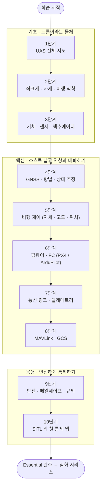

<figure class="post-figure post-figure--header">
<svg role="img" aria-label="드론 통제 사슬. 위에서부터 통제 앱(GCS, 8·10단계)이 MAVLink로 명령을 내려보내고 상태를 돌려받는다. 그 아래 무선 링크(텔레메트리·RC·영상, 7·9단계)는 끊길 수 있다. 기체 안에서는 FC 펌웨어(PX4·ArduPilot·비행 모드, 6단계)가 제어 루프(캐스케이드 P/PID, 5단계)에 목표값을 넣고, 상태 추정(GNSS·IMU, 2·4단계)이 제어 루프에 현재 상태를 공급한다. 제어 루프는 쿼드콥터의 모터 네 개에 명령을 보내고 센서 값은 상태 추정으로 올라간다(3단계). 맨 아래에는 기초 1~3, 핵심 4~8, 응용 9~10으로 나뉜 10단계 도장 줄이 있다." viewBox="0 0 320 620" width="360" xmlns="http://www.w3.org/2000/svg">
  <title>드론 통제 사슬 — 통제 앱에서 MAVLink·무선 링크·FC 펌웨어·제어 루프를 거쳐 모터까지, 그리고 10단계 지도</title>
  <defs>
    <marker id="dc-hdr-arrow" viewBox="0 0 10 10" refX="9" refY="5" markerWidth="6" markerHeight="6" orient="auto-start-reverse">
      <path d="M0,0 L10,5 L0,10 z" fill="currentColor"/>
    </marker>
    <marker id="dc-hdr-arrow-acc" viewBox="0 0 10 10" refX="9" refY="5" markerWidth="6" markerHeight="6" orient="auto-start-reverse">
      <path d="M0,0 L10,5 L0,10 z" fill="var(--accent-color)"/>
    </marker>
  </defs>
  <text x="160" y="22" text-anchor="middle" font-size="14" font-weight="700" fill="currentColor">드론 통제 사슬 — 앱에서 모터까지</text>
  <!-- GCS / control app -->
  <rect x="12" y="40" width="296" height="50" rx="4" fill="var(--bg-light)" stroke="currentColor" stroke-width="2"/>
  <text x="160" y="62" text-anchor="middle" font-size="14" font-weight="700" fill="currentColor">통제 앱 · GCS</text>
  <text x="160" y="80" text-anchor="middle" font-size="12" fill="currentColor">지도 · 미션 · 텔레메트리 · RTL</text>
  <rect x="262" y="31" width="42" height="18" rx="3" fill="var(--bg-panel)" stroke="var(--gold)" stroke-width="1.6"/>
  <text x="283" y="44" text-anchor="middle" font-size="12" font-weight="700" fill="currentColor">8·10</text>
  <!-- MAVLink: command down, state up -->
  <line x1="126" y1="92" x2="126" y2="122" stroke="currentColor" stroke-width="2" marker-end="url(#dc-hdr-arrow)"/>
  <line x1="194" y1="122" x2="194" y2="92" stroke="currentColor" stroke-width="2" marker-end="url(#dc-hdr-arrow)"/>
  <text x="116" y="112" text-anchor="end" font-size="12" fill="currentColor">명령</text>
  <text x="160" y="112" text-anchor="middle" font-size="12" font-weight="700" fill="var(--accent-color)">MAVLink</text>
  <text x="204" y="112" text-anchor="start" font-size="12" fill="currentColor">상태</text>
  <!-- radio link (can break) -->
  <rect x="12" y="126" width="296" height="48" rx="4" fill="var(--bg-light)" stroke="var(--accent-color)" stroke-width="2" stroke-dasharray="7 4"/>
  <text x="160" y="147" text-anchor="middle" font-size="14" font-weight="700" fill="currentColor">무선 링크</text>
  <text x="160" y="165" text-anchor="middle" font-size="12" fill="currentColor">텔레메트리 · RC · 영상 — 끊길 수 있다</text>
  <rect x="262" y="117" width="42" height="18" rx="3" fill="var(--bg-panel)" stroke="var(--gold)" stroke-width="1.6"/>
  <text x="283" y="130" text-anchor="middle" font-size="12" font-weight="700" fill="currentColor">7·9</text>
  <line x1="126" y1="176" x2="126" y2="234" stroke="currentColor" stroke-width="2" marker-end="url(#dc-hdr-arrow)"/>
  <line x1="194" y1="234" x2="194" y2="176" stroke="currentColor" stroke-width="2" marker-end="url(#dc-hdr-arrow)"/>
  <!-- the air vehicle -->
  <rect x="6" y="210" width="308" height="306" rx="8" fill="none" stroke="currentColor" stroke-width="1.5" stroke-dasharray="3 4" opacity="0.6"/>
  <text x="16" y="227" font-size="12" fill="var(--text-light)">기체 안</text>
  <!-- FC firmware -->
  <rect x="18" y="238" width="284" height="46" rx="4" fill="var(--bg-light)" stroke="currentColor" stroke-width="2"/>
  <text x="160" y="258" text-anchor="middle" font-size="14" font-weight="700" fill="currentColor">FC 펌웨어</text>
  <text x="160" y="276" text-anchor="middle" font-size="12" fill="currentColor">PX4 · ArduPilot · 비행 모드</text>
  <rect x="270" y="229" width="28" height="18" rx="3" fill="var(--bg-panel)" stroke="var(--gold)" stroke-width="1.6"/>
  <text x="284" y="242" text-anchor="middle" font-size="12" font-weight="700" fill="currentColor">6</text>
  <line x1="96" y1="286" x2="96" y2="312" stroke="var(--secondary-color)" stroke-width="2" marker-end="url(#dc-hdr-arrow)"/>
  <text x="104" y="303" font-size="12" fill="currentColor">setpoint</text>
  <!-- control loop -->
  <rect x="18" y="314" width="156" height="56" rx="4" fill="var(--bg-light)" stroke="var(--secondary-color)" stroke-width="2"/>
  <text x="96" y="338" text-anchor="middle" font-size="14" font-weight="700" fill="currentColor">제어 루프</text>
  <text x="96" y="357" text-anchor="middle" font-size="12" fill="currentColor">캐스케이드 P/PID</text>
  <rect x="142" y="305" width="28" height="18" rx="3" fill="var(--bg-panel)" stroke="var(--gold)" stroke-width="1.6"/>
  <text x="156" y="318" text-anchor="middle" font-size="12" font-weight="700" fill="currentColor">5</text>
  <!-- state estimation -->
  <rect x="196" y="314" width="106" height="56" rx="4" fill="var(--bg-light)" stroke="var(--secondary-color)" stroke-width="2"/>
  <text x="249" y="338" text-anchor="middle" font-size="14" font-weight="700" fill="currentColor">상태 추정</text>
  <text x="249" y="357" text-anchor="middle" font-size="12" fill="currentColor">GNSS · IMU</text>
  <rect x="262" y="305" width="36" height="18" rx="3" fill="var(--bg-panel)" stroke="var(--gold)" stroke-width="1.6"/>
  <text x="280" y="318" text-anchor="middle" font-size="12" font-weight="700" fill="currentColor">2·4</text>
  <line x1="196" y1="342" x2="178" y2="342" stroke="var(--secondary-color)" stroke-width="2" marker-end="url(#dc-hdr-arrow)"/>
  <!-- control loop to motors, sensors to estimation -->
  <line x1="96" y1="372" x2="104" y2="416" stroke="var(--accent-color)" stroke-width="2" marker-end="url(#dc-hdr-arrow-acc)"/>
  <text x="90" y="398" text-anchor="end" font-size="12" fill="currentColor">모터 명령</text>
  <line x1="216" y1="418" x2="236" y2="374" stroke="var(--secondary-color)" stroke-width="2" marker-end="url(#dc-hdr-arrow)"/>
  <text x="236" y="404" font-size="12" fill="currentColor">센서 값</text>
  <!-- quadcopter -->
  <g stroke="currentColor" stroke-width="3" stroke-linecap="round">
    <line x1="160" y1="452" x2="104" y2="428"/>
    <line x1="160" y1="452" x2="216" y2="428"/>
    <line x1="160" y1="452" x2="104" y2="476"/>
    <line x1="160" y1="452" x2="216" y2="476"/>
  </g>
  <g fill="var(--gold-soft)" stroke="currentColor" stroke-width="1.5">
    <ellipse cx="104" cy="424" rx="28" ry="6"/>
    <ellipse cx="216" cy="424" rx="28" ry="6"/>
    <ellipse cx="104" cy="472" rx="28" ry="6"/>
    <ellipse cx="216" cy="472" rx="28" ry="6"/>
  </g>
  <g fill="currentColor">
    <circle cx="104" cy="428" r="4"/>
    <circle cx="216" cy="428" r="4"/>
    <circle cx="104" cy="476" r="4"/>
    <circle cx="216" cy="476" r="4"/>
  </g>
  <rect x="142" y="442" width="36" height="20" rx="4" fill="var(--bg-light)" stroke="currentColor" stroke-width="2"/>
  <text x="160" y="457" text-anchor="middle" font-size="12" font-weight="700" fill="currentColor">FC</text>
  <text x="150" y="504" text-anchor="middle" font-size="12" fill="currentColor">모터 ×4 · 센서 · 배터리</text>
  <rect x="236" y="491" width="28" height="18" rx="3" fill="var(--bg-panel)" stroke="var(--gold)" stroke-width="1.6"/>
  <text x="250" y="504" text-anchor="middle" font-size="12" font-weight="700" fill="currentColor">3</text>
  <!-- 10-stage stamp row -->
  <g stroke-width="2" fill="var(--bg-light)">
    <rect x="24" y="536" width="22" height="22" rx="2" stroke="currentColor"/>
    <rect x="50" y="536" width="22" height="22" rx="2" stroke="currentColor"/>
    <rect x="76" y="536" width="22" height="22" rx="2" stroke="currentColor"/>
    <rect x="110" y="536" width="22" height="22" rx="2" stroke="var(--secondary-color)"/>
    <rect x="136" y="536" width="22" height="22" rx="2" stroke="var(--secondary-color)"/>
    <rect x="162" y="536" width="22" height="22" rx="2" stroke="var(--secondary-color)"/>
    <rect x="188" y="536" width="22" height="22" rx="2" stroke="var(--secondary-color)"/>
    <rect x="214" y="536" width="22" height="22" rx="2" stroke="var(--secondary-color)"/>
    <rect x="248" y="536" width="22" height="22" rx="2" stroke="var(--accent-color)"/>
    <rect x="274" y="536" width="22" height="22" rx="2" stroke="var(--accent-color)"/>
  </g>
  <g font-size="12" font-weight="700" fill="currentColor" text-anchor="middle">
    <text x="35" y="552">1</text>
    <text x="61" y="552">2</text>
    <text x="87" y="552">3</text>
    <text x="121" y="552">4</text>
    <text x="147" y="552">5</text>
    <text x="173" y="552">6</text>
    <text x="199" y="552">7</text>
    <text x="225" y="552">8</text>
    <text x="259" y="552">9</text>
    <text x="285" y="552">10</text>
  </g>
  <g stroke-width="2" fill="none">
    <polyline points="24,566 24,570 98,570 98,566" stroke="currentColor"/>
    <polyline points="110,566 110,570 236,570 236,566" stroke="var(--secondary-color)"/>
    <polyline points="248,566 248,570 296,570 296,566" stroke="var(--accent-color)"/>
  </g>
  <g font-size="12" font-weight="700" fill="currentColor" text-anchor="middle">
    <text x="61" y="587">기초</text>
    <text x="173" y="587">핵심</text>
    <text x="272" y="587">응용</text>
  </g>
  <text x="160" y="610" text-anchor="middle" font-size="12" fill="var(--text-light)">탭 숫자 = 단계 · 1단계는 이 사슬 전체의 지도</text>
</svg>
<figcaption>통제 앱의 명령은 MAVLink와 무선 링크를 건너 FC 펌웨어 → 제어 루프 → 모터로 내려가고, 상태 추정이 그 루프를 받친다. 각 고리의 탭 숫자가 그 고리를 다루는 단계다.</figcaption>
</figure>

## 소개

최종 목표는 **드론 통제 애플리케이션**을 만드는 것입니다. 지도 위에서 기체를 고르고, 미션을 올리고, 텔레메트리를 보며, 문제가 생기면 귀환(RTL)을 명령하는 앱입니다. 그런데 이 앱이 실제로 하는 일은 대부분 **화면 밖**에서 벌어집니다. 버튼 하나가 MAVLink 메시지가 되어 무선 링크를 건너고, 비행 컨트롤러(FC)의 펌웨어가 그 명령을 해석해 위치·속도·자세 제어 루프에 목표값을 넣고, 그 루프는 GNSS와 IMU를 융합한 상태 추정값을 믿고 모터 네 개의 회전수를 조절합니다.

앱 개발자가 이 사슬을 모두 구현할 필요는 없습니다. 하지만 **사슬의 각 고리가 무엇을 보장하고 언제 실패하는지**는 알아야 합니다. GPS가 흔들릴 때 기체가 왜 표류하는지, 링크가 끊기면 펌웨어가 무엇을 하는지, `COMMAND_ACK`가 오지 않으면 앱은 어떻게 행동해야 하는지 — 이것을 모르면 통제 앱은 "보기 좋은 원격 조종기"에 그칩니다.

이 커리큘럼은 `Drone-Control-Essential` 시리즈의 마스터 로드맵입니다. 목적은 **전체 지도를 잡고 기초·핵심을 덮는 것**이며, 특정 스택의 앱 구현이나 고급 제어·자율비행처럼 깊이 파야 하는 주제는 이후 **심화 시리즈 후보**로만 남겨 둡니다(말미 참고). 각 항목을 정복할 때마다 체크박스를 채우는 **도장깨기** 방식으로 진행합니다.

> **선수 지식:** 고등학교 수준의 벡터·삼각함수, 기초 미분 개념, 그리고 한 가지 이상의 프로그래밍 언어. 통신 단계는 [Network Essential](/2026/07/29/network-essential-curriculum.html)의 UDP·소켓 지식을, 통제 앱 단계는 [Concurrency Essential](/2026/08/24/concurrency-essential-curriculum.html)의 비동기·이벤트 루프 지식을 재사용합니다.

## 학습 흐름

10단계는 **기초 → 핵심 → 응용** 세 구간으로 나뉩니다. 기초(1~3단계)는 "드론이라는 물체"를 이해하는 구간, 핵심(4~8단계)은 "드론이 스스로 날고 지상과 대화하는 원리"를 이해하는 구간, 응용(9~10단계)은 "안전하게 통제하는 앱"으로 엮는 구간입니다.

## 단계 설계 한눈에

| 구간 | 단계 | 학습 목표 | 핵심 개념 | 추천 자료 후보 |
| --- | --- | --- | --- | --- |
| 기초 | 1. UAS 전체 지도 | 드론 시스템의 구성 요소와 통제 앱의 자리를 설명한다 | UAS = 기체 + FC + 데이터링크 + GCS + 운용자, 기체 분류, 오픈소스 생태계 | PX4 User Guide 개요, ArduPilot 문서 "Introduction", Dronecode |
| 기초 | 2. 좌표계·자세·비행 역학 | 기체의 위치·자세를 수식으로 표현하고 멀티콥터가 움직이는 원리를 설명한다 | NED/ENU, body frame, 오일러각·쿼터니언·회전행렬, 6-DOF, 추력·토크, 믹서 | Beard & McLain *Small Unmanned Aircraft*, Quan Quan *Introduction to Multicopter Design and Control* |
| 기초 | 3. 기체·센서·액추에이터 | 하드웨어 구성품의 역할과 한계를 이해하고 비행시간을 추정한다 | 프레임, BLDC·KV, ESC(PWM/DShot), 프로펠러, LiPo·C-rate, IMU·자력계·기압계·거리센서, 진동 | PX4 "Assembly"·"Sensor Hardware", ArduPilot "Choosing a Flight Controller", eCalc 류 계산기 |
| 핵심 | 4. GNSS·항법·상태 추정 | GPS가 위치를 정하는 원리와 오차, 센서 융합으로 상태를 추정하는 구조를 설명한다 | 의사거리·삼변측량, GNSS 성좌, DOP, RTK, WGS84↔ECEF↔로컬 NED, 상보 필터, EKF(EKF2/EKF3) | Misra & Enge *GPS: Signals, Measurements, and Performance*, kalmanfilter.net, PX4 EKF2 / ArduPilot EKF3 문서 |
| 핵심 | 5. 비행 제어 | 캐스케이드 P/PID 구조를 그리고 비행 모드가 어느 루프에 목표값을 넣는지 설명한다 | 피드백·PID, 위치→속도→자세→각속도 캐스케이드, 고도 제어, 튜닝, 비행 모드 | Åström & Murray *Feedback Systems*(무료), MATLAB Tech Talks 드론 제어 시리즈, PX4 "Controller Diagrams" |
| 핵심 | 6. 펌웨어·FC | PX4·ArduPilot의 내부 구조를 비교하고 파라미터·로그·업데이트 흐름을 다룬다 | Pixhawk FMU 표준, MCU·RTOS(NuttX/ChibiOS), uORB, HAL, 파라미터, 컴패니언 컴퓨터, BSD vs GPLv3 | PX4 Developer Guide "Architecture", ArduPilot Dev "Code Overview", Pixhawk 표준 문서 |
| 핵심 | 7. 통신 링크·텔레메트리 | RC·텔레메트리·영상 링크를 구분하고 링크 버짓·지연·손실을 따진다 | RC 무선 링크(ELRS·Crossfire)와 수신기→FC 프로토콜(CRSF·SBUS·PPM), SiK 텔레메트리, Wi-Fi·LTE, 링크 버짓·dBm, 지연, 링크 손실 | ArduPilot "Telemetry Radios", ExpressLRS 문서, [Network Essential](/2026/07/29/network-essential-curriculum.html) |
| 핵심 | 8. MAVLink·GCS | MAVLink 메시지를 읽고 써서 기체 상태를 받고 명령을 보낸다 | MAVLink v2 프레임, sysid/compid, HEARTBEAT, COMMAND_LONG/ACK, 미션·파라미터 마이크로서비스, 서명, QGC·Mission Planner | mavlink.io, pymavlink, MAVSDK 문서, QGroundControl User Guide |
| 응용 | 9. 안전·페일세이프·규제 | 실패 시나리오와 펌웨어의 대응, 국내 비행 규칙을 정리한다 | arming check, RC/GCS/배터리/지오펜스 페일세이프, 프리플라이트 체크, 조종자 증명·기체 신고·비행 승인, 전파 규제 | PX4/ArduPilot "Safety"·"Failsafe", 항공안전법, 드론 원스톱 민원서비스 |
| 응용 | 10. SITL 위 첫 통제 앱 | 실기체 없이 시뮬레이터에서 연결→이륙→미션→RTL을 수행하는 최소 통제 앱을 만든다 | SITL·HITL, Gazebo, MAVProxy, ULog/DataFlash 로그, MAVSDK 미션·텔레메트리 API, 앱 상태 머신 | PX4 "Simulation", ArduPilot "SITL", MAVSDK Examples, PX4 Flight Review |

## 학습 진행 현황

> 완료한 항목에는 상세 포스트 링크가 연결됩니다. 학습이 진행될 때마다 체크박스와 진행률을 갱신합니다.

- 현재 완료한 항목: **21개**
- 전체 항목: **30개**
- 진행률: **70%**

## 1단계: UAS 전체 지도 — 기체 · FC · 링크 · 지상국 · 운용자

드론은 "날아다니는 기계"가 아니라 **무인 항공기 시스템(UAS, Unmanned Aircraft System)** 입니다. 기체(Air Vehicle), 그 안의 비행 컨트롤러, 지상과 잇는 데이터링크, 지상통제소(GCS), 그리고 운용자까지가 한 시스템입니다. 이 단계에서는 각 요소의 책임 경계를 긋고, 우리가 만들 통제 앱이 **GCS 쪽에서 MAVLink로 FC와 대화하는 소프트웨어**라는 위치를 확정합니다. 자세한 내용은 **[1단계 포스트](/2026/11/05/drone-uas-system-map.html)**에서 다룹니다.

- [x] **UAS 구성 요소와 책임 경계**: 기체·FC·데이터링크·GCS·운용자, "무엇이 기체 안에서 결정되고 무엇이 지상에서 결정되는가" — [[상세]](/2026/11/05/drone-uas-system-map.html)
- [x] **기체 분류와 특성**: 멀티콥터·고정익·VTOL·헬리콥터, 체공 시간·탑재량·제어 난이도 트레이드오프 — [[상세]](/2026/11/05/drone-uas-system-map.html)
- [x] **오픈소스 드론 생태계 지도**: PX4·ArduPilot·Betaflight, Dronecode, MAVLink, QGroundControl·Mission Planner, MAVSDK·ROS 2 — 통제 앱의 자리 — [[상세]](/2026/11/05/drone-uas-system-map.html)

## 2단계: 좌표계 · 자세 · 비행 역학 — 기체를 수식으로 표현하기

통제 앱이 다루는 모든 숫자(위치, 고도, heading, 속도 벡터)는 **어떤 좌표계 기준인지**를 알아야 의미가 있습니다. 지구 고정 좌표(NED/ENU)와 기체 고정 좌표(body frame), 그 둘을 잇는 자세 표현을 익히고, 멀티콥터가 모터 회전수만으로 어떻게 6자유도 운동을 만드는지 봅니다. 자세한 내용은 **[2단계 포스트](/2026/11/05/drone-frames-attitude-dynamics.html)**에서 다룹니다.

- [x] **좌표계**: NED vs ENU, body frame(FRD/FLU), 로컬 원점(home), 단위와 부호 규약 — PX4/MAVLink/ROS가 서로 다른 규약을 쓰는 지점 — [[상세]](/2026/11/05/drone-frames-attitude-dynamics.html)
- [x] **자세 표현**: 오일러각(롤·피치·요)과 짐벌 락, 회전행렬, 쿼터니언 — 왜 FC 내부는 쿼터니언을 쓰는가 — [[상세]](/2026/11/05/drone-frames-attitude-dynamics.html)
- [x] **멀티콥터 비행 역학**: 6-DOF, 추력·토크와 롤/피치/요/스로틀, 반토크와 요 제어, 믹서(mixer)·제어 할당 — [[상세]](/2026/11/05/drone-frames-attitude-dynamics.html)

## 3단계: 기체 · 센서 · 액추에이터 — 하드웨어의 역할과 한계

제어와 항법은 결국 **센서가 주는 값**과 **액추에이터가 낼 수 있는 힘** 위에서만 성립합니다. 프레임·모터·ESC·프로펠러·배터리의 관계로 추력과 비행시간을 추정하고, IMU·자력계·기압계 같은 센서가 무엇을 재고 어떻게 틀리는지(노이즈·바이어스·진동·자기 간섭)를 익힙니다. 자세한 내용은 **[3단계 포스트](/2026/11/05/drone-airframe-sensors-actuators.html)**에서 다룹니다.

- [x] **추진계**: 프레임 크기·프로펠러, BLDC 모터와 KV, ESC와 신호 프로토콜(PWM/OneShot/DShot), 추력 대 중량비 — [[상세]](/2026/11/05/drone-airframe-sensors-actuators.html)
- [x] **전원계**: LiPo 셀 전압·용량·C-rate, 전압 강하, 전류 센서, 비행시간 추정과 배터리 페일세이프의 근거 — [[상세]](/2026/11/05/drone-airframe-sensors-actuators.html)
- [x] **센서**: IMU(자이로·가속도계), 자력계, 기압계, GNSS 수신기, 거리센서·광류 — 각각의 오차 특성과 진동·자기 간섭·캘리브레이션 — [[상세]](/2026/11/05/drone-airframe-sensors-actuators.html)

## 4단계: GNSS · 항법 · 상태 추정 — "지금 어디에, 어떤 자세로 있는가"

통제 앱 지도 위의 드론 아이콘은 **FC가 추정한 상태**를 그린 것일 뿐입니다. GPS가 위성 신호로 위치를 정하는 원리와 오차 요인, 위경도를 로컬 좌표로 바꾸는 변환, 그리고 GNSS·IMU·기압계·자력계를 융합하는 상태 추정기(EKF)의 구조를 이해합니다. 자세한 내용은 **[4단계 포스트](/2026/11/05/drone-gnss-navigation-estimation.html)**에서 다룹니다.

- [x] **GNSS 원리와 오차**: 의사거리와 삼변측량, 시계 오차와 4번째 위성, GPS·GLONASS·Galileo·BeiDou, DOP·다중경로·전리층 오차, RTK/DGPS 개요 — [[상세]](/2026/11/05/drone-gnss-navigation-estimation.html)
- [x] **측지 좌표 변환**: WGS84 위경도·타원체고 vs 해발고도, ECEF, 로컬 NED 변환 — 지도 표시·웨이포인트 계산의 기초 — [[상세]](/2026/11/05/drone-gnss-navigation-estimation.html)
- [x] **센서 융합과 EKF**: 상보 필터에서 칼만 필터로, 예측·갱신 구조, PX4 EKF2 / ArduPilot EKF3, 추정 품질 지표와 GPS 글리치 대응 — [[상세]](/2026/11/05/drone-gnss-navigation-estimation.html)

## 5단계: 비행 제어 — 자세 · 고도 · 위치 루프

"고도 30m 유지", "이 웨이포인트로 이동"이라는 명령은 FC 안에서 **여러 겹의 제어 루프**로 풀립니다. 피드백 제어와 PID의 기초, 위치→속도→자세→각속도로 이어지는 캐스케이드 구조, 그리고 각 비행 모드가 이 캐스케이드의 어느 층에 목표값을 넣는지를 이해합니다. 자세한 내용은 **5단계 포스트**에서 다룹니다.

- [x] **피드백 제어와 PID**: 오차·P/I/D 항의 의미, 적분 와인드업, 미분 노이즈, 루프 주기와 지연 — [[상세]](/2026/11/05/drone-flight-control.html)
- [x] **캐스케이드 제어 구조**: 각속도(rate) → 자세(attitude) → 속도 → 위치 루프, 고도(수직) 제어 분리, 바깥 루프는 P·안쪽 루프는 PID인 구성, 튜닝 순서와 로그로 보는 응답 — [[상세]](/2026/11/05/drone-flight-control.html)
- [x] **비행 모드**: Manual/Stabilized → Altitude → Position → Mission/Auto → RTL·Land, PX4 모드와 ArduPilot 모드 대응표 — 앱이 모드를 바꾼다는 것의 의미 — [[상세]](/2026/11/05/drone-flight-control.html)

<figure class="post-figure">
<svg role="img" aria-label="캐스케이드 제어와 비행 모드. 가운데 세로로 위치 루프, 속도 루프, 자세 루프, 각속도 루프가 바깥에서 안으로 이어지고, 각 루프는 다음 루프의 목표값(속도 목표, 자세 목표, 각속도 목표)을 출력한다. 각속도 루프의 토크·추력 출력은 믹서(제어 할당)를 거쳐 모터 네 개로 간다. 왼쪽의 비행 모드는 서로 다른 층에 목표값을 넣는다. Mission·Auto·RTL·Land는 위치 루프에, Position은 스틱 입력을 속도 루프에 넣고 스틱이 중립이면 위치 루프로 제자리를 유지하며, Manual/Stabilized와 Altitude는 자세 루프에 넣는다. Altitude 모드의 고도 축은 수직 속도로 제어된다. 각속도 루프는 가장 안쪽이자 가장 빠른 루프다. 오른쪽의 상태 추정(EKF)은 위치·속도·자세 루프에 피드백을 공급하고, 각속도 루프로 가는 점선 화살표는 실제로는 필터링된 자이로 값을 직접 쓴다는 뜻이다." viewBox="0 0 320 504" width="360" xmlns="http://www.w3.org/2000/svg">
  <title>캐스케이드 제어 — 위치 → 속도 → 자세 → 각속도 → 믹서 → 모터, 비행 모드별 목표 주입 층</title>
  <defs>
    <marker id="dc-cas-arrow" viewBox="0 0 10 10" refX="9" refY="5" markerUnits="userSpaceOnUse" markerWidth="9" markerHeight="9" orient="auto-start-reverse">
      <path d="M0,0 L10,5 L0,10 z" fill="currentColor"/>
    </marker>
    <marker id="dc-cas-arrow-acc" viewBox="0 0 10 10" refX="9" refY="5" markerUnits="userSpaceOnUse" markerWidth="9" markerHeight="9" orient="auto-start-reverse">
      <path d="M0,0 L10,5 L0,10 z" fill="var(--accent-color)"/>
    </marker>
    <marker id="dc-cas-arrow-sec" viewBox="0 0 10 10" refX="9" refY="5" markerUnits="userSpaceOnUse" markerWidth="9" markerHeight="9" orient="auto-start-reverse">
      <path d="M0,0 L10,5 L0,10 z" fill="var(--secondary-color)"/>
    </marker>
  </defs>
  <text x="160" y="22" text-anchor="middle" font-size="14" font-weight="700" fill="currentColor">캐스케이드 제어와 비행 모드</text>
  <text x="65" y="42" text-anchor="middle" font-size="12" fill="var(--text-light)">모드 → 목표 주입</text>
  <text x="198" y="42" text-anchor="middle" font-size="12" fill="var(--text-light)">제어 루프</text>
  <!-- cascade loops -->
  <g fill="var(--bg-light)" stroke="currentColor" stroke-width="2">
    <rect x="140" y="50" width="116" height="44" rx="4"/>
    <rect x="140" y="114" width="116" height="44" rx="4"/>
    <rect x="140" y="178" width="116" height="44" rx="4"/>
    <rect x="140" y="242" width="116" height="44" rx="4"/>
  </g>
  <g text-anchor="middle" fill="currentColor">
    <text x="198" y="69" font-size="14" font-weight="700">위치 루프</text>
    <text x="198" y="86" font-size="12">→ 속도 목표</text>
    <text x="198" y="133" font-size="14" font-weight="700">속도 루프</text>
    <text x="198" y="150" font-size="12">→ 자세 목표</text>
    <text x="198" y="197" font-size="14" font-weight="700">자세 루프</text>
    <text x="198" y="214" font-size="12">→ 각속도 목표</text>
    <text x="198" y="261" font-size="14" font-weight="700">각속도 루프</text>
    <text x="198" y="278" font-size="12">→ 토크 · 추력</text>
  </g>
  <g stroke="currentColor" stroke-width="2">
    <line x1="198" y1="94" x2="198" y2="113" marker-end="url(#dc-cas-arrow)"/>
    <line x1="198" y1="158" x2="198" y2="177" marker-end="url(#dc-cas-arrow)"/>
    <line x1="198" y1="222" x2="198" y2="241" marker-end="url(#dc-cas-arrow)"/>
    <line x1="198" y1="286" x2="198" y2="305" marker-end="url(#dc-cas-arrow)"/>
    <line x1="198" y1="346" x2="198" y2="365" marker-end="url(#dc-cas-arrow)"/>
  </g>
  <!-- mixer + motors -->
  <rect x="122" y="306" width="152" height="40" rx="4" fill="var(--bg-light)" stroke="var(--secondary-color)" stroke-width="2"/>
  <text x="198" y="331" text-anchor="middle" font-size="14" font-weight="700" fill="currentColor">믹서 (제어 할당)</text>
  <rect x="122" y="366" width="152" height="36" rx="4" fill="var(--bg-light)" stroke="var(--secondary-color)" stroke-width="2"/>
  <text x="198" y="389" text-anchor="middle" font-size="14" font-weight="700" fill="currentColor">모터 ×4 · ESC</text>
  <!-- flight-mode chips: where each mode injects its setpoint -->
  <g fill="var(--bg-panel)" stroke="var(--accent-color)" stroke-width="2">
    <rect x="6" y="50" width="118" height="44" rx="4"/>
    <rect x="6" y="114" width="118" height="44" rx="4"/>
    <rect x="6" y="178" width="118" height="44" rx="4"/>
  </g>
  <g text-anchor="middle" font-size="12" font-weight="700" fill="currentColor">
    <text x="65" y="69">Mission · Auto</text>
    <text x="65" y="86">RTL · Land</text>
    <text x="65" y="141">Position ※²</text>
    <text x="65" y="197">Manual/Stabilized</text>
    <text x="65" y="214">Altitude ※</text>
  </g>
  <g stroke="var(--accent-color)" stroke-width="2">
    <line x1="124" y1="72" x2="139" y2="72" marker-end="url(#dc-cas-arrow-acc)"/>
    <line x1="124" y1="136" x2="139" y2="136" marker-end="url(#dc-cas-arrow-acc)"/>
    <line x1="124" y1="200" x2="139" y2="200" marker-end="url(#dc-cas-arrow-acc)"/>
  </g>
  <g text-anchor="middle" font-size="12" fill="var(--text-light)">
    <text x="65" y="261">가장 안쪽 ·</text>
    <text x="65" y="278">가장 빠른 루프</text>
  </g>
  <!-- state-estimation feedback rail -->
  <rect x="272" y="50" width="42" height="236" rx="4" fill="var(--bg-light)" stroke="var(--secondary-color)" stroke-width="2"/>
  <text x="293" y="172" text-anchor="middle" font-size="12" font-weight="700" fill="currentColor" transform="rotate(-90 293 168)">상태 추정 (EKF) 피드백</text>
  <g stroke="var(--secondary-color)" stroke-width="2">
    <line x1="272" y1="72" x2="257" y2="72" marker-end="url(#dc-cas-arrow-sec)"/>
    <line x1="272" y1="136" x2="257" y2="136" marker-end="url(#dc-cas-arrow-sec)"/>
    <line x1="272" y1="200" x2="257" y2="200" marker-end="url(#dc-cas-arrow-sec)"/>
    <line x1="272" y1="264" x2="257" y2="264" stroke-dasharray="4 3" marker-end="url(#dc-cas-arrow-sec)"/>
  </g>
  <!-- takeaway -->
  <text x="160" y="430" text-anchor="middle" font-size="13" font-weight="700" fill="currentColor">모드를 바꾼다 = 목표값을 넣는 층을 바꾼다</text>
  <text x="160" y="452" text-anchor="middle" font-size="12" fill="var(--text-light)">※ Altitude: 수평은 자세, 고도는 수직 속도</text>
  <text x="160" y="472" text-anchor="middle" font-size="12" fill="var(--text-light)">※² Position: 스틱 = 속도 목표, 중립 시 위치 유지</text>
  <text x="160" y="492" text-anchor="middle" font-size="12" fill="var(--text-light)">점선: 각속도 루프는 자이로 직접 사용 · PX4 단순화</text>
</svg>
<figcaption>비행 모드는 캐스케이드의 어느 층에 목표값을 넣느냐로 갈린다. Mission·RTL은 위치, Position은 속도(스틱 중립 시 위치 유지), Stabilized·Altitude는 자세 루프에 목표를 주고, 각 루프는 상태 추정을 피드백으로 받는다(각속도 루프는 필터링된 자이로를 직접 사용).</figcaption>
</figure>

## 6단계: 펌웨어 · 비행 컨트롤러 — PX4와 ArduPilot의 내부

통제 앱의 상대는 결국 **FC 위에서 도는 펌웨어**입니다. FC 하드웨어(Pixhawk 계열)와 RTOS, 그리고 두 대표 오픈소스 오토파일럿의 아키텍처를 비교합니다. 파라미터 체계와 로그, 펌웨어 업데이트 흐름은 앱이 직접 다루게 되는 부분입니다. 자세한 내용은 **6단계 포스트**에서 다룹니다.

- [x] **FC 하드웨어**: Pixhawk FMU 표준, MCU와 IO 프로세서, 센서 이중화, 컴패니언 컴퓨터(라즈베리파이·Jetson)와의 역할 분담 — [[상세]](/2026/11/05/drone-firmware-flight-controller.html)
- [x] **PX4 vs ArduPilot 아키텍처**: NuttX + uORB pub/sub 모듈 vs ChibiOS + HAL·vehicle 코드, 라이선스(BSD vs GPLv3), 커뮤니티와 선택 기준 — [[상세]](/2026/11/05/drone-firmware-flight-controller.html)
- [x] **파라미터·로그·업데이트**: 파라미터 체계와 저장, ULog/DataFlash 로그, 부트로더·펌웨어 업로드 — 앱이 다룰 운영 기능 — [[상세]](/2026/11/05/drone-firmware-flight-controller.html)

## 7단계: 통신 링크 · 텔레메트리 — 지상과 기체 사이의 전파

드론에는 보통 **여러 개의 무선 링크**가 동시에 존재합니다. 수동 조종용 RC 링크, 상태와 명령을 주고받는 텔레메트리 링크, 그리고 영상 링크입니다. 각 링크의 주파수·대역폭·지연·거리를 비교하고, 링크가 약해지거나 끊어질 때 무슨 일이 일어나는지를 다룹니다. 자세한 내용은 **7단계 포스트**에서 다룹니다.

- [x] **링크의 종류와 역할**: RC 무선 링크(ExpressLRS·TBS Crossfire)와 수신기→FC 프로토콜(CRSF·SBUS·PPM), 텔레메트리(SiK 계열 시리얼 라디오), Wi-Fi·LTE/셀룰러, 영상 링크 — 무엇을 어떤 링크로 보내는가 — [[상세]](/2026/11/05/drone-telemetry-radio-links.html)
- [x] **무선 기초**: 주파수 대역(2.4GHz·5.8GHz·sub-GHz), dBm·링크 버짓, RSSI·LQ, 안테나·편파·가시선(LOS), 국내 전파 규제 개요 — [[상세]](/2026/11/05/drone-telemetry-radio-links.html)
- [x] **텔레메트리 전송 계층**: 시리얼·UDP·TCP 위의 MAVLink, 메시지 전송률(stream rate)과 대역 예산, 지연·손실 시 앱이 보여야 할 상태 — [[상세]](/2026/11/05/drone-telemetry-radio-links.html)

## 8단계: MAVLink · 지상통제소(GCS) — 통제 앱의 언어

통제 앱이 FC와 나누는 **언어는 MAVLink**입니다. 프레임 구조와 시스템/컴포넌트 ID, HEARTBEAT로 시작하는 연결 수립, 명령-응답(`COMMAND_LONG`→`COMMAND_ACK`) 패턴, 미션·파라미터 업로드 프로토콜을 직접 메시지 수준에서 다뤄 보고, 기존 GCS가 이를 어떻게 화면으로 옮기는지 봅니다. 자세한 내용은 **8단계 포스트**에서 다룹니다.

- [ ] **MAVLink 프로토콜 구조**: v1/v2 프레임, sysid/compid, 메시지 정의(XML dialect), HEARTBEAT와 연결 수립, 메시지 서명
- [ ] **마이크로서비스**: Command 프로토콜(COMMAND_LONG/INT·ACK·재전송), Mission 프로토콜(업로드/다운로드 핸드셰이크), Parameter 프로토콜, 텔레메트리 스트림
- [ ] **GCS와 라이브러리**: QGroundControl·Mission Planner 기능 지도, pymavlink vs MAVSDK vs MAVROS/ROS 2(uXRCE-DDS) — 앱 스택 선택 기준

## 9단계: 안전 · 페일세이프 · 규제 기초 — 실패를 설계하기

통제 앱의 품질은 **정상 비행보다 실패 상황에서** 드러납니다. 펌웨어가 이륙을 거부하는 조건(arming check), 링크·배터리·지오펜스 페일세이프가 발동하는 조건과 동작, 그리고 국내에서 드론을 날리기 위한 법적 절차를 정리합니다. 규제 세부(무게 기준·절차)는 개정이 잦으므로 학습 시점에 국토교통부·드론 원스톱 민원서비스의 최신 고시로 확인합니다. 자세한 내용은 **9단계 포스트**에서 다룹니다.

- [ ] **이륙 전 안전**: arming check(센서·EKF·GPS·배터리), 프리플라이트 체크리스트, 캘리브레이션 상태 — 앱이 보여 줘야 할 "왜 Arm이 안 되는가"
- [ ] **페일세이프**: RC 손실·GCS(데이터링크) 손실·배터리 부족·지오펜스 위반·EKF 실패 시의 동작(RTL·Land·Hold) 설정과 우선순위
- [ ] **국내 규제 기초**: 항공안전법상 무인비행장치, 기체 신고·조종자 증명(무게별 종 구분), 비행 금지·제한 구역과 관제권, 고도 제한·비행 승인·촬영 허가, 전파 인증

## 10단계: SITL 위 첫 통제 앱 — 연결 · 이륙 · 미션 · 귀환

마지막 단계는 **실기체 없이** 지금까지의 지식을 하나의 최소 통제 앱으로 엮는 것입니다. PX4 SITL을 Gazebo와 함께 띄우고(MAVSDK는 PX4 기준으로 개발·검증되며 ArduPilot 지원은 부분적이므로, ArduPilot SITL을 쓴다면 pymavlink·MAVProxy 경로를 함께 고려합니다), MAVSDK로 연결→상태 수신→Arm→이륙→미션 업로드·실행→RTL을 수행하는 앱을 만든 뒤, 비행 로그로 결과를 검증합니다. 자세한 내용은 **10단계 포스트**에서 다룹니다.

- [ ] **시뮬레이션 환경**: SITL·HITL 차이, PX4 SITL + Gazebo / ArduPilot SITL, MAVProxy로 포트 분기, QGC 동시 연결
- [ ] **최소 통제 앱**: MAVSDK(PX4 기준)로 연결·텔레메트리 구독·Arm/Takeoff·미션 업로드·RTL, 명령 타임아웃·ACK 처리, 앱 상태 머신(연결/대기/비행/귀환/오류)
- [ ] **검증과 로그 분석**: 페일세이프 주입 테스트(링크 끊기·배터리 시뮬레이션), ULog·Flight Review로 궤적·제어 응답 확인, 다음 심화로 넘길 질문 정리

## 핵심 포인트

- **통제 앱은 "명령을 보내는 곳"이지 "비행시키는 곳"이 아닙니다**: 실제 비행은 FC의 제어 루프가 수행합니다. 앱은 목표(모드·미션·setpoint)를 주고, 상태를 관찰하고, 실패에 대응합니다. 이 책임 경계가 1단계의 핵심이자 시리즈 전체의 뼈대입니다.
- **모든 숫자에는 좌표계와 출처가 붙어 있습니다**: 지도 위 위치는 EKF가 추정한 값이고, 고도에는 기준(타원체·해발·home 상대)이 있습니다. 2·4단계를 건너뛰면 앱에서 "고도가 이상하다"는 버그를 영원히 쫓게 됩니다.
- **링크는 반드시 끊깁니다**: 7~9단계는 하나의 질문으로 이어집니다 — "링크가 끊기면 기체는 무엇을 하고, 앱은 무엇을 보여 주는가?" 이 질문에 답할 수 있으면 Essential의 목표를 달성한 것입니다.
- **실기체 전에 SITL**: 모든 실험은 시뮬레이터에서 먼저 합니다. 같은 펌웨어 코드가 SITL에서 돌기 때문에, 통제 앱은 실기체 없이도 거의 끝까지 개발·검증할 수 있습니다.

## 추천 학습 자료

1. **PX4 User Guide / Developer Guide** (docs.px4.io): 기체 조립·비행 모드·페일세이프부터 uORB 아키텍처·SITL까지, PX4 계열의 1차 자료.
2. **ArduPilot Documentation** (ardupilot.org): Copter 운용·파라미터·EKF3·SITL과 개발자 문서. PX4와 교차로 읽으면 "공통 개념 vs 구현 선택"이 보입니다.
3. **MAVLink Developer Guide** (mavlink.io): 메시지 정의와 마이크로서비스(Command·Mission·Parameter) 프로토콜의 명세.
4. **MAVSDK 문서**: 통제 앱의 첫 구현에 쓸 고수준 API(Python·C++·Swift·Java 등)와 예제.
5. **Beard & McLain, *Small Unmanned Aircraft: Theory and Practice***: 좌표계·역학·상태 추정·제어를 한 권으로 잇는 교과서.
6. **Åström & Murray, *Feedback Systems*** (무료 공개): 피드백 제어와 PID의 개념적 토대.
7. **[Network Essential](/2026/07/29/network-essential-curriculum.html)**: UDP·소켓·지연과 손실 — 텔레메트리 전송 계층의 선행 지식.
8. **[Concurrency Essential](/2026/08/24/concurrency-essential-curriculum.html)**: 비동기·이벤트 루프 — 텔레메트리 구독과 명령 전송을 동시에 다루는 통제 앱의 선행 지식.

## 심화 시리즈 후보

Essential을 완주한 뒤 이어갈 심화 시리즈 후보입니다. 지금은 제목과 범위만 정해 두고, 본문은 Essential 진행 결과를 보고 확정합니다.

| 후보 시리즈 | 범위 | 이어지는 Essential 단계 |
| --- | --- | --- |
| `Drone-GCS-App` | 특정 스택으로 실제 통제 앱 구현 — 지도·미션 편집기·다기체 대시보드·WebSocket 텔레메트리 중계, 데스크톱/웹/모바일 선택 | 8, 10 |
| `Drone-Autopilot-Internals` | PX4/ArduPilot 소스 수준 분석 — 모듈·드라이버 작성, 파라미터·로그 체계 확장, 커스텀 MAVLink 메시지 | 6, 8 |
| `Drone-State-Estimation` | 칼만 필터 유도부터 EKF2/EKF3 구조, VIO·광류·GPS-denied 항법, RTK 운용 | 4 |
| `Drone-Advanced-Control` | 비선형·기하 제어, LQR·MPC, INDI, 시스템 식별과 자동 튜닝 | 5 |
| `Drone-Autonomy` | Offboard 제어, ROS 2 + uXRCE-DDS, 경로 계획·장애물 회피, 컴패니언 컴퓨터 위 엣지 AI | 5, 6, 10 |
| `Drone-Fleet-Ops` | 다기체·군집 운용, 셀룰러 BVLOS, UTM·원격 식별, 드론 보안(MAVLink 서명·GNSS 재밍/스푸핑 대응) | 7, 9 |

## 결론

드론 통제 앱은 지도와 버튼으로 이루어진 UI처럼 보이지만, 그 아래에는 **좌표계 → 센서 → 상태 추정 → 제어 루프 → 펌웨어 → 무선 링크 → MAVLink**로 이어지는 긴 사슬이 있습니다. 이 커리큘럼은 그 사슬의 고리를 하나씩 확인하고, 마지막에 SITL 위에서 직접 사슬의 맨 끝(앱)을 붙여 보는 여정입니다. 10단계를 도장깨기로 채우면, 심화 시리즈에서 어떤 스택을 고르든 "왜 이렇게 동작하는가"를 설명할 수 있는 바닥이 생깁니다.

### 다음 학습 (Next Learning)

- [1단계 · UAS 전체 지도](/2026/11/05/drone-uas-system-map.html) — 기체·FC·데이터링크·GCS·운용자와 통제 앱의 자리
- [2단계 · 좌표계 · 자세 · 비행 역학](/2026/11/05/drone-frames-attitude-dynamics.html) — NED/ENU·쿼터니언·믹서
- [3단계 · 기체 · 센서 · 액추에이터](/2026/11/05/drone-airframe-sensors-actuators.html) — 추진계·배터리·센서 오차
- [4단계 · GNSS · 항법 · 상태 추정](/2026/11/05/drone-gnss-navigation-estimation.html) — 의사거리·DOP·NED 변환·칼만 필터
- [5단계 · 비행 제어](/2026/11/05/drone-flight-control.html) — PID·캐스케이드·비행 모드 대응표
- [6단계 · 펌웨어 · 비행 컨트롤러](/2026/11/05/drone-firmware-flight-controller.html) — Pixhawk·PX4 vs ArduPilot·파라미터·로그
- [7단계 · 통신 링크 · 텔레메트리](/2026/11/05/drone-telemetry-radio-links.html) — CRSF·SBUS·링크 버짓·MAVLink 대역 예산·링크 판정
- [Network Essential Curriculum](/2026/07/29/network-essential-curriculum.html) — 텔레메트리 전송 계층의 기초
- [Concurrency Essential Curriculum](/2026/08/24/concurrency-essential-curriculum.html) — 통제 앱의 비동기 구조 기초
