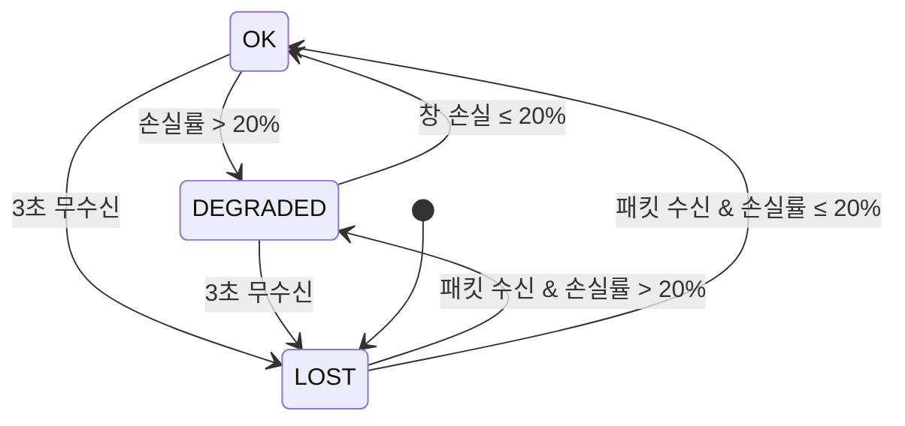

<figure class="post-figure post-figure--header">
<svg role="img" aria-label="지상국과 기체 사이에 목적이 다른 네 링크가 나란히 떠 있는 그림. 맨 위는 기체(FC), 맨 아래는 지상국(통제 앱과 라디오)이다. 그 사이의 네 줄은 위에서부터 ① RC 링크: 지상에서 기체로, 2.4GHz 또는 900MHz대(ELRS 등), 채널 값을 나르며 지연 수~수십 ms. ② 텔레메트리 링크: 양방향, SiK 433/915MHz 라디오 위의 MAVLink, 상태·명령·미션을 수~수십 kbps로. ③ 영상 링크: 기체에서 지상으로, 5.8GHz 아날로그 또는 디지털, 카메라 영상을 수~수십 Mbps로. ④ IP 링크: 양방향, Wi-Fi 또는 LTE/5G 셀룰러, MAVLink와 영상을 함께 싣고 지연이 들쭉날쭉하다. 통제 앱이 MAVLink로 직접 만지는 텔레메트리와 IP 링크가 강조되어 있다." viewBox="0 0 320 476" width="360" xmlns="http://www.w3.org/2000/svg">
  <title>한 기체, 여러 링크 — RC · 텔레메트리 · 영상 · IP</title>
  <defs>
    <marker id="tl-hdr-arrow" viewBox="0 0 10 10" refX="9" refY="5" markerUnits="userSpaceOnUse" markerWidth="9" markerHeight="9" orient="auto-start-reverse">
      <path d="M0,0 L10,5 L0,10 z" fill="currentColor"/>
    </marker>
  </defs>
  <text x="160" y="20" text-anchor="middle" font-size="14" font-weight="700" fill="currentColor">한 기체, 여러 링크</text>
  <!-- drone -->
  <g stroke="currentColor" stroke-width="2" fill="none">
    <line x1="110" y1="44" x2="146" y2="52"/>
    <line x1="210" y1="44" x2="174" y2="52"/>
    <line x1="110" y1="44" x2="110" y2="38"/>
    <line x1="210" y1="44" x2="210" y2="38"/>
  </g>
  <ellipse cx="110" cy="37" rx="24" ry="4" fill="var(--bg-light)" stroke="currentColor" stroke-width="1.5"/>
  <ellipse cx="210" cy="37" rx="24" ry="4" fill="var(--bg-light)" stroke="currentColor" stroke-width="1.5"/>
  <rect x="144" y="46" width="32" height="18" rx="3" fill="var(--bg-light)" stroke="currentColor" stroke-width="2"/>
  <text x="246" y="62" font-size="13" font-weight="700" fill="currentColor">기체 · FC</text>
  <line x1="160" y1="64" x2="160" y2="92" stroke="currentColor" stroke-width="1.5" stroke-dasharray="3 3"/>
  <!-- row 1: RC -->
  <rect x="16" y="92" width="288" height="64" rx="4" fill="var(--bg-light)" stroke="currentColor" stroke-width="1.5"/>
  <line x1="40" y1="148" x2="40" y2="102" stroke="currentColor" stroke-width="2" marker-end="url(#tl-hdr-arrow)"/>
  <text x="76" y="114" font-size="13" font-weight="700" fill="currentColor">RC 링크</text>
  <text x="296" y="114" text-anchor="end" font-size="12" font-weight="700" fill="var(--accent-color)">지상 → 기체</text>
  <text x="76" y="134" font-size="12" fill="currentColor">2.4GHz · 900MHz대 · ELRS</text>
  <text x="76" y="150" font-size="12" fill="var(--text-light)">채널 값 · 지연 수~수십 ms</text>
  <!-- row 2: telemetry (app-facing) -->
  <rect x="16" y="164" width="288" height="64" rx="4" fill="var(--gold-soft)" stroke="var(--accent-color)" stroke-width="2"/>
  <line x1="40" y1="176" x2="40" y2="216" stroke="currentColor" stroke-width="2" marker-start="url(#tl-hdr-arrow)" marker-end="url(#tl-hdr-arrow)"/>
  <text x="76" y="186" font-size="13" font-weight="700" fill="currentColor">텔레메트리 링크</text>
  <text x="296" y="186" text-anchor="end" font-size="12" font-weight="700" fill="var(--accent-color)">양방향</text>
  <text x="76" y="206" font-size="12" fill="currentColor">SiK 433 / 915MHz · MAVLink</text>
  <text x="76" y="222" font-size="12" fill="var(--text-light)">상태 · 명령 · 미션 · 수~수십 kbps</text>
  <!-- row 3: video -->
  <rect x="16" y="236" width="288" height="64" rx="4" fill="var(--bg-light)" stroke="currentColor" stroke-width="1.5"/>
  <line x1="40" y1="246" x2="40" y2="292" stroke="currentColor" stroke-width="2" marker-end="url(#tl-hdr-arrow)"/>
  <text x="76" y="258" font-size="13" font-weight="700" fill="currentColor">영상 링크</text>
  <text x="296" y="258" text-anchor="end" font-size="12" font-weight="700" fill="var(--accent-color)">기체 → 지상</text>
  <text x="76" y="278" font-size="12" fill="currentColor">5.8GHz · 아날로그 / 디지털</text>
  <text x="76" y="294" font-size="12" fill="var(--text-light)">카메라 영상 · 수~수십 Mbps</text>
  <!-- row 4: IP (app-facing) -->
  <rect x="16" y="308" width="288" height="64" rx="4" fill="var(--gold-soft)" stroke="var(--accent-color)" stroke-width="2"/>
  <line x1="40" y1="320" x2="40" y2="360" stroke="currentColor" stroke-width="2" marker-start="url(#tl-hdr-arrow)" marker-end="url(#tl-hdr-arrow)"/>
  <text x="76" y="330" font-size="13" font-weight="700" fill="currentColor">IP 링크</text>
  <text x="296" y="330" text-anchor="end" font-size="12" font-weight="700" fill="var(--accent-color)">양방향</text>
  <text x="76" y="350" font-size="12" fill="currentColor">Wi-Fi · LTE/5G 셀룰러</text>
  <text x="76" y="366" font-size="12" fill="var(--text-light)">MAVLink + 영상 · 지연 들쭉날쭉</text>
  <!-- ground station -->
  <line x1="160" y1="372" x2="160" y2="396" stroke="currentColor" stroke-width="1.5" stroke-dasharray="3 3"/>
  <rect x="114" y="386" width="8" height="18" rx="1" fill="var(--bg-light)" stroke="currentColor" stroke-width="1.5"/>
  <g stroke="currentColor" stroke-width="2" fill="none">
    <line x1="118" y1="404" x2="118" y2="430"/>
    <line x1="118" y1="430" x2="106" y2="444"/>
    <line x1="118" y1="430" x2="130" y2="444"/>
    <line x1="118" y1="430" x2="118" y2="444"/>
    <line x1="122" y1="420" x2="146" y2="420" stroke-width="1.5"/>
  </g>
  <rect x="146" y="396" width="50" height="32" rx="2" fill="var(--bg-light)" stroke="currentColor" stroke-width="2"/>
  <path d="M140,430 L202,430 L208,438 L134,438 z" fill="var(--bg-light)" stroke="currentColor" stroke-width="1.5"/>
  <text x="222" y="414" font-size="13" font-weight="700" fill="currentColor">지상국</text>
  <text x="222" y="432" font-size="12" fill="var(--text-light)">통제 앱 · 라디오</text>
  <text x="160" y="466" text-anchor="middle" font-size="12" fill="var(--text-light)">강조 = 통제 앱이 MAVLink로 만지는 링크</text>
</svg>
<figcaption>기체와 지상 사이에는 요구가 서로 다른 링크가 따로 떠 있다 — 조종은 지연에, 텔레메트리는 양방향성에, 영상은 대역에 민감하고, 통제 앱이 직접 다루는 것은 텔레메트리(또는 IP) 링크 위의 MAVLink다</figcaption>
</figure>

## 들어가며

이 글은 `Drone-Control-Essential` 시리즈의 **7단계**입니다. 전체 흐름은 [Drone Control Essential Curriculum](/2026/11/05/drone-control-essential-curriculum.html)에서 확인하고, 직전 단계 [펌웨어 · 비행 컨트롤러](/2026/11/05/drone-firmware-flight-controller.html)를 먼저 읽으면 좋습니다.

6단계까지는 기체 **안**을 보았습니다. 센서가 상태 추정으로, 추정이 제어 루프로, 제어 루프가 모터로 이어지는 사슬은 모두 FC 한 장 위에서 닫힙니다. 통제 앱은 그 사슬 **밖**, 수백 m~수 km 떨어진 지상에 있습니다. 앱과 FC를 잇는 것은 전선이 아니라 **전파**이고, 전파는 약해지고, 막히고, 끊깁니다.

앱 개발자가 무선 공학자가 될 필요는 없습니다. 하지만 세 가지는 알아야 합니다. 첫째, 기체에 떠 있는 **여러 링크가 각각 무엇을 나르는지**. 둘째, 링크가 **왜, 어느 거리에서** 약해지는지. 셋째, 그 위에서 MAVLink가 **얼마나 많은 대역을 쓰고**, 손실과 끊김을 앱이 **어떻게 판정해 운용자에게 보여야 하는지**. 이 글은 이 세 질문을 순서대로 다룹니다.

<div class="post-summary-box" markdown="1">

### 📌 이 글에서 다루는 내용

#### 🔍 핵심 주제

- **링크의 종류와 역할**: RC 무선 링크(ExpressLRS·TBS Crossfire)와 수신기→FC 프로토콜(CRSF·SBUS·PPM), 텔레메트리(SiK 계열 시리얼 라디오), Wi-Fi·LTE/셀룰러, 영상 링크 — 무엇을 어떤 링크로 보내는가
- **무선 기초**: 주파수 대역(2.4GHz·5.8GHz·sub-GHz), dBm·링크 버짓, RSSI·LQ, 안테나·편파·가시선(LOS), 국내 전파 규제 개요
- **텔레메트리 전송 계층**: 시리얼·UDP·TCP 위의 MAVLink, 메시지 전송률(stream rate)과 대역 예산, 지연·손실 시 앱이 보여야 할 상태

</div>

## 1. 링크의 종류와 역할

### 1.1 한 기체, 여러 링크

취미용 FPV 기체든 측량용 쿼드콥터든, 기체와 지상 사이에는 보통 **목적이 다른 링크가 여러 개** 떠 있습니다.

| 링크 | 방향 | 나르는 것 | 필요한 대역 | 지연 요구 | 대표 기술 |
| --- | --- | --- | --- | --- | --- |
| RC 링크 | 지상 → 기체 (+ 짧은 회신) | 스틱·스위치 채널 값 | 수 kbps | 수~수십 ms | ExpressLRS, TBS Crossfire, FrSky |
| 텔레메트리 링크 | 양방향 | MAVLink 상태·명령·미션·파라미터 | 수~수십 kbps | 수백 ms까지 허용 | SiK 계열 라디오(433/915MHz), RFD900 |
| 영상 링크 | 기체 → 지상 | 카메라 영상 | 수~수십 Mbps | FPV는 수십 ms 이하 | 아날로그 5.8GHz, DJI·Walksnail·HDZero 디지털 |
| IP 링크 | 양방향 | MAVLink + 영상 + 기타 데이터 | Mbps 단위 | 망 상태에 따라 변동 | Wi-Fi, LTE/5G 셀룰러, 메시 라디오 |

링크를 나누는 이유는 **요구가 서로 충돌하기 때문**입니다. 수동 조종은 데이터는 적지만 지연과 끊김에 극도로 민감합니다. 텔레메트리는 조금 늦어도 되지만 양방향이고 메시지 종류가 많습니다. 영상은 대역을 압도적으로 많이 먹습니다. 한 링크에 모두 실으면 영상 트래픽이 조종 명령을 밀어내는 일이 생깁니다. 반대로 Wi-Fi나 LTE처럼 대역이 넉넉한 IP 링크 하나에 텔레메트리와 영상을 모두 싣는 구성도 흔한데, 이때는 **조종 명령과 페일세이프를 무엇에 맡길지**를 따로 설계해야 합니다.

통제 앱이 직접 만지는 것은 주로 **텔레메트리 링크(또는 IP 링크) 위의 MAVLink**입니다. 그래도 RC 링크와 영상 링크를 알아야 하는 이유가 있습니다. RC 링크가 끊기면 FC가 RC 페일세이프를 일으키고, 그 결과가 텔레메트리로 앱에 돌아옵니다. 그래서 앱은 "지금 기체가 왜 RTL 중인가"를 설명하려면 **다른 링크의 상태까지** 보여 줘야 합니다.

### 1.2 RC 링크: 무선 구간과 수신기→FC 구간

RC 링크는 두 구간으로 나뉩니다. 조종기(또는 조종기에 꽂은 **송신 모듈**)에서 기체의 **수신기**까지가 무선 구간이고, 수신기에서 FC까지가 유선 구간입니다.

- **무선 구간**: 요즘 많이 쓰는 것은 오픈소스 **ExpressLRS(ELRS)** 와 상용 **TBS Crossfire**입니다. ELRS는 2.4GHz판과 900MHz대판이 있고, 패킷 전송률(예: 50~500Hz 이상)과 출력을 바꿔 가며 거리와 지연을 맞바꿉니다. 둘 다 주파수 도약(FHSS)으로 간섭을 피하고, 기체 쪽 신호 품질을 조종기로 되돌려 보내는 **회신(telemetry) 채널**을 갖습니다.
- **유선 구간(수신기→FC)**: 수신기가 FC에 채널 값을 넘기는 프로토콜입니다. 오래된 순서로 **PPM**(펄스 간격으로 채널 여러 개를 한 선에 싣는 아날로그 방식), **SBUS**(Futaba가 만든 디지털 직렬 방식), **CRSF**(Crossfire 프로토콜, ELRS도 사용)가 대표적입니다.

SBUS와 CRSF는 모두 **채널 16개 × 11비트**를 22바이트로 빽빽하게 묶습니다. 둘의 차이는 감싸는 틀에 있습니다. SBUS는 100000 baud·짝수 패리티·반전 신호의 고정 25바이트 프레임이고, 끝에 **frame lost·failsafe 플래그**가 붙습니다. CRSF는 420000 baud의 가변 길이 프레임에 타입 바이트와 CRC가 붙고, 양방향이라 **링크 통계(RSSI·LQ·SNR)** 같은 회신 프레임도 같은 선으로 돌아옵니다.

```python
# RC 채널 16개 × 11비트를 22바이트로 묶는다 — SBUS와 CRSF가 같은 배치를 쓴다.
def pack11(channels):
    bits, nbits, out = 0, 0, bytearray()
    for ch in channels:                 # LSB부터 차례로 이어 붙인다
        bits |= (ch & 0x7FF) << nbits
        nbits += 11
        while nbits >= 8:
            out.append(bits & 0xFF)
            bits >>= 8
            nbits -= 8
    return bytes(out)

def unpack11(data, n=16):
    v = int.from_bytes(data, "little")
    return [(v >> (11 * i)) & 0x7FF for i in range(n)]

def crc8_dvb_s2(data):                  # CRSF CRC: 다항식 0xD5, 초기값 0
    crc = 0
    for b in data:
        crc ^= b
        for _ in range(8):
            crc = ((crc << 1) ^ 0xD5) & 0xFF if crc & 0x80 else (crc << 1) & 0xFF
    return crc

def crsf_rc_frame(channels):
    body = bytes([0x16]) + pack11(channels)          # type 0x16 = RC_CHANNELS_PACKED
    return bytes([0xC8, len(body) + 1]) + body + bytes([crc8_dvb_s2(body)])

def ticks_to_us(t):                     # 172 → 988µs, 992 → 1500µs, 1811 → 2012µs
    return 1500 + (t - 992) * 5 / 8

sticks = [992, 992, 172, 992, 1811] + [992] * 11     # roll, pitch, throttle(최저), yaw, AUX1(최고)
frame = crsf_rc_frame(sticks)
print(f"CRSF 프레임 {len(frame)}바이트: {frame[:6].hex(' ')} … {frame[-3:].hex(' ')}")
print(f"  sync=0x{frame[0]:02X} len={frame[1]} type=0x{frame[2]:02X} crc=0x{frame[-1]:02X}")
ok = crc8_dvb_s2(frame[2:-1]) == frame[-1]
print(f"  CRC 검사: {'통과' if ok else '실패'}, 채널 1~5 → {[round(ticks_to_us(t)) for t in unpack11(frame[3:25])[:5]]} µs")
bad = bytearray(frame); bad[10] ^= 0x04                # 비트 하나가 뒤집히면
print(f"  비트 하나 손상 → CRC 검사: {'통과' if crc8_dvb_s2(bad[2:-1]) == bad[-1] else '실패 → 프레임 폐기'}")

# SBUS: 0x0F + 같은 22바이트 + 플래그 + 0x00 (100000 baud, 8E2, 반전 신호)
flags = 0x08                                           # bit3 = failsafe, bit2 = frame lost
sbus = bytes([0x0F]) + pack11(sticks) + bytes([flags, 0x00])
print(f"SBUS 프레임 {len(sbus)}바이트, 플래그 0x{sbus[23]:02X}: "
      f"frame_lost={bool(sbus[23] & 0x04)}, failsafe={bool(sbus[23] & 0x08)}")

# CRSF 프레임 26바이트: c8 18 16 e0 03 1f … 0f 7c 01
#   sync=0xC8 len=24 type=0x16 crc=0x01
#   CRC 검사: 통과, 채널 1~5 → [1500, 1500, 988, 1500, 2012] µs
#   비트 하나 손상 → CRC 검사: 실패 → 프레임 폐기
# SBUS 프레임 25바이트, 플래그 0x08: frame_lost=False, failsafe=True
```

여기서 앱 개발자가 가져갈 것은 세 가지입니다.

1. **채널 값은 결국 µs 펄스 폭의 언어로 번역됩니다.** 1000~2000µs(중립 1500µs)라는 오래된 PWM 관례가 디지털 프로토콜에서도 살아 있습니다. FC 파라미터의 RC 보정 값이나 MAVLink `RC_CHANNELS` 메시지의 채널 값도 이 단위입니다.
2. **손상된 프레임은 버려집니다.** CRC가 맞지 않으면 FC는 그 프레임을 쓰지 않고 직전 값을 유지합니다. 버려지는 프레임이 일정 시간 이어지면 RC 손실로 판정합니다.
3. **RC 손실은 수신기가 알리는 방식이 제각각입니다.** SBUS는 failsafe 플래그를 세우고, CRSF/ELRS는 기본 설정에서 **아예 출력을 멈춥니다**. 옛 PWM 수신기 중에는 스로틀을 미리 정한 낮은 값으로 내려 손실을 알리는 것도 있습니다. FC는 이 신호 중 하나를 받아 RC 페일세이프로 넘어갑니다. PX4는 `COM_RC_LOSS_T`(기본 0.5초) 동안 RC가 끊기면 손실로 보고 `NAV_RCL_ACT`에 정한 동작을 합니다. ArduPilot은 `FS_THR_ENABLE`과 관련 파라미터로 동작을 정합니다. 페일세이프 설계 자체는 9단계에서 다룹니다.

### 1.3 텔레메트리 링크: SiK 라디오

**SiK**는 3DR이 만든 텔레메트리 라디오용 오픈소스 펌웨어이고, 지금도 Holybro 등 여러 제조사의 저가 텔레메트리 라디오가 이 펌웨어를 씁니다. 지상 쪽 라디오는 USB로 PC에, 기체 쪽 라디오는 FC의 TELEM 포트(UART)에 연결합니다. 두 라디오는 **투명 시리얼 브리지**처럼 동작합니다. 한쪽 UART로 들어간 바이트가 다른 쪽 UART로 나옵니다. 그래서 FC와 앱은 그 사이에 무선 구간이 있다는 것을 모른 채 시리얼로 MAVLink를 주고받습니다.

알아 둘 성질은 이렇습니다.

- **두 개의 속도**: UART 속도(`SERIAL_SPEED`, 기본 57600 baud)와 공중 전송 속도(`AIR_SPEED`, 기본 64kbps)는 따로 설정합니다. 공중 속도를 낮추면 수신 감도가 좋아져 거리가 늘고, 높이면 대역이 늘지만 거리가 줄어듭니다.
- **공중 구간이 병목일 수 있습니다**: 오류 정정(ECC)을 켜면 유효 대역이 절반 가까이 줄고, 양방향 트래픽이 같은 공중 시간을 나눠 씁니다. 그래서 57600 baud 시리얼보다 공중 구간이 먼저 꽉 찰 수 있습니다.
- **MAVLink를 알아봅니다**: SiK는 MAVLink 프레임 경계를 알아보고 프레임 단위로 묶어 보낼 수 있습니다. 또 **`RADIO_STATUS`** 메시지를 스스로 만들어 끼워 넣습니다. 이 메시지에는 양쪽 RSSI(`rssi`·`remrssi`), 잡음(`noise`·`remnoise`), 송신 버퍼 여유(`txbuf`), 수신 오류 수가 들어 있습니다. 통제 앱의 **링크 품질 표시에 가장 먼저 쓸 재료**입니다. SiK의 RSSI는 dBm이 아니라 0~255 눈금이고, 대략 `dBm ≈ rssi / 1.9 − 127`로 환산합니다.
- **흐름 제어**: `txbuf`가 줄어들면 라디오 버퍼가 차고 있다는 뜻입니다. ArduPilot은 이 값을 보고 텔레메트리 전송률을 스스로 줄입니다.

> **⚠️ 주파수 대역 주의**: SiK 라디오는 **433MHz판과 915MHz판**으로 팔립니다. 915MHz판은 미국 등의 902~928MHz 비면허 대역을 기준으로 만든 제품이 많은데, 국내 비면허 대역은 이와 범위·출력·채널 조건이 다릅니다. 해외 직구 915MHz 라디오를 기본 설정 그대로 쓰면 **국내 기술기준을 벗어날 수 있습니다.** 국내에서는 적합성평가(KC)를 받은 제품을 쓰고, 허용 주파수 범위(`MIN_FREQ`·`MAX_FREQ`)와 출력(`TXPOWER`)을 국내 기준에 맞춥니다. 같은 주의가 900MHz대 ELRS·Crossfire에도 적용됩니다.

### 1.4 영상 링크

영상 링크는 다른 링크보다 대역이 수백~수천 배 큽니다. 두 갈래로 나뉩니다.

- **FPV(1인칭 비행)용 저지연 영상**: 조종자가 고글로 보며 직접 조종하는 영상입니다. 지연이 수십 ms를 넘으면 조종이 어려워집니다. 아날로그 5.8GHz 영상은 지연이 거의 없지만 화질이 낮고 잡음이 끼며, 신호가 약해지면 화면이 지글거리다 사라집니다. 디지털 시스템(DJI O3/O4, Walksnail, HDZero)은 화질이 좋은 대신 신호가 약해지면 **화면이 멈추거나 끊기는** 식으로 실패합니다.
- **임무·관제용 영상**: 측량·점검·감시처럼 지상의 앱이 영상을 보여 주고 녹화하는 경우입니다. 보통 컴패니언 컴퓨터가 카메라 영상을 H.264/H.265로 인코딩해 **IP 링크 위의 RTP/RTSP 스트림**으로 보냅니다. QGroundControl은 이런 스트림을 받아 지도 옆에 띄울 수 있습니다. MAVLink에는 카메라와 영상 스트림을 찾고 제어하는 **Camera 프로토콜**이 있습니다. 하지만 영상 데이터 자체는 MAVLink로 나르지 않습니다.

통제 앱 관점에서 영상은 **텔레메트리와 따로 끊긴다**는 점이 중요합니다. 영상이 끊겨도 텔레메트리는 살아 있을 수 있고, 반대도 가능합니다. 앱은 두 상태를 따로 표시해야 합니다.

### 1.5 Wi-Fi · LTE/셀룰러: IP 위로

**Wi-Fi**는 장비가 싸고 대역이 크지만, 일반 출력과 안테나로는 쓸 만한 거리가 수백 m 수준입니다. 실내·근거리 시험, 컴패니언 컴퓨터 개발, 소형 기체에 흔히 씁니다. ArduPilot 문서에도 소개된 ESP8266/ESP32 기반 Wi-Fi 브리지처럼 **시리얼 MAVLink를 UDP로 바꿔 주는 브리지**도 많이 쓰입니다.

**LTE/5G 셀룰러**는 기지국이 닿는 곳이라면 거리에 사실상 제한이 없습니다. 그래서 장거리·가시권 밖(BVLOS) 운용과 원격 관제의 기반이 됩니다. 대신 성질이 다릅니다.

- **지연이 들쭉날쭉합니다**: 수십 ms에서 수백 ms까지 오가고, 핸드오버나 혼잡 때 순간적으로 초 단위로 튑니다.
- **기체가 NAT 뒤에 있습니다**: 통신사 망은 기체에 공인 IP를 주지 않는 경우가 많습니다. 그래서 지상 앱이 기체로 직접 접속할 수 없고, 보통 **중계 서버**나 VPN을 두고 양쪽이 그쪽으로 나가며 연결합니다.
- **상공의 망 품질은 지상과 다릅니다**: 기지국 안테나는 지상 사용자를 향해 있습니다. 고도가 올라가면 여러 기지국의 신호가 섞여 간섭이 늘 수 있습니다.

셀룰러 기반 다기체 운용과 BVLOS는 심화 후보 `Drone-Fleet-Ops`에서 다룹니다. Essential에서는 **"IP 링크 위의 MAVLink도 결국 같은 MAVLink"**라는 점, 그리고 지연·손실 특성이 다르니 **앱의 연결 판정 기준을 링크 종류마다 다르게** 잡아야 한다는 점을 기억하면 됩니다.

## 2. 무선 기초

### 2.1 주파수 대역: 낮을수록 멀리, 높을수록 많이

드론 링크가 주로 쓰는 대역은 세 무리입니다.

| 대역 | 쓰임 | 장점 | 단점 |
| --- | --- | --- | --- |
| sub-GHz (433MHz·900MHz대) | 장거리 RC, 텔레메트리 | 같은 거리에서 경로 손실이 작고, 장애물·지형을 돌아 들어가는 회절이 강하다 | 대역폭이 좁고, 안테나가 크며, 나라마다 허용 범위가 다르다 |
| 2.4GHz | RC, Wi-Fi, 디지털 영상 | 전 세계 공통 ISM 대역, 작은 안테나 | Wi-Fi·블루투스와 혼잡, sub-GHz보다 감쇠가 크다 |
| 5.8GHz (5.725~5.875GHz) | FPV 영상, Wi-Fi | 대역이 넓어 영상에 적합, 안테나가 작다 | 감쇠가 크고 가시선에 더 의존한다 |

이와 별도로, 국제전기통신연합(ITU)은 2012년 세계전파통신회의(WRC-12)에서 **5030~5091MHz**를 무인기의 명령·제어(CNPC) 링크용으로 배정했습니다. 공역 통합 운용을 위한 안전 등급 CNPC 링크용(AM(R)S) 대역입니다. 국내 분배 현황과 이용 조건은 과학기술정보통신부의 주파수 분배표와 국립전파연구원의 기술기준으로 확인합니다.

### 2.2 dBm과 링크 버짓

무선에서 전력은 **dBm**(1mW를 기준으로 한 데시벨)으로 셉니다. 0dBm = 1mW, 20dBm = 100mW, 30dBm = 1W입니다. 10dB마다 10배, 3dB마다 약 2배입니다. 수신기에 들어오는 전력은 아주 작아서 −60~−110dBm(10⁻⁶~10⁻¹¹mW) 사이를 오갑니다. 곱셈이 덧셈이 되므로, 링크의 득실을 **dB 단위로 더하고 빼는 장부**로 정리할 수 있습니다. 이 장부가 **링크 버짓**입니다.

```text
수신 전력(dBm) = 송신 출력 + 송신 안테나 이득 + 수신 안테나 이득 − 경로 손실 − 기타 손실
링크 여유(dB)  = 수신 전력 − 수신 감도
```

**수신 감도**는 수신기가 데이터를 쓸 만하게 복원할 수 있는 최소 전력입니다. 공중 전송 속도가 낮을수록 감도가 좋아집니다(더 낮은 dBm까지 받습니다). **경로 손실**의 기본은 자유공간 경로 손실(FSPL)입니다. 장애물이 없을 때도 전파는 퍼지면서 약해집니다.

```text
FSPL(dB) = 20·log10(거리 km) + 20·log10(주파수 MHz) + 32.44
```

```python
import math

def fspl_db(d_km, f_mhz):               # 자유공간 경로 손실
    return 20 * math.log10(d_km) + 20 * math.log10(f_mhz) + 32.44

def max_range_km(pt, gt, gr, sens, f_mhz, margin=10.0):
    allowed = pt + gt + gr - sens - margin    # 경로 손실로 써도 되는 dB
    return 10 ** ((allowed - 20 * math.log10(f_mhz) - 32.44) / 20)

def dbm_to_mw(dbm):
    return 10 ** (dbm / 10)

print(f"20 dBm = {dbm_to_mw(20):.0f} mW, 30 dBm = {dbm_to_mw(30):.0f} mW, -100 dBm = {dbm_to_mw(-100):.0e} mW")

# 예시 값(제품·설정마다 다르다): 송신 출력, 안테나 이득 2개, 수신 감도
links = [
    ("텔레메트리 915MHz", 20, 2, 2, -105,  915),
    ("RC 2.4GHz 저속",    20, 2, 2, -108, 2440),
    ("Wi-Fi 2.4GHz",      20, 2, 2,  -80, 2440),
    ("영상 5.8GHz",       25, 2, 2,  -85, 5800),
]
print("\n1km 손실   1km 수신   여유    최대(여유10dB)  링크")
for name, pt, gt, gr, sens, f in links:
    loss = fspl_db(1.0, f)
    pr = pt + gt + gr - loss
    print(f"{loss:6.1f}dB  {pr:6.1f}dBm  {pr - sens:4.1f}dB  {max_range_km(pt, gt, gr, sens, f):6.1f} km       {name}")

print("\n거리를 두 배로 → 손실", f"{fspl_db(2, 915) - fspl_db(1, 915):.1f} dB 증가")

# 20 dBm = 100 mW, 30 dBm = 1000 mW, -100 dBm = 1e-10 mW
#
# 1km 손실   1km 수신   여유    최대(여유10dB)  링크
#   91.7dB   -67.7dBm  37.3dB    23.3 km       텔레메트리 915MHz
#  100.2dB   -76.2dBm  31.8dB    12.3 km       RC 2.4GHz 저속
#  100.2dB   -76.2dBm   3.8dB     0.5 km       Wi-Fi 2.4GHz
#  107.7dB   -78.7dBm   6.3dB     0.7 km       영상 5.8GHz
#
# 거리를 두 배로 → 손실 6.0 dB 증가
```

<figure class="post-figure">
<svg role="img" aria-label="텔레메트리 915MHz 링크를 1km 거리에서 계산한 링크 버짓을 dBm 눈금 위의 계단으로 그린 그림. 송신 출력 +20dBm에서 시작해 송신 안테나 이득 +2dBi, 수신 안테나 이득 +2dBi를 더해 24dBm까지 올라간다. 이어서 자유공간 경로 손실 91.7dB가 긴 막대로 떨어져 수신 전력은 −67.7dBm이 된다. 그 아래 점선이 수신 감도 −105dBm이고, 수신 전력과 감도 사이의 간격 37.3dB가 링크 여유다. 자유공간 계산은 상한이고 여유 10dB는 현실의 몫으로 남겨 둔다." viewBox="0 0 320 468" width="360" xmlns="http://www.w3.org/2000/svg">
  <title>링크 버짓 계단 — 텔레메트리 915MHz · 1km</title>
  <defs>
    <marker id="tl-bud-arrow" viewBox="0 0 10 10" refX="9" refY="5" markerUnits="userSpaceOnUse" markerWidth="8" markerHeight="8" orient="auto-start-reverse">
      <path d="M0,0 L10,5 L0,10 z" fill="var(--accent-color)"/>
    </marker>
  </defs>
  <text x="160" y="20" text-anchor="middle" font-size="14" font-weight="700" fill="currentColor">링크 버짓은 dB 장부</text>
  <text x="160" y="40" text-anchor="middle" font-size="12" fill="var(--text-light)">텔레메트리 915 MHz · 거리 1 km</text>
  <!-- axis + grid -->
  <text x="50" y="62" text-anchor="end" font-size="12" font-weight="700" fill="var(--text-light)">dBm</text>
  <line x1="56" y1="66" x2="56" y2="396" stroke="currentColor" stroke-width="1.5"/>
  <g stroke="var(--text-light)" stroke-width="0.6" stroke-dasharray="2 4">
    <line x1="56" y1="84" x2="312" y2="84"/>
    <line x1="56" y1="132" x2="312" y2="132"/>
    <line x1="56" y1="180" x2="312" y2="180"/>
    <line x1="56" y1="228" x2="312" y2="228"/>
    <line x1="56" y1="276" x2="312" y2="276"/>
    <line x1="56" y1="324" x2="312" y2="324"/>
    <line x1="56" y1="372" x2="312" y2="372"/>
  </g>
  <g text-anchor="end" font-size="12" fill="var(--text-light)">
    <text x="50" y="88">+20</text>
    <text x="50" y="136">0</text>
    <text x="50" y="184">−20</text>
    <text x="50" y="232">−40</text>
    <text x="50" y="280">−60</text>
    <text x="50" y="328">−80</text>
    <text x="50" y="376">−100</text>
  </g>
  <!-- gains -->
  <rect x="70" y="84" width="36" height="48" fill="var(--bg-light)" stroke="currentColor" stroke-width="1.5"/>
  <rect x="118" y="79.2" width="36" height="4.8" fill="var(--bg-light)" stroke="currentColor" stroke-width="1.5"/>
  <rect x="166" y="74.4" width="36" height="4.8" fill="var(--bg-light)" stroke="currentColor" stroke-width="1.5"/>
  <g text-anchor="middle" font-size="12" font-weight="700" fill="currentColor">
    <text x="88" y="78">+20</text>
    <text x="136" y="73">+2</text>
    <text x="184" y="68">+2</text>
  </g>
  <!-- path loss -->
  <rect x="214" y="74.4" width="36" height="220.1" fill="var(--gold-soft)" stroke="var(--accent-color)" stroke-width="2"/>
  <text x="232" y="64" text-anchor="middle" font-size="12" font-weight="700" fill="currentColor">24 dBm</text>
  <text transform="translate(237,185) rotate(-90)" text-anchor="middle" font-size="13" font-weight="700" fill="currentColor">FSPL −91.7 dB</text>
  <!-- received -->
  <rect x="262" y="292.5" width="36" height="4" fill="currentColor"/>
  <text x="282" y="286" text-anchor="middle" font-size="12" font-weight="700" fill="currentColor">−67.7 dBm</text>
  <!-- step connectors -->
  <g stroke="currentColor" stroke-width="1" stroke-dasharray="3 2">
    <line x1="106" y1="84" x2="118" y2="84"/>
    <line x1="154" y1="79.2" x2="166" y2="79.2"/>
    <line x1="202" y1="74.4" x2="214" y2="74.4"/>
    <line x1="250" y1="294.5" x2="262" y2="294.5"/>
  </g>
  <!-- sensitivity + margin -->
  <line x1="56" y1="384" x2="312" y2="384" stroke="var(--accent-color)" stroke-width="2" stroke-dasharray="6 4"/>
  <text x="64" y="378" font-size="12" font-weight="700" fill="var(--accent-color)">수신 감도 −105 dBm</text>
  <line x1="280" y1="299" x2="280" y2="381" stroke="var(--accent-color)" stroke-width="2" marker-start="url(#tl-bud-arrow)" marker-end="url(#tl-bud-arrow)"/>
  <text x="272" y="334" text-anchor="end" font-size="13" font-weight="700" fill="var(--accent-color)">여유</text>
  <text x="272" y="352" text-anchor="end" font-size="13" font-weight="700" fill="var(--accent-color)">37.3 dB</text>
  <!-- column labels -->
  <g text-anchor="middle" font-size="12" fill="currentColor">
    <text x="88" y="414">송신</text>
    <text x="88" y="430">출력</text>
    <text x="136" y="414">Tx</text>
    <text x="136" y="430">안테나</text>
    <text x="184" y="414">Rx</text>
    <text x="184" y="430">안테나</text>
    <text x="232" y="414">FSPL</text>
    <text x="232" y="430">1 km</text>
    <text x="280" y="414">수신</text>
    <text x="280" y="430">전력</text>
  </g>
  <text x="160" y="456" text-anchor="middle" font-size="12" fill="var(--text-light)">자유공간 계산은 상한 — 여유 10 dB는 현실의 몫</text>
</svg>
<figcaption>송신 출력과 두 안테나 이득을 더하고(24 dBm) 1 km 자유공간 손실 91.7 dB를 빼면 수신 전력 −67.7 dBm — 수신 감도 −105 dBm까지 남은 37.3 dB가 링크 여유다</figcaption>
</figure>

숫자를 읽는 법은 이렇습니다.

- **거리 두 배 = 6dB.** 같은 링크로 거리를 두 배 늘리려면 출력·안테나 이득·감도를 합쳐 6dB를 더 벌어야 합니다. 출력을 4배로 올리는 것과 같습니다. 출력만으로 거리를 늘리기 어려운 이유입니다.
- **감도가 거리를 정합니다.** 위 예에서 Wi-Fi와 RC 2.4GHz는 출력·안테나·주파수가 같습니다. 그런데도 최대 거리가 20배 넘게 차이 납니다. 고속 데이터를 위해 감도를 28dB 내준 결과입니다. ELRS가 패킷 전송률을 낮추면 거리가 늘어나는 것도 같은 원리입니다.
- **10dB 여유는 현실의 몫입니다.** 실제로는 기체 자세에 따른 안테나 방향 변화, 다중 경로 페이딩, 몸체·프레임에 의한 가림, 케이블 손실이 더해집니다. 자유공간 계산은 **상한**이지 약속이 아닙니다. 계산 거리의 절반만 믿어도 낙관적일 때가 많습니다.

### 2.3 RSSI · LQ · SNR

링크 상태를 나타내는 숫자는 여럿이고, 서로 다른 것을 잽니다.

- **RSSI**(수신 신호 강도): 수신기에 들어온 전력입니다. dBm으로 주는 기기도 있고, SiK처럼 자체 눈금(0~255)이나 퍼센트로 주는 기기도 있습니다. 같은 "RSSI 70"이라도 기기마다 뜻이 다릅니다.
- **SNR**(신호 대 잡음비): 신호가 잡음 바닥보다 몇 dB 위에 있는지입니다. RSSI가 높아도 주변 잡음이 크면 SNR이 낮아 링크가 나빠집니다.
- **LQ**(Link Quality): 최근 일정 구간에 보낸 패킷 중 **제대로 받은 비율**(%)입니다. ELRS·Crossfire가 대표 지표로 씁니다. 결과를 직접 재므로 "지금 링크가 일을 하고 있는가"에 가장 가깝습니다.

실무에서는 LQ와 RSSI를 **함께** 봅니다. LQ가 100%인데 RSSI가 감도 근처까지 내려왔다면 아직 버티지만 곧 무너질 링크입니다. RSSI는 충분한데 LQ가 떨어진다면 거리 문제가 아니라 간섭이나 다중 경로를 의심합니다. 통제 앱은 RC 링크의 LQ·RSSI를 MAVLink로 받아 표시할 수 있습니다. 예를 들어 `RC_CHANNELS.rssi`, ArduPilot의 RSSI 설정, 텔레메트리 라디오의 `RADIO_STATUS`가 있습니다. 단, 어떤 필드에 무엇이 실리는지는 펌웨어와 수신기 설정마다 다르므로 **표시하기 전에 단위부터 확인**해야 합니다.

### 2.4 안테나 · 편파 · 가시선(LOS)

**안테나는 출력을 만들지 않고 방향으로 나눕니다.** 다이폴 같은 무지향성 안테나는 수평 방향 전체로 고르게 보내는 대신 이득이 작습니다(2~3dBi). 패치·헬리컬 같은 지향성 안테나는 한 방향으로 모아 이득이 크지만(8~15dBi 이상), 기체가 빔 밖으로 나가면 오히려 손해입니다. 지상국에 지향성 안테나와 **안테나 추적기**를 다는 이유입니다.

**편파**는 전파의 전기장이 진동하는 방향입니다. 송수신 안테나의 편파가 어긋나면 손실이 생깁니다. 선형 편파끼리 90° 어긋나면 이론상 완전히 차단되고, 실제로도 20dB 이상 잃습니다. 그래서 기체 자세가 계속 바뀌는 FPV 영상에서는 **원형 편파** 안테나(RHCP/LHCP)를 많이 씁니다. 원형 편파끼리는 회전 방향만 맞추면 기체가 기울어도 손실이 작습니다. 선형과 원형을 섞으면 약 3dB를 잃습니다.

**가시선(LOS)** 은 직선이 비어 있다는 뜻만이 아닙니다. 전파는 송수신 안테나를 초점으로 하는 타원체 공간(**1차 프레넬 영역**)을 통해 에너지를 나릅니다. 이 영역의 **60% 이상이 비어 있어야** 자유공간 계산에 가까운 성능이 나옵니다.

```python
# 1차 프레넬 영역 반경(경로 한가운데): 이 타원의 60%는 비어 있어야 한다
for f_ghz in (0.915, 2.44, 5.8):
    r = 8.656 * math.sqrt(1.0 / f_ghz)
    print(f"1 km 경로, {f_ghz:>5} GHz → 중앙 반경 {r:4.1f} m (60% = {0.6 * r:4.1f} m)")

# 1 km 경로, 0.915 GHz → 중앙 반경  9.0 m (60% =  5.4 m)
# 1 km 경로,  2.44 GHz → 중앙 반경  5.5 m (60% =  3.3 m)
# 1 km 경로,   5.8 GHz → 중앙 반경  3.6 m (60% =  2.2 m)
```

<figure class="post-figure">
<svg role="img" aria-label="1km 떨어진 지상 안테나와 기체를 옆에서 본 그림 두 장. 두 점을 초점으로 하는 타원이 1차 프레넬 영역이고, 그 안의 점선 타원이 비어 있어야 할 60% 영역이다. 915MHz에서 경로 한가운데의 반경은 9.0m, 60%는 5.4m다. 위 그림은 지상 안테나를 삼각대(1m)에 낮게 둔 경우로, 프레넬 영역의 아래쪽이 지면 아래로 파묻히고 수풀이 60% 영역까지 파고든다. 아래 그림은 안테나를 마스트로 높인 경우로, 같은 수풀이 바깥 테두리에만 닿고 60% 영역은 비어 있다. 세로 축척은 과장되어 있다." viewBox="0 0 320 420" width="360" xmlns="http://www.w3.org/2000/svg">
  <title>1차 프레넬 영역 — 지상 안테나 높이가 링크를 가른다</title>
  <defs>
    <marker id="tl-fz-arrow" viewBox="0 0 10 10" refX="9" refY="5" markerUnits="userSpaceOnUse" markerWidth="7" markerHeight="7" orient="auto-start-reverse">
      <path d="M0,0 L10,5 L0,10 z" fill="currentColor"/>
    </marker>
  </defs>
  <text x="160" y="20" text-anchor="middle" font-size="14" font-weight="700" fill="currentColor">가시선은 선이 아니라 타원</text>
  <text x="160" y="38" text-anchor="middle" font-size="12" fill="var(--text-light)">915 MHz · 1 km · 세로 축척 과장</text>
  <!-- panel A: low antenna -->
  <text x="16" y="62" font-size="13" font-weight="700" fill="currentColor">① 지상 안테나가 낮을 때 (삼각대 1 m)</text>
  <ellipse cx="160" cy="145" rx="126" ry="30" transform="rotate(-6.9 160 145)" fill="var(--gold-soft)" stroke="var(--accent-color)" stroke-width="2"/>
  <ellipse cx="160" cy="145" rx="126" ry="18" transform="rotate(-6.9 160 145)" fill="none" stroke="currentColor" stroke-width="1.5" stroke-dasharray="4 3"/>
  <line x1="36" y1="160" x2="284" y2="130" stroke="currentColor" stroke-width="1" stroke-dasharray="2 3"/>
  <g fill="currentColor" fill-opacity="0.35" stroke="currentColor" stroke-width="1.5">
    <polygon points="116,170 130,148 144,170"/>
    <polygon points="146,170 160,146 174,170"/>
    <polygon points="176,170 190,150 204,170"/>
  </g>
  <rect x="12" y="170" width="296" height="16" fill="var(--bg-light)" stroke="currentColor" stroke-width="1.5"/>
  <rect x="32" y="152" width="8" height="12" rx="1" fill="var(--bg-light)" stroke="currentColor" stroke-width="1.5"/>
  <g stroke="currentColor" stroke-width="2">
    <line x1="36" y1="164" x2="28" y2="170"/>
    <line x1="36" y1="164" x2="44" y2="170"/>
  </g>
  <rect x="276" y="126" width="16" height="8" rx="2" fill="var(--bg-light)" stroke="currentColor" stroke-width="1.5"/>
  <line x1="266" y1="122" x2="302" y2="122" stroke="currentColor" stroke-width="2"/>
  <text x="160" y="204" text-anchor="middle" font-size="12" font-weight="700" fill="var(--accent-color)">아래쪽이 지면 · 수풀에 먹혀 일찍 무너진다</text>
  <line x1="16" y1="220" x2="304" y2="220" stroke="var(--text-light)" stroke-width="0.8" stroke-dasharray="2 4"/>
  <!-- panel B: raised mast -->
  <text x="16" y="242" font-size="13" font-weight="700" fill="currentColor">② 안테나를 마스트로 높였을 때</text>
  <ellipse cx="160" cy="300" rx="126" ry="30" transform="rotate(4.61 160 300)" fill="var(--gold-soft)" stroke="var(--accent-color)" stroke-width="2"/>
  <ellipse cx="160" cy="300" rx="126" ry="18" transform="rotate(4.61 160 300)" fill="none" stroke="currentColor" stroke-width="1.5" stroke-dasharray="4 3"/>
  <line x1="36" y1="290" x2="284" y2="310" stroke="currentColor" stroke-width="1" stroke-dasharray="2 3"/>
  <line x1="172" y1="300" x2="172" y2="272" stroke="currentColor" stroke-width="1.5" marker-end="url(#tl-fz-arrow)"/>
  <line x1="148" y1="300" x2="148" y2="284" stroke="currentColor" stroke-width="1.5" marker-end="url(#tl-fz-arrow)"/>
  <text x="178" y="288" font-size="12" font-weight="700" fill="currentColor">9.0 m</text>
  <text x="142" y="292" text-anchor="end" font-size="12" font-weight="700" fill="currentColor">60% 5.4 m</text>
  <g fill="currentColor" fill-opacity="0.35" stroke="currentColor" stroke-width="1.5">
    <polygon points="116,350 130,328 144,350"/>
    <polygon points="146,350 160,326 174,350"/>
    <polygon points="176,350 190,330 204,350"/>
  </g>
  <rect x="12" y="350" width="296" height="16" fill="var(--bg-light)" stroke="currentColor" stroke-width="1.5"/>
  <line x1="36" y1="296" x2="36" y2="350" stroke="currentColor" stroke-width="3"/>
  <rect x="32" y="282" width="8" height="14" rx="1" fill="var(--bg-light)" stroke="currentColor" stroke-width="1.5"/>
  <rect x="276" y="306" width="16" height="8" rx="2" fill="var(--bg-light)" stroke="currentColor" stroke-width="1.5"/>
  <line x1="266" y1="302" x2="302" y2="302" stroke="currentColor" stroke-width="2"/>
  <line x1="138" y1="358" x2="40" y2="358" stroke="currentColor" stroke-width="1.2" marker-end="url(#tl-fz-arrow)"/>
  <line x1="182" y1="358" x2="280" y2="358" stroke="currentColor" stroke-width="1.2" marker-end="url(#tl-fz-arrow)"/>
  <text x="160" y="362" text-anchor="middle" font-size="12" font-weight="700" fill="currentColor">1 km</text>
  <text x="160" y="390" text-anchor="middle" font-size="12" font-weight="700" fill="var(--accent-color)">60% 영역(점선)이 비면 자유공간 계산에 가깝다</text>
  <text x="160" y="408" text-anchor="middle" font-size="12" fill="var(--text-light)">높이 확보가 출력 증가보다 싸고 효과적일 때가 많다</text>
</svg>
<figcaption>915 MHz로 1 km를 잇는 1차 프레넬 영역은 한가운데 반경 9.0 m — 그중 60%(5.4 m)가 비어 있어야 한다. 안테나가 낮으면 아래쪽 절반이 지면과 수풀에 먹히고, 마스트로 높이면 같은 수풀이 바깥 테두리에만 닿는다</figcaption>
</figure>

결과가 말하는 실무 규칙은 이렇습니다. 1km 떨어진 기체와 915MHz로 통신하려면 경로 한가운데에서 **반경 5m 이상**이 비어 있어야 합니다. 지상국 안테나를 땅바닥(삼각대 1m)에 두고 저고도로 날리면, 기체가 눈에 보이는데도 프레넬 영역의 아래쪽 절반이 지면·수풀에 먹혀 링크가 기대보다 일찍 무너집니다. **지상국 안테나를 높이 드는 것**이 출력을 올리는 것보다 싸고 효과적인 경우가 많습니다. 주파수가 낮을수록 프레넬 영역이 넓어 높이 확보가 더 중요해지는 점도 기억해 둡니다.

### 2.5 국내 전파 규제 개요

전파는 공유 자원이므로, 어떤 대역을 얼마의 출력으로 쓸 수 있는지가 법으로 정해져 있습니다. 국내에서 드론 링크와 관련해 알아 둘 틀은 다음과 같습니다. 구체적인 수치는 개정될 수 있으므로 반드시 원문 고시로 확인합니다.

- **신고하지 않고 개설할 수 있는 무선국(비면허 소출력 기기)**: 2.4GHz·5.8GHz 대역 등 정해진 대역에서는, 정해진 출력·기술기준을 지키는 기기를 면허 없이 쓸 수 있습니다. 기준은 국립전파연구원의 "신고하지 아니하고 개설할 수 있는 무선국용 무선설비의 기술기준"에 있습니다.
- **적합성평가(KC)**: 국내에서 판매·사용하는 무선기기는 적합성평가를 받아야 합니다(개인 사용 목적 1대 직구 등 면제 예외가 있으나, 기술기준을 지킬 의무는 그대로입니다). 해외 직구 기기는 국내 기준과 대역·출력이 다를 수 있습니다(1.3절의 915MHz 주의).
- **출력을 올리는 개조**: 인증받은 범위를 넘는 출력·대역으로 설정을 바꾸면 위법이 될 수 있습니다. ELRS처럼 소프트웨어로 출력을 바꿀 수 있는 장비일수록 설정값이 곧 법적 책임이 됩니다.
- **아마추어 무선**: 해외 FPV 커뮤니티의 고출력 영상 송신기 사용은 대개 아마추어 무선 자격을 전제로 합니다. 국내에서도 이런 기기는 아마추어 무선기사 자격과 무선국 개설 허가가 필요할 수 있습니다.

비행 자체에 관한 규제(비행 승인·공역·기체 신고)는 전파 규제와 별개입니다. 9단계에서 다룹니다.

## 3. 텔레메트리 전송 계층

### 3.1 시리얼 · UDP · TCP 위의 MAVLink

MAVLink는 **전송 계층을 가리지 않는** 프로토콜입니다. 프레임마다 시작 바이트(v2는 `0xFD`), 길이, 순번(`seq`), 시스템/컴포넌트 ID, 메시지 ID, 그리고 CRC가 붙습니다. 그래서 바이트 스트림 어디서부터 읽기 시작해도 다음 프레임 경계를 다시 찾을 수 있습니다. 같은 프레임이 세 종류의 통로 위로 흐릅니다.

| 통로 | 쓰는 곳 | 흔한 주소 예 | 성질 |
| --- | --- | --- | --- |
| 시리얼(UART/USB) | FC TELEM 포트, SiK 라디오, USB 직결 | `/dev/ttyUSB0` @ 57600, `/dev/ttyACM0` @ 115200 | 바이트 스트림, 오류는 CRC로 걸러 낸다 |
| UDP | Wi-Fi·LTE·SITL·MAVLink 라우터 | GCS는 14550 포트에서 수신, PX4 SITL의 오프보드 API 포트는 14540 | 데이터그램 단위, 손실 시 재전송 없음 |
| TCP | ArduPilot SITL(5760), 일부 브리지 | `tcp:127.0.0.1:5760` | 손실 없이 순서대로, 대신 막히면 밀린다 |

pymavlink와 MAVProxy는 이런 주소를 `serial:` `udpin:` `udpout:` `tcp:` 같은 연결 문자열로 표현하고, MAVSDK는 `serial:///dev/ttyUSB0:57600`, `udpin://0.0.0.0:14540`(구버전은 `udp://:14540`) 같은 URL로 표현합니다. 자세한 사용법은 8단계와 10단계에서 다룹니다.

**텔레메트리에는 대개 UDP가 낫습니다.** TCP는 패킷 하나를 잃으면 재전송이 끝날 때까지 **뒤따르는 데이터 전체를 붙잡아 둡니다**(head-of-line blocking). 링크가 나빠질수록 앱이 받는 자세·위치가 점점 **과거의 값**이 됩니다. 텔레메트리 스트림은 다음 값이 곧 다시 오므로, 늦게 도착한 옛 값보다 **새 값을 빨리 받는 쪽**이 낫습니다. 꼭 도착해야 하는 것(명령, 미션 항목, 파라미터 쓰기)은 MAVLink가 프로토콜 수준에서 **ACK와 재전송**으로 따로 챙깁니다. 이 구분이 8단계 마이크로서비스의 출발점입니다.

여러 앱이 한 기체를 볼 때(관제 앱 + 녹화 도구 + 컴패니언 프로세스)는 **MAVLink 라우터**(mavlink-router, MAVProxy)가 한 링크를 여러 UDP 엔드포인트로 나눠 줍니다. 앱 쪽에서는 "FC에 직접 붙는다"가 아니라 "라우터가 내준 UDP 포트에 붙는다"가 일반적인 구성입니다.

### 3.2 메시지 전송률과 대역 예산

FC는 텔레메트리 메시지를 **종류별로 정해진 주기**로 내보냅니다. 자세(`ATTITUDE`)는 자주, 배터리(`BATTERY_STATUS`)는 드물게 보내는 식입니다. 전송률을 정하는 방법은 펌웨어마다 다릅니다.

- **ArduPilot**: 포트별 `SRn_*` 파라미터 묶음(`SR1_EXTRA1` 등)으로 메시지 그룹의 전송률을 정합니다.
- **PX4**: MAVLink 인스턴스의 **모드**(`Normal`, `Onboard`, `Minimal` 등)마다 기본 메시지 세트와 전송률이 정해져 있습니다.
- **공통**: 앱이 `MAV_CMD_SET_MESSAGE_INTERVAL`로 특정 메시지의 주기를 실행 중에 바꿀 수 있습니다. 두 펌웨어 모두 지원하는, 앱이 기대야 할 방법입니다.

전송률은 곧 **대역**입니다. 링크가 감당할 수 있는 양을 넘으면 라디오 버퍼가 차고, 지연이 늘고, 끝내 메시지가 버려집니다. 대역 예산을 직접 세어 봅니다.

```python
# MAVLink v2 한 프레임 = 헤더 10 + 페이로드 + CRC 2 (+ 서명 13)
HEADER, CRC, SIGNATURE = 10, 2, 13
PAYLOAD = {   # 확장 필드를 뺀 기본 길이(바이트)
    "HEARTBEAT": 9, "SYS_STATUS": 31, "ATTITUDE": 28, "GLOBAL_POSITION_INT": 28,
    "GPS_RAW_INT": 30, "VFR_HUD": 20, "BATTERY_STATUS": 36, "RC_CHANNELS": 42,
}

def bytes_per_sec(rates, signed=False):
    per = HEADER + CRC + (SIGNATURE if signed else 0)
    return sum((PAYLOAD[m] + per) * hz for m, hz in rates.items())

def serial_capacity(baud):               # 8N1: 바이트당 10비트
    return baud / 10

plan = {"HEARTBEAT": 1, "SYS_STATUS": 2, "ATTITUDE": 10, "GLOBAL_POSITION_INT": 5,
        "GPS_RAW_INT": 2, "VFR_HUD": 4, "BATTERY_STATUS": 1, "RC_CHANNELS": 2}
heavy = dict(plan, ATTITUDE=50, GLOBAL_POSITION_INT=25)

cap = serial_capacity(57600)
for name, rates in [("기본 계획", plan), ("ATTITUDE 50Hz·위치 25Hz", heavy)]:
    for signed in (False, True):
        bps = bytes_per_sec(rates, signed)
        print(f"{name:<22}{'서명' if signed else '평문'}: {bps:6.0f} B/s = 57600 baud의 {bps / cap:5.1%}")
print(f"\n57600 baud 시리얼 용량: {cap:.0f} B/s (8N1)")
print("ATTITUDE 한 메시지 50Hz:", bytes_per_sec({'ATTITUDE': 50}), "B/s")

# 기본 계획                 평문:   1075 B/s = 57600 baud의 18.7%
# 기본 계획                 서명:   1426 B/s = 57600 baud의 24.8%
# ATTITUDE 50Hz·위치 25Hz 평문:   3475 B/s = 57600 baud의 60.3%
# ATTITUDE 50Hz·위치 25Hz 서명:   4606 B/s = 57600 baud의 80.0%
#
# 57600 baud 시리얼 용량: 5760 B/s (8N1)
# ATTITUDE 한 메시지 50Hz: 2000 B/s
```

이 계산은 근사치입니다. MAVLink v2는 페이로드 끝의 0바이트를 잘라 보내므로(truncation) 실제 프레임은 조금 더 짧을 수 있고, 반대로 확장 필드를 채우면 더 길어집니다. 그래도 결론은 분명합니다.

- **보기 좋은 60fps 자세 표시**를 위해 `ATTITUDE`를 50Hz로 올리면, 그 메시지 하나가 57600 baud 링크의 1/3을 씁니다. 지상 화면에는 10Hz 정도만 받아 **보간**하는 편이 링크에 훨씬 낫습니다.
- 위 계산은 **하향(기체→지상)만** 센 것입니다. 앱이 보내는 명령·HEARTBEAT·미션 업로드, 그리고 **파라미터 전체 다운로드(수백~천 개의 `PARAM_VALUE`)** 가 같은 링크를 나눠 씁니다. SiK처럼 공중 시간을 양방향이 나누는 링크라면 여유는 더 줄어듭니다.
- **MAVLink 서명**(8단계)을 켜면 프레임마다 13바이트가 붙어, 작은 메시지가 많은 텔레메트리에서는 대역이 눈에 띄게 늡니다.
- 대역 예산은 **가장 느린 구간**을 기준으로 세웁니다. 지상 PC와 라디오 사이가 USB라도, 공중 구간의 실효 대역(ECC·양방향 분할 후)이 UART보다 작다면 그것이 링크의 용량입니다.

### 3.3 지연 · 손실 · 끊김: 앱이 판정하고 보여야 할 것

링크는 켜짐/꺼짐 두 상태가 아니라 **서서히 나빠지다 끊기는** 연속체입니다. 앱은 이 연속체를 운용자가 판단할 수 있는 몇 단계로 나눠 보여 줘야 합니다. 판정의 재료는 이렇습니다.

- **마지막 수신 시각**: FC는 `HEARTBEAT`를 1Hz로 보냅니다. 일정 시간(예: 3초) 동안 아무것도 못 받으면 끊긴 것으로 봅니다.
- **순번(`seq`) 빈틈**: MAVLink 프레임의 `seq`는 송신 컴포넌트마다 0~255를 돌며 1씩 늘어납니다. 받은 순번 사이의 빈틈을 세면 **손실률**이 나옵니다. 순번은 시스템/컴포넌트 ID 쌍마다 따로 세야 합니다.
- **메시지별 신선도**: 위치는 오는데 배터리 메시지만 끊길 수도 있습니다. 화면의 값마다 "몇 초 전 값인가"를 따로 압니다.

```python
import random

class LinkMonitor:
    """MAVLink seq(0~255)로 손실률을, 마지막 수신 시각으로 끊김을 판단한다."""
    def __init__(self, degraded_loss=0.2, lost_after=3.0):
        self.degraded_loss, self.lost_after = degraded_loss, lost_after
        self.last_seq = self.last_rx = None
        self.window = []                      # 최근 수신 결과(1=받음, 0=빠짐)

    def on_packet(self, seq, now):
        if self.last_seq is not None:
            gap = (seq - self.last_seq - 1) % 256  # 사이에 빠진 패킷 수
            self.window += [0] * gap
        self.window = (self.window + [1])[-100:]
        self.last_seq, self.last_rx = seq, now

    def state(self, now):
        if self.last_rx is None or now - self.last_rx > self.lost_after:
            return "LOST"
        loss = 1 - sum(self.window) / len(self.window)
        return "DEGRADED" if loss > self.degraded_loss else "OK"

random.seed(7)
mon, seq, t = LinkMonitor(), 0, 0.0
drop = lambda t: 0.02 if t < 4 else 0.45 if t < 8 else 1.0 if t < 12 else 0.02
prev = None
while t < 20:                                  # FC가 20Hz로 보내는 텔레메트리
    if random.random() > drop(t):
        mon.on_packet(seq, t)
    seq = (seq + 1) % 256
    t = round(t + 0.05, 2)
    s = mon.state(t)
    if s != prev:
        loss = 1 - sum(mon.window) / max(len(mon.window), 1)
        print(f"t={t:5.2f}s  {prev or '-':>8} → {s:<8} (최근 100개 손실 {loss:4.0%})")
        prev = s

# t= 0.05s         - → OK       (최근 100개 손실   0%)
# t= 6.20s        OK → DEGRADED (최근 100개 손실  23%)
# t=11.00s  DEGRADED → LOST     (최근 100개 손실  47%)
# t=12.05s      LOST → DEGRADED (최근 100개 손실  89%)
# t=16.20s  DEGRADED → OK       (최근 100개 손실  20%)
```



시뮬레이션은 0~4초 손실 2%, 4~8초 45%, 8~12초 완전 단절, 12초 이후 회복의 시나리오입니다. 몇 가지를 읽을 수 있습니다.

- **판정은 늦습니다.** 손실은 4초부터 45%로 뛰었지만, 창 안의 손실 비율이 20%를 넘는 6.2초에야 DEGRADED가 됩니다. 마지막 패킷은 8초 무렵인데 LOST는 11초입니다. 창 크기와 타임아웃은 **오경보와 늑장 사이의 타협**입니다.
- **회복도 단계적으로 보여 줍니다.** 링크가 돌아오자마자 OK로 올리지 않고, 창 손실이 20% 이하로 내려올 때까지 DEGRADED에 머뭅니다(12.05s → 16.2s). 이 예제에는 이력(hysteresis)이 없어 임계값 근처에서 상태가 깜빡일 수 있으니, 실제 앱에서는 회복 임계값(예: 10%)을 저하 임계값보다 낮게 따로 둡니다. 운용자에게 "돌아왔지만 아직 믿지 말라"는 신호입니다.
- **순번만으로는 긴 단절을 셀 수 없습니다.** 256개 이상 잃으면 순번이 한 바퀴 돌아 빈틈 계산이 틀어집니다. 그래서 끊김 판정은 **시간 기준**이 따로 있어야 합니다.

**앱이 화면에 보여야 할 것**은 이 판정에서 나옵니다.

1. **링크 상태 배지**: OK / 저하(손실률·RSSI와 함께) / 끊김(마지막 수신 후 경과 시간과 함께).
2. **값의 나이**: 끊긴 동안 지도 위 기체 아이콘을 **마지막 위치에 회색으로 고정**하고 "N초 전"을 표시합니다. 끊긴 링크 위에서 기체가 아직 거기 있는 것처럼 보이게 그려서는 안 됩니다.
3. **링크별 상태 분리**: 텔레메트리·RC·영상의 상태를 따로 보여 줍니다. RC LQ와 영상은 살아 있는데 텔레메트리만 끊긴 경우가 실제로 흔합니다.
4. **명령 버튼의 상태**: 링크가 끊기면 명령 버튼을 비활성화하거나 "전달 불확실"로 표시합니다. 끊긴 동안 보낸 명령이 되살아난 링크로 뒤늦게 도착하면 위험할 수 있습니다.

**FC 쪽에서도 링크를 감시합니다.** GCS(데이터 링크) 페일세이프를 켜 두었다면(두 펌웨어 모두 기본값은 꺼짐), 앱이 보내는 HEARTBEAT가 끊길 때 FC는 **GCS 페일세이프**를 일으킵니다. PX4는 `COM_DL_LOSS_T`(기본 10초) 동안 GCS HEARTBEAT를 받지 못하면 `NAV_DLL_ACT`에 정한 동작을 하고, ArduPilot은 `FS_GCS_ENABLE`과 `FS_GCS_TIMEOUT`(기본 5초)으로 동작을 정합니다. 그러니 통제 앱은 **화면이 떠 있는 동안 1Hz HEARTBEAT를 꾸준히 보내야** 합니다. UI 스레드가 멈춰 HEARTBEAT가 끊기면, 링크는 멀쩡한데 기체가 페일세이프로 귀환하는 일이 생깁니다. 반대로 앱이 죽었는데 별도의 HEARTBEAT 스레드만 살아 있으면 FC는 GCS가 살아 있다고 믿습니다. HEARTBEAT는 **앱이 실제로 기체를 지켜보고 있다는 증명**이어야 합니다.

## 4. 운용 노트

### 4.1 통제 앱에 바로 쓰이는 규칙

- **링크를 하나로 뭉뚱그리지 않는다**: 텔레메트리·RC·영상의 상태를 따로 판정하고 따로 표시합니다.
- **끊김은 시간으로, 저하는 손실률로 판정한다**: `seq` 빈틈으로 손실률을, 마지막 수신 시각으로 끊김을 정하고, 링크 종류(SiK·Wi-Fi·LTE)마다 임계값을 다르게 잡습니다.
- **오래된 값은 오래됐다고 보여 준다**: 화면의 값마다 나이를 알고, 끊긴 동안의 기체 위치는 "마지막으로 알려진 위치"로 그립니다.
- **전송률은 필요한 만큼만 요청한다**: 화면 갱신률이 아니라 운용에 필요한 정보량으로 `MAV_CMD_SET_MESSAGE_INTERVAL`을 정하고, 표시는 보간합니다.
- **텔레메트리는 UDP, 확실한 전달은 프로토콜로**: 스트림은 손실을 견디게 두고, 명령·미션·파라미터는 ACK와 재전송으로 챙깁니다(8단계).
- **HEARTBEAT는 앱의 생존 신호다**: 1Hz로 꾸준히 보내되, 앱이 실제로 동작하고 있을 때만 보냅니다.
- **장비의 대역·출력은 국내 기준으로 확인한다**: 해외 기본값의 915MHz·고출력 설정을 그대로 쓰지 않습니다.

### 4.2 이 단계에서 다루지 않은 것

변조 방식(LoRa·FSK·OFDM)과 오류 정정 부호의 원리, 다중 경로 페이딩 모델, 안테나 설계, 영상 코덱과 저지연 스트리밍 튜닝은 Essential 범위를 넘습니다. 메시 라디오와 다기체 공용 링크, 셀룰러 BVLOS 운용, 링크 암호화와 재밍 대응은 심화 후보 `Drone-Fleet-Ops`로 남겨 둡니다. MAVLink 메시지 서명은 8단계에서 프로토콜과 함께 다룹니다.

## 마무리

7단계에서 지상과 기체 사이의 전파를 보았습니다. 한 기체에는 **RC·텔레메트리·영상·IP 링크**가 각자의 요구에 맞춰 따로 떠 있습니다. RC 채널은 SBUS·CRSF 프레임으로 묶여 CRC로 검사되고, 텔레메트리는 SiK 같은 투명 시리얼 브리지나 IP 링크를 타고 흐릅니다. 링크의 거리는 **dB 장부인 링크 버짓**으로 따집니다. 거리 두 배는 6dB이고, 감도가 거리를 정하고, 프레넬 영역이 비어 있어야 계산이 맞습니다. 그 위의 MAVLink는 메시지 전송률이 곧 **대역 예산**이고, 텔레메트리는 손실을 견디는 UDP 스트림으로 둡니다. 앱은 **순번과 시간**으로 링크를 OK·저하·끊김으로 판정해 보여 주고, HEARTBEAT로 자신의 생존을 FC에 증명해야 합니다.

다음 단계는 이 링크 위에서 오가는 언어, **8단계: MAVLink · 지상통제소(GCS)** 입니다. 프레임 구조와 HEARTBEAT로 시작하는 연결 수립, 명령·미션·파라미터 프로토콜의 핸드셰이크, 그리고 QGroundControl·Mission Planner와 pymavlink·MAVSDK 같은 앱 스택을 다룹니다.

### 다음 학습

- [Drone Control Essential Curriculum](/2026/11/05/drone-control-essential-curriculum.html) — 시리즈 전체 지도와 진행률
- 직전: [펌웨어 · 비행 컨트롤러](/2026/11/05/drone-firmware-flight-controller.html) — 텔레메트리 포트 너머의 펌웨어와 파라미터
- 다시 보기: [UAS 전체 지도](/2026/11/05/drone-uas-system-map.html) — 데이터링크가 UAS 안에서 차지하는 자리
- 선행 지식: [Network Essential Curriculum](/2026/07/29/network-essential-curriculum.html) — UDP·TCP·지연과 손실
- 다음: 8단계 · MAVLink · 지상통제소(GCS) (작성 예정)
